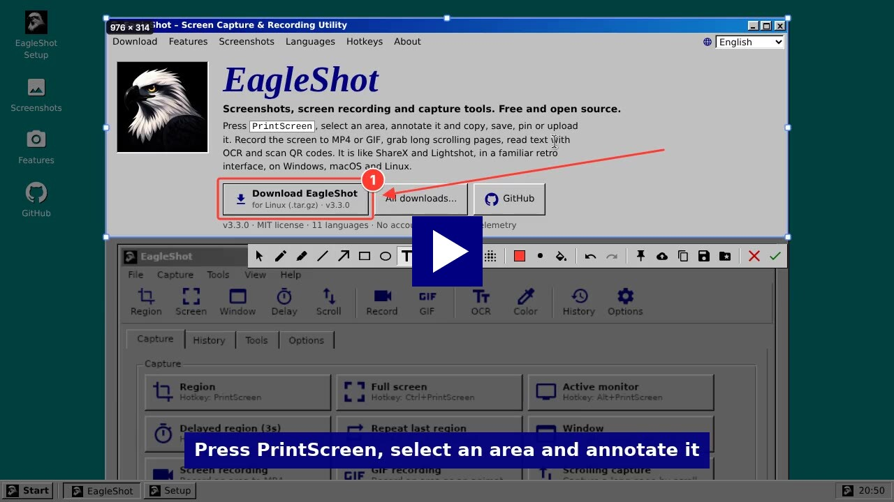
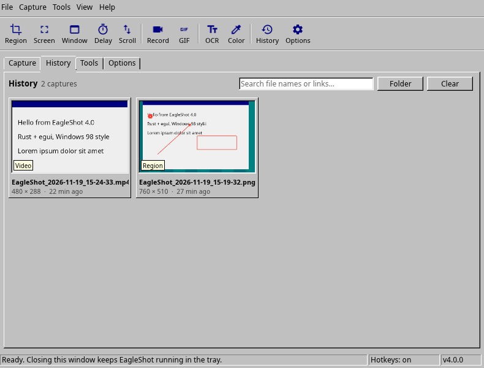
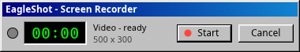
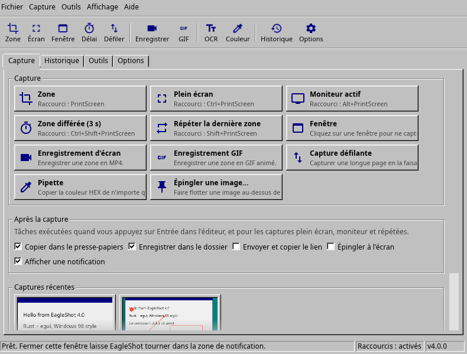
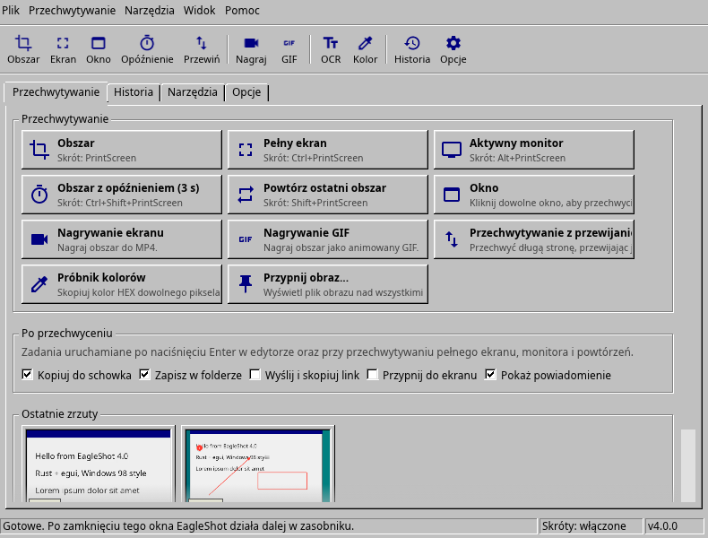
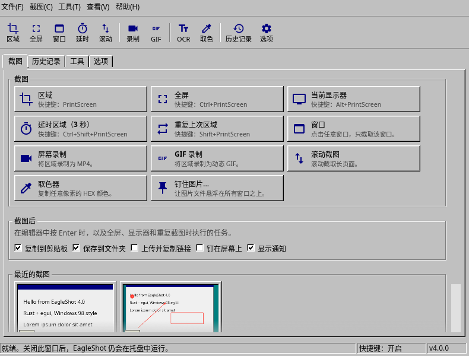

<div align="center">

# EagleShot 🦅

**Screenshots, Bildschirmaufnahmen und Aufnahmewerkzeuge für Windows, macOS und Linux – mit einer klassischen Oberfläche im Stil von Windows 98.**

[English](README.md) · [Türkçe](README.tr.md) · [简体中文](README.zh-CN.md) · [繁體中文](README.zh-TW.md) · [日本語](README.ja.md) · [한국어](README.ko.md) · [Deutsch](README.de.md) · [Français](README.fr.md) · [Polski](README.pl.md) · [Українська](README.uk.md) · [Русский](README.ru.md)

[**Website**](https://hhasanguclu.github.io/EagleShot/) · [**Download**](https://github.com/hhasanguclu/EagleShot/releases/latest) · [Releases](https://github.com/hhasanguclu/EagleShot/releases)


<a href="https://hhasanguclu.github.io/EagleShot/#video"></a><br>
<b>▶ <a href="https://hhasanguclu.github.io/EagleShot/#video">Video ansehen</a></b>

</div>

---

EagleShot ist ein kostenloses Open-Source-Screenshot-Werkzeug. Es verbindet die Geschwindigkeit von Lightshot mit einem Arbeitsablauf wie in ShareX: Aufnahmemodi, ein Editor zum Beschriften, Aufgaben nach der Aufnahme, Uploads, Verlauf und angeheftete Screenshots. Außerdem nimmt es den Bildschirm als MP4 oder GIF auf, erfasst scrollende Seiten, liest Text per OCR und scannt QR-Codes. Die Oberfläche sieht aus wie ein klassisches Programm aus Windows 9x/2000: Menüleiste, Symbolleiste, Registerkarten, 3D-Schaltflächen und Statusleiste. EagleShot gibt es in 11 Sprachen.

Seit Version 4.0 ist EagleShot in Rust geschrieben: ein einziges kleines Programm, sonst muss nichts installiert werden.

## 📸 Screenshots

| | |
|---|---|
|  |  |
| **Editor:** Bereich wählen, beschriften (Rechteck, Pfeil, Schrittnummern, Text…), dann kopieren, speichern, anheften oder hochladen | **Menüs** zeigen das Tastenkürzel jedes Aufnahmemodus |
|  |  |
| **Werkzeuge:** Aufnahme, scrollende Aufnahme, OCR, QR-Codes, Lineal, Bilder kombinieren, Hash-Prüfung… | **Verlauf** aller gespeicherten oder hochgeladenen Aufnahmen |
|  |  |
| **Optionen:** Sprache, Tastenkürzel, Dateinamen, Uploader, Bildeffekte, Aufnahme | **Startbildschirm** |

| Bildschirmrekorder | Benachrichtigung | Über |
|---|---|---|
|  |  |  |

Diese Bilder zeigen die englische Oberfläche; auf einem deutschen System startet EagleShot auf Deutsch.

## 🌍 Sprachen

EagleShot startet in der Sprache Ihres Systems. Ändern lässt sie sich unter **Optionen → Allgemein → Sprache**.

English · Türkçe · 简体中文 · 繁體中文 · 日本語 · 한국어 · Deutsch · Français · Polski · Українська · Русский

| | | |
|---|---|---|
|  |  |  |
|  |  |  |

## 🌟 Funktionen

- **Aufnahmemodi:**
  - **Bereich:** zum Auswählen ziehen oder klicken, um einen ganzen Monitor aufzunehmen
  - **Vollbild:** alle Monitore auf einmal
  - **Aktiver Monitor:** der Monitor unter der Maus
  - **Fenster:** Fenster mit der Maus hervorheben und anklicken (Windows, macOS, X11)
  - **Verzögerter Bereich:** erst ein Countdown (Standard 3 s)
  - **Letzten Bereich wiederholen:** derselbe Bereich, ohne Editor
  - **Scrollende Aufnahme:** scrollt eine Seite oder ein Dokument und setzt sie zu einem langen Bild zusammen
  - **Automatische Aufnahme:** alle N Sekunden ein Screenshot
  - **Farbwähler:** kopiert den HEX-Wert eines Pixels
- **Bildschirmaufnahme:** einen Bereich als **MP4** oder animiertes **GIF** aufnehmen (ffmpeg). Eine kleine Leiste neben dem Bereich bietet Start, Timer, Stopp und Abbrechen.
- **Editor:** Stift, Textmarker, Linie, Pfeil, Rechteck, Ellipse, Text, Hervorhebung, Schrittnummern, Verpixeln und Weichzeichnen. Rückgängig/Wiederholen, Farbpalette mit HEX-Eingabe und 6 Strichstärken.
- **Aufgaben nach der Aufnahme** (wie in ShareX): kopieren, speichern, hochladen und Link kopieren, anheften, Benachrichtigung.
- **Überall einfügen:** kopierte Bilder lassen sich in Chat-Apps, Dokumente, den Explorer und Terminals einfügen.
- **Anheften:** einen Screenshot über allen Fenstern schweben lassen. Mausrad zoomt, Strg+Mausrad ändert die Deckkraft.
- **Hochladen:** Imgur, eigener HTTP-Uploader oder **ShareX-`.sxcu`-Uploader**. Optional Links kürzen.
- **Werkzeuge:**
  - **Texterkennung (OCR):** Text aus jedem Bildschirmbereich kopieren (Tesseract, Englisch + Ihre Sprache)
  - **QR-Codes:** QR-Codes und Barcodes scannen oder erstellen
  - **Lineal**, **Bilder kombinieren**, **Hash-Prüfung** (MD5 / SHA), **Bildeditor**
- **Bildeffekte:** Hintergrund und Abstand, abgerundete Ecken, Schatten, Rahmen und Wasserzeichen, mit Live-Vorschau.
- **Globale Tastenkürzel** für jede Aktion. Unter Windows öffnet **die Druck-Taste EagleShot statt des Snipping Tools**.
- **Befehlszeile:** `eagleshot --region`, `--record`, `--ocr`… gehen an die laufende App. Praktisch unter Wayland.
- **Verlauf** mit Vorschaubildern und Suche, **Dateinamensmuster**, PNG / JPEG / WebP.
- **11 Sprachen**, HiDPI-Unterstützung, auf Wunsch Start mit dem System.

## ⌨️ Tastenkürzel

| Global (Standard) | |
|---|---|
| `PrintScreen` (`F12` unter macOS) | Bereich aufnehmen |
| `Ctrl+PrintScreen` | Vollbild aufnehmen |
| `Alt+PrintScreen` | Aktiven Monitor aufnehmen |
| `Shift+PrintScreen` | Letzten Bereich wiederholen |
| `Ctrl+Shift+PrintScreen` | Verzögerte Bereichsaufnahme |
| `Ctrl+Shift+K` | Farbwähler |

| Im Editor | |
|---|---|
| `V` `P` `K` `L` `A` `R` `E` `T` `H` `N` `X` `B` | Auswählen, Stift, Textmarker, Linie, Pfeil, Rechteck, Ellipse, Text, Hervorheben, Nummer, Verpixeln, Weichzeichnen |
| `1`–`9` | Farbe aus der Palette |
| `[` / `]` | Dünnerer / dickerer Strich |
| `F` | Füllung ein/aus |
| `Ctrl+Z` / `Ctrl+Y` | Rückgängig / Wiederholen |
| `Ctrl+C` / `Ctrl+S` / `Ctrl+Shift+S` | Kopieren / Schnell speichern / Speichern unter |
| `Ctrl+U` / `Ctrl+P` | Hochladen / Anheften |
| `Enter` oder Doppelklick | Fertig (Aufgaben nach der Aufnahme ausführen) |
| Rechtsklick / `Esc` | Auswahl zurücksetzen / Abbrechen |

## 🖥️ Befehlszeile

```bash
eagleshot --region | --fullscreen | --monitor | --window | --delay | --repeat | --color | --show
eagleshot --record | --gif | --scroll | --ocr | --qr | --ruler
eagleshot --editor [bild]       # Bild im Editor öffnen
eagleshot --pin [bild]          # Bild auf dem Bildschirm anheften
eagleshot --upload <dateien…>   # Dateien hochladen
eagleshot --minimized | --quit  # im Infobereich starten / laufendes EagleShot beenden
```

`--record` und `--gif` starten eine Aufnahme; derselbe Befehl beendet sie wieder. Läuft EagleShot bereits, geht der Befehl an diese Instanz.

## 🚀 Installation

Laden Sie die Datei für Ihr System unter [Releases](https://github.com/hhasanguclu/EagleShot/releases/latest) herunter.

### Windows

1. `EagleShot_Setup_v4.0.0_win-x64.exe` ausführen. Das Installationsprogramm enthält FFmpeg (Aufnahme) und Tesseract OCR (Texterkennung).
2. **„Druck-Taste für EagleShot verwenden“** aktiviert lassen, damit die Taste EagleShot statt des Snipping Tools öffnet.
3. Bei einer SmartScreen-Warnung **Weitere Informationen → Trotzdem ausführen** wählen (die App ist nicht signiert).

Eine portable `.zip` gibt es ebenfalls.

### macOS

**Am einfachsten:** **Terminal** öffnen und ausführen

```bash
curl -fsSL https://hhasanguclu.github.io/EagleShot/install-macos.sh | bash
```

Lädt die passende Version für deinen Mac (Apple Silicon oder Intel) herunter, installiert sie in **Programme** und öffnet sie – ohne Sicherheitswarnung.

**Mit der `.dmg`:**

1. Die `.dmg` öffnen und **EagleShot** in **Programme** ziehen.
2. EagleShot ist nicht mit einem kostenpflichtigen Apple-Entwicklerzertifikat signiert, daher meldet macOS, die App „kann nicht geöffnet werden“, „kann nicht überprüft werden“ oder „ist beschädigt“, und bietet **In den Papierkorb legen** an. **Fertig** klicken (nicht In den Papierkorb legen), dann **Systemeinstellungen → Datenschutz & Sicherheit** öffnen und auf **Trotzdem öffnen** klicken. Oder im Terminal `xattr -cr /Applications/EagleShot.app` ausführen.
3. **Bildschirmaufnahme** und **Bedienungshilfen** (für Tastenkürzel) erlauben.

Für Aufnahme und OCR: `brew install ffmpeg tesseract tesseract-lang`

### Linux

```bash
tar xzf EagleShot_v4.0.0_linux-x64.tar.gz
cd EagleShot_v4.0.0_linux-x64
./installers/linux/install.sh
```

- Läuft unter X11 und Wayland (GNOME, KDE). Unter Wayland laufen Screenshots über xdg-desktop-portal, die Fenster über XWayland.
- Globale Tastenkürzel brauchen den Fokus in X11 oder XWayland; unter reinem Wayland ein Tastenkürzel der Arbeitsumgebung auf `eagleshot --region` legen.
- Das Symbol im Infobereich nutzt StatusNotifierItem (KDE, die meisten Desktops; unter GNOME die Erweiterung AppIndicator installieren).
- Optional: `ffmpeg` (Aufnahme, X11), `tesseract-ocr` (Texterkennung), `wl-clipboard` oder `xclip` (Zwischenablage).

### Aus dem Quellcode bauen

Benötigt wird [Rust](https://rustup.rs) 1.85 oder neuer.

```bash
git clone https://github.com/hhasanguclu/EagleShot.git
cd EagleShot
cargo run --release
```

Unter Debian / Ubuntu zuerst die Build-Pakete mit `./scripts/linux-build-deps.sh` installieren. Die Tests laufen mit `cargo test`.

## 🎮 Verwendung

1. Nach dem Start öffnet sich das Hauptfenster und EagleShot erscheint im Infobereich.
2. **Druck** drücken (**F12** unter macOS), einen Aufnahmemodus anklicken oder das Menü im Infobereich nutzen.
3. Einen Bereich aufziehen (oder einen Monitor anklicken) und mit den Griffen anpassen.
4. Mit der Symbolleiste beschriften.
5. **Enter** führt die Aufgaben nach der Aufnahme aus; oder Kopieren, Speichern, Hochladen bzw. Anheften wählen. **Esc** bricht ab.
6. Alles findet sich später auf der Registerkarte **Verlauf**.

## 🛠️ Technik

| | |
|---|---|
| Sprache | Rust |
| Oberfläche | egui / eframe mit selbst gezeichnetem klassischem Windows-Theme |
| Bildschirmaufnahme | xcap (Windows, macOS, X11, Wayland-Portal) |
| Infobereich / Tastenkürzel | tray-icon, global-hotkey |
| Bildverarbeitung | image, tiny-skia, ab_glyph |
| Aufnahme / OCR / QR | ffmpeg / Tesseract / qrcode + rxing |
| Übersetzungen | `Resources/i18n/*.json` (Schlüssel ist der englische Text) |

## 📁 Projektstruktur

```
EagleShot/
├── src/core/              # Aufnahme, Recording, OCR, Uploads, Zwischenablage, Einstellungen, Verlauf (ohne UI)
├── src/ui/                # Klassische Windows-Steuerelemente, Hauptfenster, Editor, angeheftete Bilder, Benachrichtigungen
├── src/app/               # Infobereich, Tastenkürzel, Aufnahmeabläufe, Aufgaben nach der Aufnahme
├── src/main.rs            # Einstiegspunkt und Befehlszeile
├── Resources/i18n/        # Übersetzungen: tr, zh-CN, zh-TW, ja, ko, de, fr, pl, uk, ru
├── vendor/eframe/         # eframe 0.37 mit zwei kleinen Patches (siehe Cargo.toml)
├── installers/            # Windows (Inno Setup), macOS (.app / .dmg), Linux (install.sh)
├── scripts/               # Linux-Build-Pakete, Smoke-Test, Bündeln der Windows-Werkzeuge
├── tests/                 # Test der Übersetzungsabdeckung
└── docs/                  # Website (GitHub Pages) und Screenshots
```

## 🤝 Übersetzungen

Die Übersetzungen liegen in `Resources/i18n/<sprache>.json`. Jede Datei ordnet dem englischen Text die Übersetzung zu. Fehlende Einträge erscheinen auf Englisch; eine Korrektur oder eine neue Sprache ist ein kleiner Pull Request.

## 📝 Lizenz

MIT-Lizenz. Siehe [LICENSE](LICENSE).
