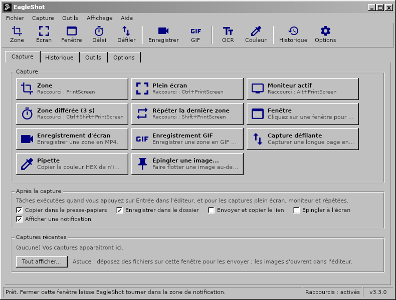
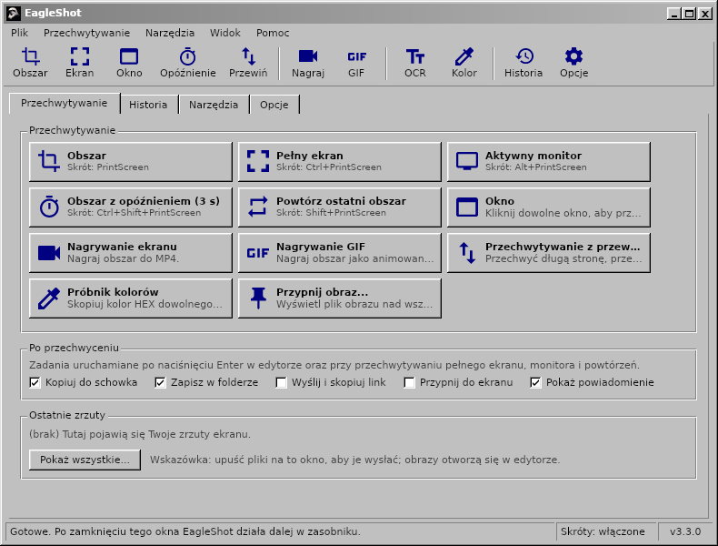
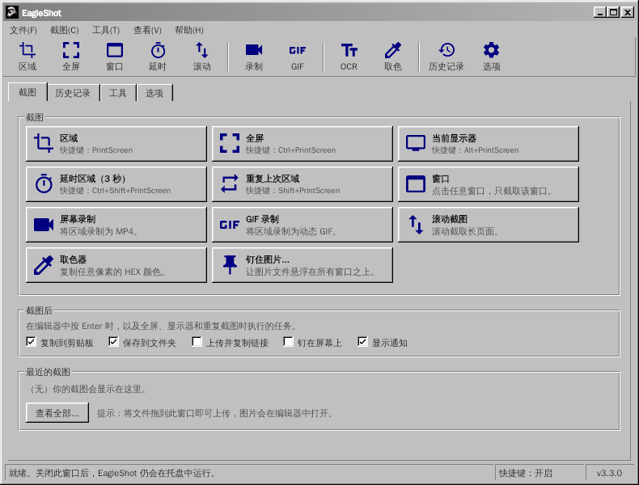

<div align="center">

# EagleShot 🦅

**Captures d'écran, enregistrement d'écran et outils de capture pour Windows, macOS et Linux, avec une interface classique façon Windows 98.**

[English](README.md) · [Türkçe](README.tr.md) · [简体中文](README.zh-CN.md) · [繁體中文](README.zh-TW.md) · [日本語](README.ja.md) · [한국어](README.ko.md) · [Deutsch](README.de.md) · [Français](README.fr.md) · [Polski](README.pl.md) · [Українська](README.uk.md) · [Русский](README.ru.md)

[**Site web**](https://hhasanguclu.github.io/EagleShot/) · [**Télécharger**](https://github.com/hhasanguclu/EagleShot/releases/latest) · [Versions](https://github.com/hhasanguclu/EagleShot/releases)



</div>

---

EagleShot est un outil de capture d'écran gratuit et open source. Il allie la rapidité de Lightshot à un fonctionnement à la ShareX : modes de capture, éditeur d'annotations, tâches après capture, envois, historique et captures épinglées. Il enregistre aussi l'écran en MP4 ou GIF, capture les pages défilantes, lit le texte par OCR et scanne les codes QR. Son interface ressemble à un programme classique de Windows 9x/2000 : barre de menus, barre d'outils, onglets, boutons en relief et barre d'état. Il est disponible en 11 langues.

## 📸 Captures d'écran

| | |
|---|---|
|  |  |
| **Éditeur :** sélectionnez une zone, annotez-la (rectangle, flèche, numéros d'étape, texte…), puis copiez, enregistrez, épinglez ou envoyez | Les **menus** affichent le raccourci de chaque mode de capture |
|  |  |
| **Outils :** enregistrement, capture défilante, OCR, codes QR, règle, combinateur d'images, vérificateur de hash… | **Historique** de tout ce que vous avez enregistré ou envoyé |
|  |  |
| **Options :** langue, raccourcis, noms de fichiers, services d'envoi, effets d'image, enregistrement | **Écran de démarrage** |

| Enregistreur d'écran | Notification | À propos |
|---|---|---|
|  |  |  |

Ces images montrent l'interface anglaise ; sur un système en français, EagleShot démarre en français.

## 🌍 Langues

EagleShot démarre dans la langue de votre système. Vous pouvez la changer dans **Options → Général → Langue**.

English · Türkçe · 简体中文 · 繁體中文 · 日本語 · 한국어 · Deutsch · Français · Polski · Українська · Русский

| | | |
|---|---|---|
|  |  |  |
|  |  |  |

## 🌟 Fonctionnalités

- **Modes de capture :**
  - **Zone :** faites glisser pour sélectionner, ou cliquez pour capturer un moniteur entier
  - **Plein écran :** tous les moniteurs à la fois
  - **Moniteur actif :** le moniteur sous la souris
  - **Fenêtre :** survolez une fenêtre pour la mettre en évidence, cliquez pour la capturer (Windows, macOS, X11)
  - **Zone différée :** d'abord un compte à rebours (3 s par défaut)
  - **Répéter la dernière zone :** la même zone, sans éditeur
  - **Capture défilante :** fait défiler une page ou un document et l'assemble en une longue image
  - **Capture automatique :** une capture toutes les N secondes
  - **Pipette :** copie la valeur HEX de n'importe quel pixel
- **Enregistrement d'écran :** enregistrez une zone en **MP4** ou en **GIF** animé (ffmpeg). Une petite barre à côté de la zone propose Démarrer, un chronomètre, Arrêter et Annuler.
- **Éditeur d'annotations :** stylo, surligneur, ligne, flèche, rectangle, ellipse, texte, surbrillance, numéros d'étape, pixellisation et flou. Annuler/rétablir, palette de couleurs avec saisie HEX et 6 épaisseurs de trait.
- **Tâches après capture** (comme dans ShareX) : copier, enregistrer, envoyer et copier le lien, épingler, notification.
- **Collez partout :** les images copiées se collent dans les messageries, les documents, l'Explorateur et les terminaux.
- **Épingler à l'écran :** gardez une capture au-dessus de toutes les fenêtres. La molette zoome, Ctrl+molette change l'opacité.
- **Envoi :** Imgur, un service HTTP personnalisé ou les **services ShareX `.sxcu`**. Raccourcissement des liens en option.
- **Outils :**
  - **Reconnaissance de texte (OCR) :** copiez le texte de n'importe quelle partie de l'écran (Tesseract, anglais + votre langue)
  - **Codes QR :** scannez des codes QR et des codes-barres, ou créez-en
  - **Règle**, **combinateur d'images**, **vérificateur de hash** (MD5 / SHA), **éditeur d'images**
- **Effets d'image :** arrière-plan et marge, coins arrondis, ombre, bordure et filigrane, avec aperçu en direct.
- **Raccourcis globaux** pour chaque action. Sous Windows, **la touche Impr. écran ouvre EagleShot au lieu de l'Outil Capture d'écran**.
- **Ligne de commande :** `eagleshot --region`, `--record`, `--ocr`… sont transmis à l'application en cours. Pratique sous Wayland.
- **Historique** avec miniatures et recherche, **modèles de noms de fichiers**, PNG / JPEG / WebP.
- **11 langues**, prise en charge HiDPI, démarrage avec le système si vous le souhaitez.

## ⌨️ Raccourcis

| Globaux (par défaut) | |
|---|---|
| `PrintScreen` (`F12` sur macOS) | Capturer une zone |
| `Ctrl+PrintScreen` | Capturer le plein écran |
| `Alt+PrintScreen` | Capturer le moniteur actif |
| `Shift+PrintScreen` | Répéter la dernière zone |
| `Ctrl+Shift+PrintScreen` | Capture de zone différée |
| `Ctrl+Shift+K` | Pipette |

| Dans l'éditeur | |
|---|---|
| `V` `P` `K` `L` `A` `R` `E` `T` `H` `N` `X` `B` | Sélection, Stylo, Surligneur, Ligne, Flèche, Rectangle, Ellipse, Texte, Surbrillance, Numéro, Pixelliser, Flouter |
| `1`–`9` | Choisir une couleur de la palette |
| `[` / `]` | Trait plus fin / plus épais |
| `F` | Activer/désactiver le remplissage |
| `Ctrl+Z` / `Ctrl+Y` | Annuler / Rétablir |
| `Ctrl+C` / `Ctrl+S` / `Ctrl+Shift+S` | Copier / Enregistrement rapide / Enregistrer sous |
| `Ctrl+U` / `Ctrl+P` | Envoyer / Épingler |
| `Entrée` ou double-clic | Terminé (lancer les tâches après capture) |
| Clic droit / `Échap` | Réinitialiser la sélection / Annuler |

## 🖥️ Ligne de commande

```bash
eagleshot --region | --fullscreen | --monitor | --window | --delay | --repeat | --color | --show
eagleshot --record | --gif | --scroll | --ocr | --qr | --ruler
eagleshot --editor [image]       # ouvrir une image dans l'éditeur
eagleshot --upload <fichiers…>   # envoyer des fichiers
```

`--record` et `--gif` démarrent un enregistrement ; relancez la même commande pour l'arrêter. Si EagleShot est déjà ouvert, la commande est transmise à cette instance.

## 🚀 Installation

Téléchargez le fichier correspondant à votre système sur la page [Versions](https://github.com/hhasanguclu/EagleShot/releases/latest).

### Windows

1. Lancez `EagleShot_Setup_v3.3.0_win-x64.exe`. L'installateur inclut FFmpeg (enregistrement) et Tesseract OCR (reconnaissance de texte).
2. Laissez cochée l'option **« Utiliser la touche Impr. écran pour EagleShot »** pour que la touche ouvre EagleShot au lieu de l'Outil Capture d'écran.
3. Si SmartScreen vous avertit, cliquez sur **Informations complémentaires → Exécuter quand même** (l'application n'est pas signée).

Une version portable `.zip` est aussi disponible.

### macOS

1. Ouvrez le `.dmg` (Apple Silicon ou Intel) et faites glisser **EagleShot** dans **Applications**.
2. Premier lancement : clic droit sur EagleShot → **Ouvrir**. À partir de macOS 15 : **Réglages Système → Confidentialité et sécurité → Ouvrir quand même**.
3. Autorisez **Enregistrement de l'écran** et **Accessibilité** (pour les raccourcis).
4. Si macOS indique que l'application est « endommagée » : `xattr -cr /Applications/EagleShot.app`

Pour l'enregistrement et l'OCR : `brew install ffmpeg tesseract tesseract-lang`

### Linux

```bash
tar xzf EagleShot_v3.3.0_linux-x64.tar.gz
cd EagleShot_v3.3.0_linux-x64
./installers/linux/install.sh
```

- Capture d'écran : `scrot`, `maim` ou ImageMagick (X11). Sous Wayland, EagleShot utilise xdg-desktop-portal (GNOME, KDE) ou `grim` / `gnome-screenshot`.
- Presse-papiers : `xclip` (X11) ou `wl-clipboard` (Wayland)
- Facultatif : `ffmpeg` (enregistrement, X11) et `tesseract-ocr` (reconnaissance de texte)

### Compiler depuis les sources

```bash
git clone https://github.com/hhasanguclu/EagleShot.git
cd EagleShot
dotnet run
```

Pour compiler toutes les plateformes d'un coup : `./scripts/build-all.ps1` (PowerShell) ou `./scripts/build-all.sh` (Bash).

## 🎮 Utilisation

1. Au lancement, la fenêtre principale s'ouvre et EagleShot se place dans la zone de notification.
2. Appuyez sur **Impr. écran** (**F12** sur macOS), cliquez sur un mode de capture ou utilisez le menu de la zone de notification.
3. Faites glisser pour sélectionner une zone (ou cliquez sur un moniteur), puis ajustez-la avec les poignées.
4. Annotez avec la barre d'outils.
5. Appuyez sur **Entrée** pour lancer les tâches après capture, ou choisissez Copier, Enregistrer, Envoyer ou Épingler. **Échap** annule.
6. Retrouvez tout plus tard dans l'onglet **Historique**.

## 🛠️ Technologies

| | |
|---|---|
| Langage | C# / .NET 9 |
| Interface | Avalonia UI 11.2 avec un thème Windows classique sur mesure |
| Raccourcis globaux | SharpHook |
| Images | SkiaSharp |
| Enregistrement / OCR / QR | ffmpeg / Tesseract / QRCoder + ZXing.Net |
| Traductions | `Resources/i18n/*.json` (la clé est le texte anglais) |

## 📁 Structure du projet

```
EagleShot/
├── Core/                  # Capture, enregistrement, OCR, envois, raccourcis, paramètres, traduction
├── Views/                 # Fenêtre principale, éditeur, paramètres, outils, notifications
├── Styles/                # Classic.axaml (thème Windows classique), AppStyles.axaml (couleurs, icônes)
├── Resources/i18n/        # Traductions : tr, zh-CN, zh-TW, ja, ko, de, fr, pl, uk, ru
├── installers/            # Windows (Inno Setup), macOS (.app / .dmg), Linux (install.sh)
├── scripts/               # Scripts de compilation, outils Windows embarqués
├── docs/                  # Site web (GitHub Pages) et captures d'écran
├── App.axaml(.cs)         # Démarrage de l'application, zone de notification, commandes
└── Program.cs             # Point d'entrée
```

## 🤝 Traductions

Les traductions se trouvent dans `Resources/i18n/<langue>.json`. Chaque fichier associe le texte anglais à sa traduction. Les entrées manquantes s'affichent en anglais ; une correction ou une nouvelle langue tient dans une petite pull request.

## 📝 Licence

Licence MIT.
