<div align="center">

# EagleShot 🦅

**Windows・macOS・Linux 向けのスクリーンショット、画面録画、キャプチャツール。クラシックな Windows 98 風のインターフェイスで。**

[English](README.md) · [Türkçe](README.tr.md) · [简体中文](README.zh-CN.md) · [繁體中文](README.zh-TW.md) · [日本語](README.ja.md) · [한국어](README.ko.md) · [Deutsch](README.de.md) · [Français](README.fr.md) · [Polski](README.pl.md) · [Українська](README.uk.md) · [Русский](README.ru.md)

[**ウェブサイト**](https://hhasanguclu.github.io/EagleShot/) · [**ダウンロード**](https://github.com/hhasanguclu/EagleShot/releases/latest) · [リリース](https://github.com/hhasanguclu/EagleShot/releases)

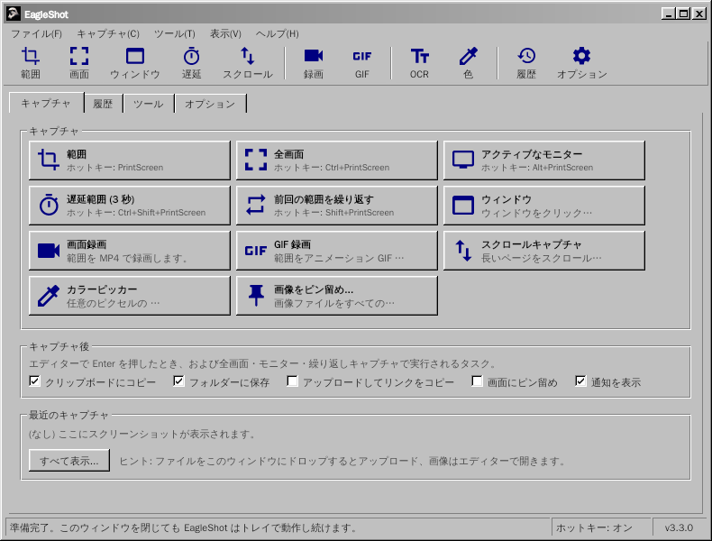

</div>

---

EagleShot は無料のオープンソースのスクリーンショットツールです。Lightshot の速さと ShareX のようなワークフローを組み合わせています: キャプチャモード、注釈エディター、キャプチャ後のタスク、アップロード、履歴、ピン留め。画面を MP4 や GIF で録画し、スクロールするページをキャプチャし、OCR で文字を読み取り、QR コードをスキャンすることもできます。見た目はクラシックな Windows 9x/2000 のプログラムそのもの: メニューバー、ツールバー、タブ、立体的なボタン、ステータスバー。11 か国語に対応しています。

## 📸 スクリーンショット

| | |
|---|---|
| 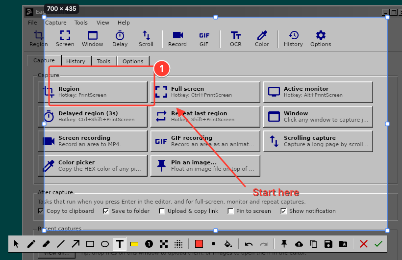 | 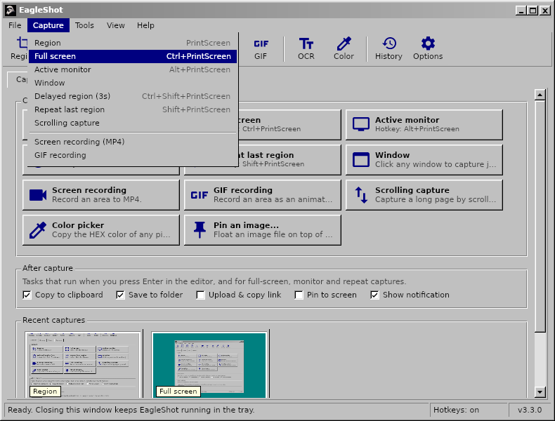 |
| **エディター:** 範囲を選択して注釈 (四角形、矢印、番号、テキストなど) を付け、コピー・保存・ピン留め・アップロード | **メニュー**には各キャプチャモードのホットキーが表示されます |
| 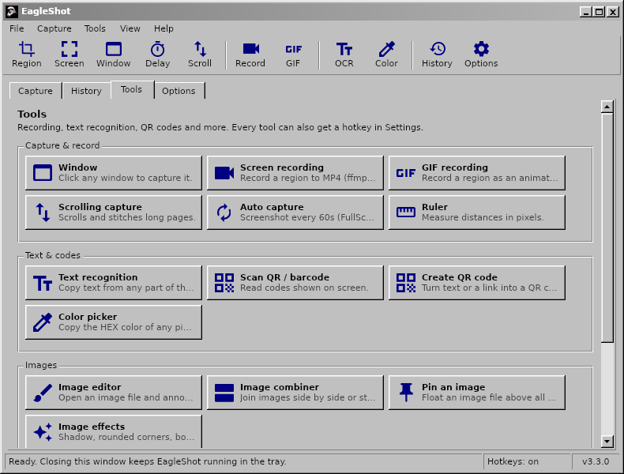 | 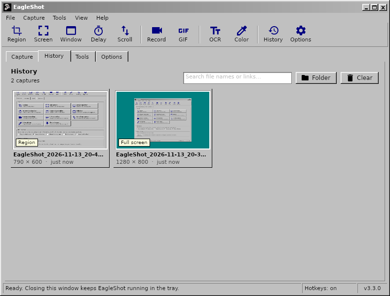 |
| **ツール:** 録画、スクロールキャプチャ、OCR、QR コード、ルーラー、画像の結合、ハッシュチェッカーなど | 保存・アップロードしたものすべての**履歴** |
| 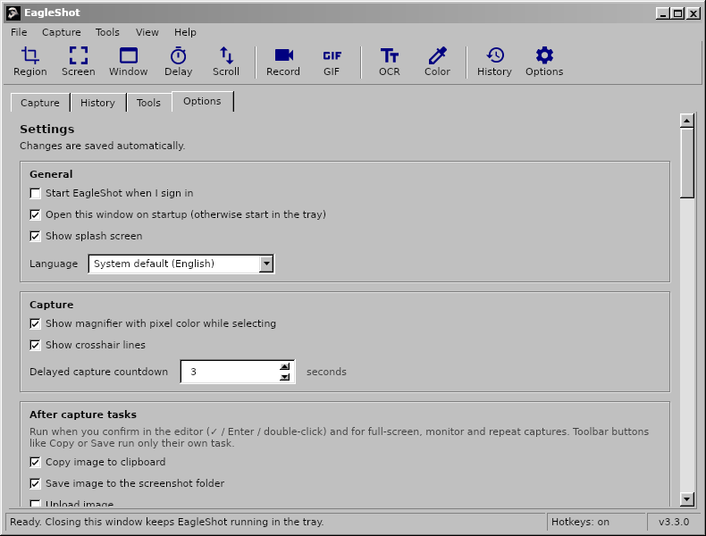 | 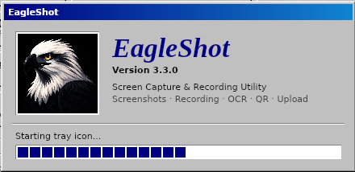 |
| **オプション:** 言語、ホットキー、ファイル名、アップローダー、画像効果、録画 | **スプラッシュ画面** |

| 画面レコーダー | 通知 | バージョン情報 |
|---|---|---|
| 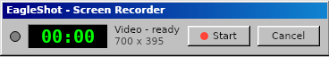 | 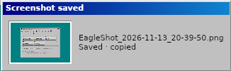 | 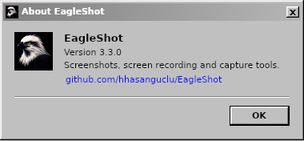 |

上の画像は英語の画面です。日本語のシステムでは EagleShot は日本語で起動します。

## 🌍 言語

EagleShot はシステムの言語で起動します。**オプション → 全般 → 言語** で変更できます。

English · Türkçe · 简体中文 · 繁體中文 · 日本語 · 한국어 · Deutsch · Français · Polski · Українська · Русский

| | | |
|---|---|---|
| 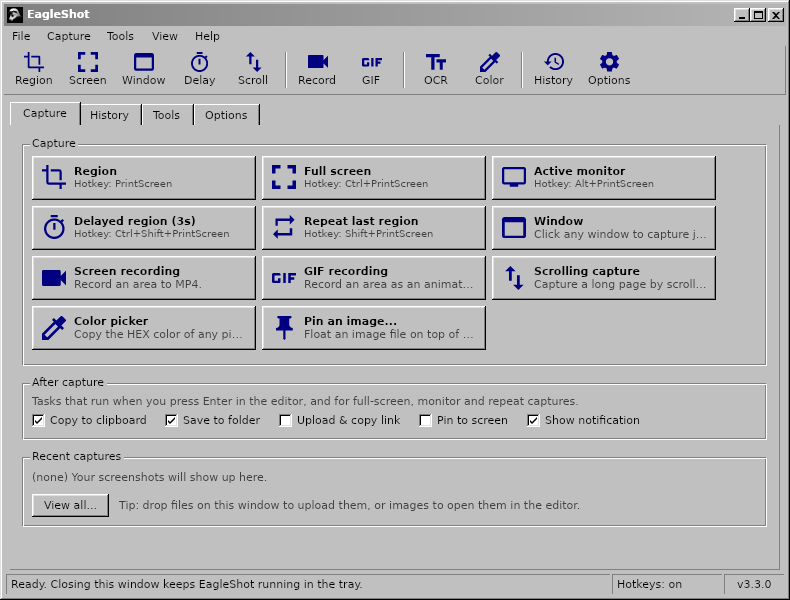 | 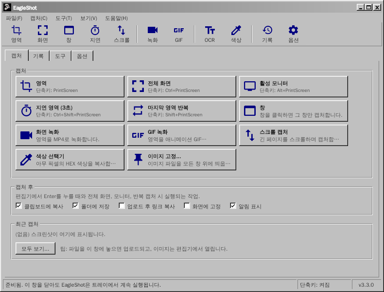 | 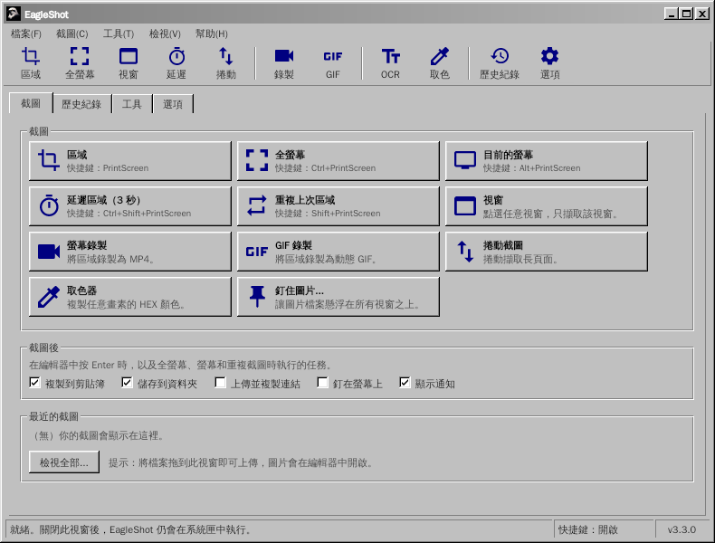 |
| 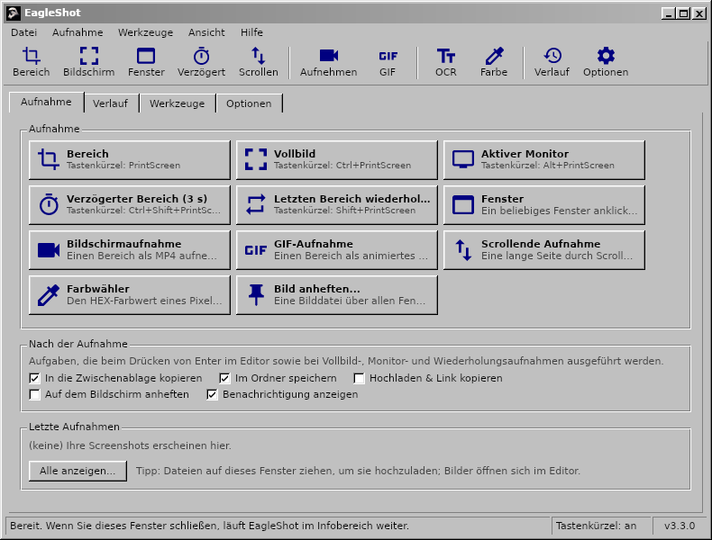 | 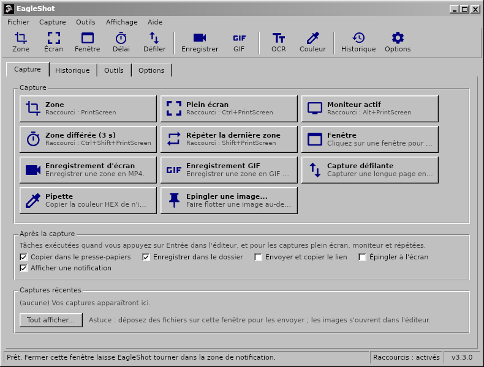 | 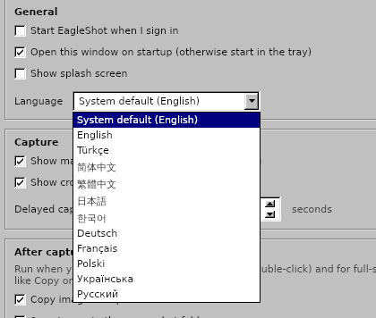 |

## 🌟 機能

- **キャプチャモード:**
  - **範囲:** ドラッグで選択、またはクリックでモニター全体
  - **全画面:** すべてのモニターを一度に
  - **アクティブなモニター:** マウスがあるモニター
  - **ウィンドウ:** ウィンドウにカーソルを合わせて強調表示し、クリックでキャプチャ (Windows、macOS、X11)
  - **遅延範囲:** 先にカウントダウン (既定 3 秒)
  - **前回の範囲を繰り返す:** エディターなしで同じ範囲を
  - **スクロールキャプチャ:** ページや文書をスクロールして 1 枚の長い画像につなぎ合わせます
  - **自動キャプチャ:** N 秒ごとにスクリーンショット
  - **カラーピッカー:** 任意のピクセルの HEX 値をコピー
- **画面録画:** 範囲を **MP4** またはアニメーション **GIF** で録画 (ffmpeg)。範囲の横の小さなバーに開始、タイマー、停止、キャンセルがあります。
- **注釈エディター:** ペン、マーカー、直線、矢印、四角形、楕円、テキスト、ハイライト、番号、モザイク、ぼかし。元に戻す/やり直し、HEX 入力付きのカラーパレット、6 段階の線の太さ。
- **キャプチャ後のタスク** (ShareX と同様): コピー、保存、アップロードしてリンクをコピー、ピン留め、通知。
- **どこにでも貼り付け:** コピーした画像はチャットアプリ、文書、エクスプローラー、ターミナルに貼り付けられます。
- **画面にピン留め:** スクリーンショットをすべてのウィンドウの前面に表示。ホイールで拡大縮小、Ctrl+ホイールで不透明度を変更。
- **アップロード:** Imgur、任意の HTTP アップローダー、**ShareX の `.sxcu` アップローダー**。リンク短縮も可能。
- **ツール:**
  - **文字認識 (OCR):** 画面のどこからでもテキストをコピー (Tesseract、英語 + お使いの言語)
  - **QR コード:** QR コードやバーコードの読み取り・作成
  - **ルーラー**、**画像の結合**、**ハッシュチェッカー** (MD5 / SHA)、**画像エディター**
- **画像効果:** 背景と余白、角丸、影、枠線、透かし。ライブプレビュー付き。
- すべての操作に**グローバルホットキー**。Windows では **PrintScreen キーで Snipping Tool ではなく EagleShot が開きます**。
- **コマンドライン:** `eagleshot --region`、`--record`、`--ocr` などは起動中のアプリに渡されます。Wayland で便利です。
- サムネイルと検索付きの**履歴**、**ファイル名のパターン**、PNG / JPEG / WebP。
- **11 か国語**、HiDPI 対応、必要ならシステムと同時に起動。

## ⌨️ ショートカット

| グローバル (既定) | |
|---|---|
| `PrintScreen` (macOS は `F12`) | 範囲をキャプチャ |
| `Ctrl+PrintScreen` | 全画面をキャプチャ |
| `Alt+PrintScreen` | アクティブなモニターをキャプチャ |
| `Shift+PrintScreen` | 前回の範囲を繰り返す |
| `Ctrl+Shift+PrintScreen` | 遅延範囲キャプチャ |
| `Ctrl+Shift+K` | カラーピッカー |

| エディター内 | |
|---|---|
| `V` `P` `K` `L` `A` `R` `E` `T` `H` `N` `X` `B` | 選択、ペン、マーカー、直線、矢印、四角形、楕円、テキスト、ハイライト、番号、モザイク、ぼかし |
| `1`–`9` | パレットの色を選択 |
| `[` / `]` | 線を細く / 太く |
| `F` | 塗りつぶしの切り替え |
| `Ctrl+Z` / `Ctrl+Y` | 元に戻す / やり直し |
| `Ctrl+C` / `Ctrl+S` / `Ctrl+Shift+S` | コピー / すばやく保存 / 名前を付けて保存 |
| `Ctrl+U` / `Ctrl+P` | アップロード / ピン留め |
| `Enter` またはダブルクリック | 完了 (キャプチャ後のタスクを実行) |
| 右クリック / `Esc` | 選択をリセット / キャンセル |

## 🖥️ コマンドライン

```bash
eagleshot --region | --fullscreen | --monitor | --window | --delay | --repeat | --color | --show
eagleshot --record | --gif | --scroll | --ocr | --qr | --ruler
eagleshot --editor [画像]        # 画像をエディターで開く
eagleshot --upload <ファイル…>   # ファイルをアップロード
```

`--record` と `--gif` は録画を開始し、同じコマンドをもう一度実行すると停止します。EagleShot がすでに起動していれば、コマンドはそのインスタンスに渡されます。

## 🚀 インストール

[リリース](https://github.com/hhasanguclu/EagleShot/releases/latest)ページからお使いのシステム用のファイルをダウンロードしてください。

### Windows

1. `EagleShot_Setup_v3.3.0_win-x64.exe` を実行します。インストーラーには FFmpeg (録画) と Tesseract OCR (文字認識) が含まれています。
2. PrintScreen キーで Snipping Tool ではなく EagleShot が開くよう、**「PrintScreen キーを EagleShot で使う」**をオンのままにします。
3. SmartScreen の警告が出たら **詳細情報 → 実行** をクリックします (アプリは署名されていません)。

ポータブル版の `.zip` もあります。

### macOS

1. `.dmg` (Apple Silicon または Intel) を開き、**EagleShot** を**アプリケーション**にドラッグします。
2. 初回起動: EagleShot を右クリック → **開く**。macOS 15 以降では **システム設定 → プライバシーとセキュリティ → このまま開く**。
3. **画面収録**と**アクセシビリティ** (ホットキー用) を許可します。
4. 「壊れている」と表示されたら: `xattr -cr /Applications/EagleShot.app`

録画と OCR には: `brew install ffmpeg tesseract tesseract-lang`

### Linux

```bash
tar xzf EagleShot_v3.3.0_linux-x64.tar.gz
cd EagleShot_v3.3.0_linux-x64
./installers/linux/install.sh
```

- 画面キャプチャ: `scrot`、`maim`、または ImageMagick (X11)。Wayland では xdg-desktop-portal (GNOME、KDE) または `grim` / `gnome-screenshot` を使います。
- クリップボード: `xclip` (X11) または `wl-clipboard` (Wayland)
- 任意: `ffmpeg` (録画、X11) と `tesseract-ocr` (文字認識)

### ソースからビルド

```bash
git clone https://github.com/hhasanguclu/EagleShot.git
cd EagleShot
dotnet run
```

全プラットフォームを一度にビルド: `./scripts/build-all.ps1` (PowerShell) または `./scripts/build-all.sh` (Bash)。

## 🎮 使い方

1. 起動するとメインウィンドウが開き、EagleShot はシステムトレイに常駐します。
2. **PrintScreen** (macOS は **F12**) を押すか、キャプチャモードをクリックするか、トレイメニューを使います。
3. ドラッグで範囲を選択し (またはモニターをクリック)、ハンドルで調整します。
4. ツールバーで注釈を付けます。
5. **Enter** でキャプチャ後のタスクを実行するか、コピー・保存・アップロード・ピン留めを選びます。**Esc** でキャンセル。
6. あとで**履歴**タブからいつでも見つけられます。

## 🛠️ 技術スタック

| | |
|---|---|
| 言語 | C# / .NET 9 |
| UI | Avalonia UI 11.2 + 独自のクラシック Windows テーマ |
| グローバルホットキー | SharpHook |
| 画像処理 | SkiaSharp |
| 録画 / OCR / QR | ffmpeg / Tesseract / QRCoder + ZXing.Net |
| 翻訳 | `Resources/i18n/*.json` (キーは英語の文字列) |

## 📁 プロジェクト構成

```
EagleShot/
├── Core/                  # キャプチャ、録画、OCR、アップロード、ホットキー、設定、翻訳
├── Views/                 # メインウィンドウ、エディター、設定、ツール、通知
├── Styles/                # Classic.axaml (クラシック Windows テーマ)、AppStyles.axaml (色、アイコン)
├── Resources/i18n/        # 翻訳: tr, zh-CN, zh-TW, ja, ko, de, fr, pl, uk, ru
├── installers/            # Windows (Inno Setup)、macOS (.app / .dmg)、Linux (install.sh)
├── scripts/               # ビルドスクリプト、Windows 用ツールの同梱
├── docs/                  # ウェブサイト (GitHub Pages) とスクリーンショット
├── App.axaml(.cs)         # アプリの起動、トレイ、コマンド
└── Program.cs             # エントリーポイント
```

## 🤝 翻訳

翻訳は `Resources/i18n/<言語>.json` にあります。各ファイルは英語の文字列と翻訳の対応表です。未翻訳の項目は英語で表示されるので、修正や新しい言語の追加は小さなプルリクエストで済みます。

## 📝 ライセンス

MIT ライセンス。
