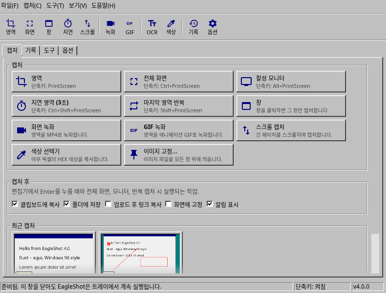
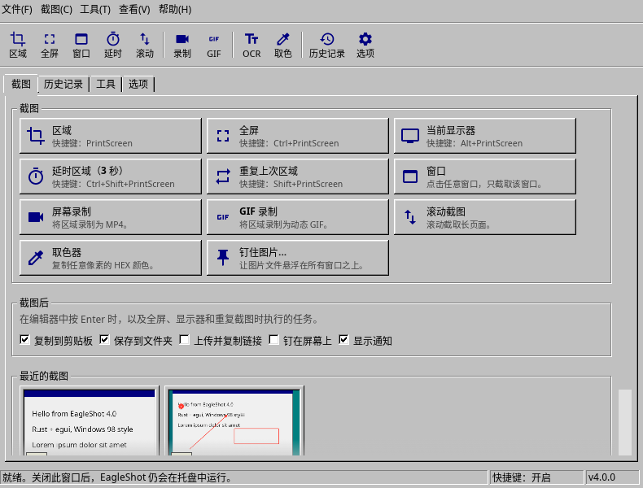
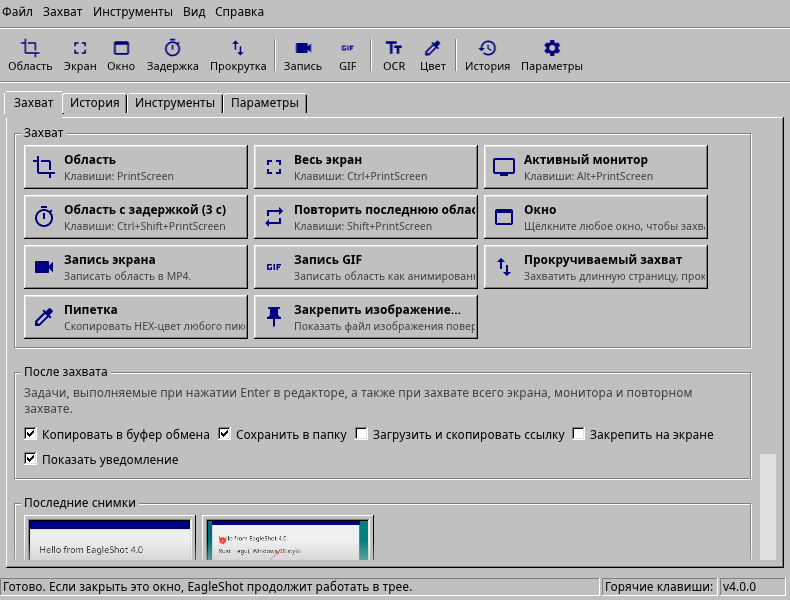

<div align="center">

# EagleShot 🦅

**Windows, macOS, Linux용 스크린샷, 화면 녹화, 캡처 도구. 클래식한 Windows 98 스타일 인터페이스로.**

[English](README.md) · [Türkçe](README.tr.md) · [简体中文](README.zh-CN.md) · [繁體中文](README.zh-TW.md) · [日本語](README.ja.md) · [한국어](README.ko.md) · [Deutsch](README.de.md) · [Français](README.fr.md) · [Polski](README.pl.md) · [Українська](README.uk.md) · [Русский](README.ru.md)

[**웹사이트**](https://hhasanguclu.github.io/EagleShot/) · [**다운로드**](https://github.com/hhasanguclu/EagleShot/releases/latest) · [릴리스](https://github.com/hhasanguclu/EagleShot/releases)



<a href="https://hhasanguclu.github.io/EagleShot/#video"></a><br>
<b>▶ <a href="https://hhasanguclu.github.io/EagleShot/#video">동영상 보기</a></b>

</div>

---

EagleShot은 무료 오픈 소스 스크린샷 도구입니다. Lightshot의 속도와 ShareX 같은 작업 흐름을 결합했습니다: 캡처 모드, 주석 편집기, 캡처 후 작업, 업로드, 기록, 화면 고정. 화면을 MP4나 GIF로 녹화하고, 스크롤되는 페이지를 캡처하고, OCR로 텍스트를 읽고, QR 코드를 스캔할 수도 있습니다. 인터페이스는 클래식한 Windows 9x/2000 프로그램처럼 생겼습니다: 메뉴 모음, 도구 모음, 탭, 입체 버튼, 상태 표시줄. 11개 언어를 지원합니다.

버전 4.0부터 EagleShot은 Rust로 작성되었습니다: 따로 설치할 것이 없는 작은 프로그램 하나입니다.

## 📸 스크린샷

| | |
|---|---|
|  |  |
| **편집기:** 영역을 선택하고 주석(사각형, 화살표, 단계 번호, 텍스트 등)을 단 다음 복사, 저장, 고정 또는 업로드 | **메뉴**에 캡처 모드별 단축키가 표시됩니다 |
|  |  |
| **도구:** 녹화, 스크롤 캡처, OCR, QR 코드, 눈금자, 이미지 합치기, 해시 검사기 등 | 저장하거나 업로드한 모든 것의 **기록** |
|  |  |
| **옵션:** 언어, 단축키, 파일 이름, 업로더, 이미지 효과, 녹화 | **시작 화면** |

| 화면 레코더 | 알림 | 정보 |
|---|---|---|
|  |  |  |

위 이미지는 영어 화면입니다. 한국어 시스템에서는 EagleShot이 한국어로 시작됩니다.

## 🌍 언어

EagleShot은 시스템 언어로 시작합니다. **옵션 → 일반 → 언어**에서 바꿀 수 있습니다.

English · Türkçe · 简体中文 · 繁體中文 · 日本語 · 한국어 · Deutsch · Français · Polski · Українська · Русский

| | | |
|---|---|---|
|  |  |  |
|  |  |  |

## 🌟 기능

- **캡처 모드:**
  - **영역:** 드래그해 선택하거나 클릭해 모니터 전체를 캡처
  - **전체 화면:** 모든 모니터를 한 번에
  - **활성 모니터:** 마우스가 있는 모니터
  - **창:** 창 위에 마우스를 올려 강조하고 클릭해 캡처 (Windows, macOS, X11)
  - **지연 영역:** 먼저 카운트다운 (기본 3초)
  - **마지막 영역 반복:** 편집기 없이 같은 영역을
  - **스크롤 캡처:** 페이지나 문서를 스크롤해 하나의 긴 이미지로 이어 붙입니다
  - **자동 캡처:** N초마다 스크린샷
  - **색상 선택기:** 아무 픽셀의 HEX 값을 복사
- **화면 녹화:** 영역을 **MP4** 또는 애니메이션 **GIF**로 녹화 (ffmpeg). 영역 옆의 작은 막대에 시작, 타이머, 중지, 취소가 있습니다.
- **주석 편집기:** 펜, 형광펜, 선, 화살표, 사각형, 타원, 텍스트, 강조, 단계 번호, 모자이크, 흐리게. 실행 취소/다시 실행, HEX 입력이 있는 색상 팔레트, 6단계 선 굵기.
- **캡처 후 작업** (ShareX처럼): 복사, 저장, 업로드 후 링크 복사, 화면 고정, 알림.
- **어디에나 붙여 넣기:** 복사한 이미지를 채팅 앱, 문서, 탐색기, 터미널에 붙여 넣을 수 있습니다.
- **화면에 고정:** 스크린샷을 모든 창 위에 띄웁니다. 휠로 확대/축소, Ctrl+휠로 불투명도 조절.
- **업로드:** Imgur, 사용자 지정 HTTP 업로더 또는 **ShareX `.sxcu` 업로더**. 링크 줄이기 선택 가능.
- **도구:**
  - **텍스트 인식 (OCR):** 화면 어디서든 텍스트 복사 (Tesseract, 영어 + 사용자 언어)
  - **QR 코드:** QR 코드와 바코드를 스캔하거나 만들기
  - **눈금자**, **이미지 합치기**, **해시 검사기** (MD5 / SHA), **이미지 편집기**
- **이미지 효과:** 배경과 여백, 둥근 모서리, 그림자, 테두리, 워터마크. 실시간 미리 보기 제공.
- 모든 작업에 **전역 단축키**. Windows에서는 **PrintScreen 키로 캡처 도구 대신 EagleShot이 열립니다**.
- **명령줄:** `eagleshot --region`, `--record`, `--ocr` 등이 실행 중인 앱으로 전달됩니다. Wayland에서 유용합니다.
- 썸네일과 검색이 있는 **기록**, **파일 이름 패턴**, PNG / JPEG / WebP.
- **11개 언어**, HiDPI 지원, 원하면 시스템과 함께 시작.

## ⌨️ 단축키

| 전역 (기본값) | |
|---|---|
| `PrintScreen` (macOS는 `F12`) | 영역 캡처 |
| `Ctrl+PrintScreen` | 전체 화면 캡처 |
| `Alt+PrintScreen` | 활성 모니터 캡처 |
| `Shift+PrintScreen` | 마지막 영역 반복 |
| `Ctrl+Shift+PrintScreen` | 지연 영역 캡처 |
| `Ctrl+Shift+K` | 색상 선택기 |

| 편집기에서 | |
|---|---|
| `V` `P` `K` `L` `A` `R` `E` `T` `H` `N` `X` `B` | 선택, 펜, 형광펜, 선, 화살표, 사각형, 타원, 텍스트, 강조, 번호, 모자이크, 흐리게 |
| `1`–`9` | 팔레트 색상 선택 |
| `[` / `]` | 가늘게 / 굵게 |
| `F` | 채우기 켜기/끄기 |
| `Ctrl+Z` / `Ctrl+Y` | 실행 취소 / 다시 실행 |
| `Ctrl+C` / `Ctrl+S` / `Ctrl+Shift+S` | 복사 / 빠른 저장 / 다른 이름으로 저장 |
| `Ctrl+U` / `Ctrl+P` | 업로드 / 고정 |
| `Enter` 또는 두 번 클릭 | 완료 (캡처 후 작업 실행) |
| 오른쪽 클릭 / `Esc` | 선택 초기화 / 취소 |

## 🖥️ 명령줄

```bash
eagleshot --region | --fullscreen | --monitor | --window | --delay | --repeat | --color | --show
eagleshot --record | --gif | --scroll | --ocr | --qr | --ruler
eagleshot --editor [이미지]      # 편집기에서 이미지 열기
eagleshot --pin [이미지]         # 이미지를 화면에 고정
eagleshot --upload <파일…>       # 파일 업로드
eagleshot --minimized | --quit   # 트레이에서 시작 / 실행 중인 EagleShot 종료
```

`--record`와 `--gif`는 녹화를 시작하고, 같은 명령을 다시 실행하면 멈춥니다. EagleShot이 이미 실행 중이면 명령은 그 인스턴스로 전달됩니다.

## 🚀 설치

[릴리스](https://github.com/hhasanguclu/EagleShot/releases/latest) 페이지에서 시스템에 맞는 파일을 내려받으세요.

### Windows

1. `EagleShot_Setup_v4.0.0_win-x64.exe`를 실행합니다. 설치 프로그램에는 FFmpeg (녹화)와 Tesseract OCR (텍스트 인식)이 포함되어 있습니다.
2. PrintScreen 키가 캡처 도구 대신 EagleShot을 열도록 **"PrintScreen 키를 EagleShot에 사용"**을 켜 둡니다.
3. SmartScreen 경고가 나오면 **추가 정보 → 실행**을 클릭합니다 (앱이 서명되지 않았습니다).

포터블 `.zip` 버전도 있습니다.

### macOS

**가장 쉬운 방법:** **터미널**을 열고 다음을 실행합니다

```bash
curl -fsSL https://hhasanguclu.github.io/EagleShot/install-macos.sh | bash
```

Mac에 맞는 버전(Apple Silicon 또는 Intel)을 내려받아 **응용 프로그램**에 설치하고, 보안 경고 없이 실행합니다.

**`.dmg`로 설치:**

1. `.dmg`를 열고 **EagleShot**을 **응용 프로그램**으로 드래그합니다.
2. EagleShot은 유료 Apple 개발자 인증서로 서명되지 않았기 때문에 macOS가 "열 수 없음", "확인할 수 없음" 또는 "손상되었음"이라고 표시하며 **휴지통으로 이동**을 제안합니다. (휴지통으로 이동이 아니라) **완료**를 클릭한 다음 **시스템 설정 → 개인정보 보호 및 보안**으로 가서 **그래도 열기**를 클릭합니다. 또는 터미널에서 `xattr -cr /Applications/EagleShot.app`를 실행합니다.
3. **화면 기록**과 **손쉬운 사용** (단축키용) 권한을 허용합니다.

녹화와 OCR에는: `brew install ffmpeg tesseract tesseract-lang`

### Linux

```bash
tar xzf EagleShot_v4.0.0_linux-x64.tar.gz
cd EagleShot_v4.0.0_linux-x64
./installers/linux/install.sh
```

- X11과 Wayland (GNOME, KDE)에서 동작합니다. Wayland에서는 xdg-desktop-portal로 스크린샷을 찍고, 창은 XWayland로 실행됩니다.
- 전역 단축키는 X11 또는 XWayland 창에 포커스가 있어야 작동합니다. 순수 Wayland에서는 데스크톱 단축키에 `eagleshot --region`을 지정하세요.
- 트레이 아이콘은 StatusNotifierItem을 사용합니다 (KDE와 대부분의 데스크톱; GNOME에서는 AppIndicator 확장을 설치하세요).
- 선택: `ffmpeg` (녹화, X11), `tesseract-ocr` (텍스트 인식), `wl-clipboard` 또는 `xclip` (클립보드)

### 소스에서 빌드

[Rust](https://rustup.rs) 1.85 이상이 필요합니다.

```bash
git clone https://github.com/hhasanguclu/EagleShot.git
cd EagleShot
cargo run --release
```

Debian / Ubuntu에서는 먼저 `./scripts/linux-build-deps.sh`로 빌드 패키지를 설치하세요. 테스트는 `cargo test`로 실행합니다.

## 🎮 사용법

1. 실행하면 기본 창이 열리고 EagleShot이 시스템 트레이에 상주합니다.
2. **PrintScreen** (macOS는 **F12**)을 누르거나, 캡처 모드를 클릭하거나, 트레이 메뉴를 사용합니다.
3. 드래그로 영역을 선택하고 (또는 모니터를 클릭하고) 핸들로 조정합니다.
4. 도구 모음으로 주석을 답니다.
5. **Enter**를 눌러 캡처 후 작업을 실행하거나 복사, 저장, 업로드, 고정을 선택합니다. **Esc**는 취소입니다.
6. 나중에 **기록** 탭에서 모두 찾을 수 있습니다.

## 🛠️ 기술 스택

| | |
|---|---|
| 언어 | Rust |
| UI | egui / eframe + 직접 그린 클래식 Windows 테마 |
| 화면 캡처 | xcap (Windows, macOS, X11, Wayland 포털) |
| 트레이 / 단축키 | tray-icon, global-hotkey |
| 이미지 처리 | image, tiny-skia, ab_glyph |
| 녹화 / OCR / QR | ffmpeg / Tesseract / qrcode + rxing |
| 번역 | `Resources/i18n/*.json` (키는 영어 문장) |

## 📁 프로젝트 구조

```
EagleShot/
├── src/core/              # 캡처, 녹화, OCR, 업로드, 클립보드, 설정, 기록 (UI 없음)
├── src/ui/                # 클래식 Windows 위젯, 기본 창, 편집기, 고정 이미지, 알림
├── src/app/               # 트레이, 단축키, 캡처 흐름, 캡처 후 작업
├── src/main.rs            # 진입점과 명령줄
├── Resources/i18n/        # 번역: tr, zh-CN, zh-TW, ja, ko, de, fr, pl, uk, ru
├── vendor/eframe/         # 작은 패치 두 개를 적용한 eframe 0.37 (Cargo.toml 참고)
├── installers/            # Windows (Inno Setup), macOS (.app / .dmg), Linux (install.sh)
├── scripts/               # Linux 빌드 패키지, 스모크 테스트, Windows 도구 번들링
├── tests/                 # 번역 누락 검사 테스트
└── docs/                  # 웹사이트 (GitHub Pages)와 스크린샷
```

## 🤝 번역

번역은 `Resources/i18n/<언어>.json`에 있습니다. 각 파일은 영어 문장과 번역을 짝지어 둡니다. 번역이 없는 항목은 영어로 표시되므로 수정이나 새 언어 추가는 작은 풀 리퀘스트로 충분합니다.

## 📝 라이선스

MIT 라이선스. [LICENSE](LICENSE)를 참고하세요.
