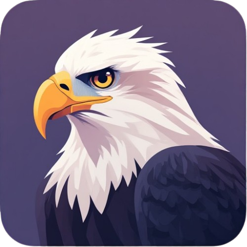

# EagleShot 🦅

> [🇬🇧 English](#english) | [🇹🇷 Türkçe](#türkçe)



---

## English

A lightweight, modern, cross-platform screenshot tool for Windows, macOS and Linux. It pairs the speed of Lightshot with a ShareX-style workflow: capture modes, an annotation editor, after-capture tasks, uploads, history and pinned screenshots, all in one dark Fluent interface.

### 🌟 Features

- **Main window:** a dashboard with capture modes, recent captures, a searchable **History** gallery (with video and GIF previews), a **Tools** page and a **Settings** page. Closing it keeps EagleShot running in the tray. Drop files on it to upload them, or images to edit them.
- **Capture modes:**
  - **Region:** drag to select, or click to grab a whole monitor
  - **Full screen:** all monitors at once
  - **Active monitor:** the monitor under the mouse
  - **Delayed region:** configurable countdown (default 3 s)
  - **Repeat last region:** same area again, no editor
  - **Window:** hover to highlight a window, click to capture it (Windows, macOS, X11)
  - **Scrolling capture:** scrolls a page or document automatically and stitches it into one long image
  - **Auto capture:** a screenshot every N seconds (full screen, last region or active monitor)
  - **Color picker:** copies the HEX value of any pixel
- **Screen recording:** record a region to **MP4** or an animated **GIF** (via ffmpeg). A floating bar shows the timer with Stop and Cancel, and a frame marks the recorded area.
- **Tools:**
  - **Text recognition (OCR):** select text anywhere on screen and copy it (via Tesseract)
  - **QR codes:** scan QR codes and barcodes from the screen, or create QR codes
  - **Ruler:** measures width, height, diagonal and angle in pixels
  - **Image editor:** open any image file (or a history item) and annotate it
  - **Image combiner:** joins images vertically or horizontally
  - **Hash checker:** MD5 / SHA-1 / SHA-256 / SHA-512 of a file, with comparison
  - **Link shortener** (is.gd) and **file upload** for any file type
- **Image effects:** padding and background, rounded corners, drop shadow, border and a text watermark, with a live preview.
- **Selection:** magnifier with pixel grid, HEX color and coordinates, crosshair, live size in real pixels, 8 resize handles, drag to move, arrow keys to nudge.
- **Annotation tools:** Pen, Marker, Line, Arrow, Rectangle, Ellipse (optionally filled), Text (editable, A+/A−), Highlight, Step numbers, Pixelate and Blur.
  - Shift snaps lines and arrows to 45° and makes squares and circles
  - Select tool to move shapes, Delete to remove them, double-click text to edit it
  - Undo / Redo, a 17-color palette plus a HEX input, 6 stroke sizes
- **Outputs (toolbar):** Pin to screen, Upload, Copy, Quick save, Save as (PNG / JPEG / WebP), Done.
- **After-capture tasks** (ShareX-style): copy to clipboard, save to folder, upload and copy the link, pin to screen, notification. Toggle them from the home page or in Settings.
- **Pin to screen:** an always-on-top floating screenshot. Wheel zooms, Ctrl+wheel changes opacity, double-click closes.
- **Upload:** Imgur (Client ID) or a **custom HTTP uploader** (POST/PUT/PATCH, multipart or binary body, headers, form arguments, `{json:…}` / `{regex:…}` link extraction), with a test button. **ShareX `.sxcu` uploaders can be imported directly**, giving access to hundreds of ShareX-compatible hosts. Optional link shortening.
- **File naming:** patterns such as `EagleShot_%y-%mo-%d_%h-%mi-%s`, with a live preview, plus a configurable folder, format and quality.
- **Configurable global hotkeys:** click a box and press the combination; PrintScreen works too.
- **Command line and single instance:** `eagleshot --region` and the other switches below are forwarded to the running app. Useful for desktop shortcuts and Wayland.
- **Notifications:** toasts with a thumbnail; click one to open the file or link.
- **Cross-platform, HiDPI-aware,** with optional auto-start.

### ⌨️ Shortcuts

| Global (default) | |
|---|---|
| `PrintScreen` (`F12` on macOS) | Capture region |
| `Ctrl+PrintScreen` | Capture full screen |
| `Alt+PrintScreen` | Capture active monitor |
| `Shift+PrintScreen` | Repeat last region |
| `Ctrl+Shift+PrintScreen` | Delayed region capture |

| In the editor | |
|---|---|
| `V` `P` `K` `L` `A` `R` `E` `T` `H` `N` `X` `B` | Select, Pen, Marker, Line, Arrow, Rectangle, Ellipse, Text, Highlight, Number, Pixelate, Blur |
| `1`–`9` | Pick a palette color |
| `[` / `]` | Smaller / larger stroke |
| `F` | Toggle fill |
| `Ctrl+Z` / `Ctrl+Y` | Undo / Redo |
| `Ctrl+C` / `Ctrl+S` / `Ctrl+Shift+S` | Copy / Quick save / Save as |
| `Ctrl+U` / `Ctrl+P` | Upload / Pin |
| `Ctrl+A` | Select the whole screen |
| `Enter` or double-click | Done (run the after-capture tasks) |
| Arrow keys (+Shift) | Move the selected shape or the selection |
| `Delete` | Delete the selected shape |
| Right-click / `Esc` | Reset the selection / cancel |

### 🖥️ Command line

```bash
eagleshot --region | --fullscreen | --monitor | --window | --delay | --repeat | --color | --show
eagleshot --record | --gif | --scroll | --ocr | --qr | --ruler
eagleshot --editor [image]      # open an image in the editor
eagleshot --upload <files…>     # upload files
```

`--record` and `--gif` start a recording; run the same command again to stop it. If EagleShot is already running, the command goes to that instance. On Wayland, where global keyboard hooks aren't available, bind these commands to your desktop's own shortcuts.

### 🚀 Installation

#### Windows

**Using the installer:**
1. Download `EagleShot_Setup_v3.1.0_win-x64.exe` from [Releases](https://github.com/hhasanguclu/EagleShot/releases).
2. Run the installer and follow the steps.

**Manual:**
```bash
dotnet publish -c Release -r win-x64 --self-contained true -p:PublishSingleFile=true -o publish/win-x64
```

#### Linux

```bash
# Build
dotnet publish -c Release -r linux-x64 --self-contained true -p:PublishSingleFile=true -o publish/linux-x64

# Install
chmod +x installers/linux/install.sh
./installers/linux/install.sh
```

Dependencies:
- Screen capture: `scrot`, `maim` or ImageMagick `import` (X11). On Wayland, EagleShot uses xdg-desktop-portal (built into GNOME and KDE) and falls back to `grim` or `gnome-screenshot`
- Clipboard: `xclip` (X11) or `wl-clipboard` (Wayland)
- Optional: `ffmpeg` (screen recording, X11 only) and `tesseract-ocr` (text recognition)

**Optional tools on every platform:** screen recording needs [ffmpeg](https://ffmpeg.org) and text recognition needs [Tesseract](https://github.com/tesseract-ocr/tesseract). Windows: `winget install Gyan.FFmpeg UB-Mannheim.TesseractOCR`. macOS: `brew install ffmpeg tesseract tesseract-lang`. EagleShot finds them on PATH and in the usual install folders, or you can set their paths in Settings.

#### macOS

```bash
# Build (Apple Silicon)
dotnet publish -c Release -r osx-arm64 --self-contained true -p:PublishSingleFile=true -o publish/osx-arm64

# Create .app bundle
chmod +x installers/macos/create-app.sh
./installers/macos/create-app.sh
```

Drag `EagleShot.app` to `/Applications`.
On first launch, grant **Screen Recording** and **Accessibility** (for hotkeys) under **System Settings > Privacy & Security**.

#### Build from Source

```bash
git clone https://github.com/hhasanguclu/EagleShot.git
cd EagleShot
dotnet run
```

Build all platforms at once:
```bash
# PowerShell
./scripts/build-all.ps1

# Bash
chmod +x scripts/build-all.sh
./scripts/build-all.sh
```

### 🎮 Usage

1. After launch, the main window opens and EagleShot sits in the system tray.
2. Press **PrintScreen** (or **F12** on macOS), click a capture card, or use the tray menu.
3. Drag to select a region (or click a monitor), then adjust it with the handles.
4. Annotate with the toolbar.
5. Press **Enter** / **✓** to run your after-capture tasks, or pick Copy, Save, Upload or Pin. **Esc** cancels.
6. Find everything later on the **History** page.

### 🛠️ Tech Stack

| | |
|---|---|
| Language | C# |
| UI Framework | Avalonia UI 11.2 (Fluent Theme, Inter font) |
| Runtime | .NET 9.0 |
| Global Hotkey | SharpHook (cross-platform) |
| Imaging | SkiaSharp (PNG / JPEG / WebP encoding, effects) |
| Screen Capture | Win32 GDI / scrot, maim, grim… / screencapture |
| Clipboard | Win32 API / xclip, wl-copy / osascript |

---

## Türkçe

Windows, macOS ve Linux'ta çalışan, hafif, modern ve kullanıcı dostu bir ekran görüntüsü alma aracı. Lightshot'ın hızını ShareX tarzı bir iş akışıyla birleştirir: yakalama modları, düzenleme editörü, yakalama sonrası görevler, yükleme, geçmiş ve ekrana sabitleme. Hepsi tek bir koyu Fluent arayüzde.

### 🌟 Özellikler

- **Ana pencere:** yakalama modları, son yakalamalar, aranabilir **Geçmiş** galerisi (video ve GIF önizlemeli), **Araçlar** ve **Ayarlar** sayfalarından oluşan bir panel. Pencereyi kapatınca EagleShot tepside çalışmaya devam eder. Pencereye bırakılan dosyalar yüklenir, resimler editörde açılır.
- **Yakalama modları:**
  - **Bölge:** sürükleyerek seçin ya da bir monitörü tıklayıp tamamını alın
  - **Tam ekran:** tüm monitörler tek seferde
  - **Aktif monitör:** farenin bulunduğu monitör
  - **Gecikmeli bölge:** ayarlanabilir geri sayım (varsayılan 3 sn)
  - **Son bölgeyi tekrarla:** aynı alanı editör açmadan tekrar alır
  - **Pencere:** üzerine gelinen pencere vurgulanır, tıklayınca o pencere yakalanır (Windows, macOS, X11)
  - **Kaydırmalı yakalama:** sayfayı otomatik kaydırıp tek uzun görüntüde birleştirir
  - **Otomatik yakalama:** her N saniyede bir görüntü (tam ekran, son bölge veya aktif monitör)
  - **Renk seçici:** herhangi bir pikselin HEX değerini kopyalar
- **Ekran kaydı:** bir bölgeyi **MP4** ya da animasyonlu **GIF** olarak kaydeder (ffmpeg ile). Süre sayacı, Durdur ve İptal butonlu bir çubuk çıkar; kaydedilen alan çerçeveyle gösterilir.
- **Araçlar:**
  - **Metin tanıma (OCR):** ekrandaki metni seçip kopyalar (Tesseract ile)
  - **QR kod:** ekrandaki QR kod ve barkodları okur, yeni QR kod oluşturur
  - **Cetvel:** genişlik, yükseklik, köşegen ve açıyı piksel cinsinden ölçer
  - **Resim editörü:** herhangi bir resim dosyasını (veya geçmişteki bir kaydı) açıp düzenler
  - **Resim birleştirici:** resimleri alt alta ya da yan yana birleştirir
  - **Hash kontrolü:** dosyanın MD5 / SHA-1 / SHA-256 / SHA-512 değerlerini hesaplar ve karşılaştırır
  - **Link kısaltma** (is.gd) ve her türden **dosya yükleme**
- **Görsel efektler:** kenar boşluğu ve arka plan, yuvarlatılmış köşeler, gölge, çerçeve ve filigran; canlı önizlemeli.
- **Seçim:** piksel ızgaralı büyüteç (HEX renk ve koordinatlarla), artı imleci, gerçek piksel cinsinden canlı boyut, 8 boyutlandırma tutamacı, sürükleyerek taşıma, ok tuşlarıyla ince ayar.
- **Düzenleme araçları:** Kalem, Fosforlu kalem, Çizgi, Ok, Dikdörtgen, Elips (isteğe bağlı dolgulu), Metin (düzenlenebilir, A+/A−), Vurgulama, Adım numarası, Mozaik ve Bulanıklaştırma.
  - Shift ile çizgi ve oklar 45°'ye kilitlenir, kare ve daire çizilir
  - Seçim aracıyla şekiller taşınır, Delete ile silinir; metne çift tıklayınca düzenlenir
  - Geri al / Yinele, 17 renklik palet ve HEX girişi, 6 kalem kalınlığı
- **Çıktılar (araç çubuğu):** Ekrana sabitle, Yükle, Kopyala, Hızlı kaydet, Farklı kaydet (PNG / JPEG / WebP), Bitti.
- **Yakalama sonrası görevler** (ShareX tarzı): panoya kopyala, klasöre kaydet, yükleyip bağlantıyı kopyala, ekrana sabitle, bildirim göster. Ana sayfadan ya da Ayarlar'dan açıp kapatılır.
- **Ekrana sabitleme:** her zaman üstte duran, yüzen ekran görüntüsü. Fare tekerleği yakınlaştırır, Ctrl+tekerlek saydamlığı değiştirir, çift tıklama kapatır.
- **Yükleme:** Imgur (Client ID) veya **özel HTTP yükleyici** (POST/PUT/PATCH, multipart veya binary gövde, başlıklar, form alanları, `{json:…}` / `{regex:…}` ile bağlantı çıkarma); test butonuyla birlikte. **ShareX `.sxcu` yükleyicileri doğrudan içe aktarılabilir**, böylece ShareX uyumlu yüzlerce servis kullanılabilir. İsteğe bağlı link kısaltma.
- **Dosya adlandırma:** `EagleShot_%y-%mo-%d_%h-%mi-%s` gibi kalıplar ve canlı önizleme; klasör, format ve kalite de ayarlanabilir.
- **Ayarlanabilir global kısayollar:** kutuya tıklayıp tuş kombinasyonuna basın; PrintScreen de çalışır.
- **Komut satırı ve tek örnek:** `eagleshot --region` ve aşağıdaki diğer parametreler çalışan uygulamaya iletilir. Masaüstü kısayolları ve Wayland için kullanışlıdır.
- **Bildirimler:** küçük resimli bildirimler; tıklayınca dosya ya da bağlantı açılır.
- **Çapraz platform, HiDPI uyumlu,** isteğe bağlı otomatik başlatma.

### ⌨️ Kısayollar

| Global (varsayılan) | |
|---|---|
| `PrintScreen` (macOS'ta `F12`) | Bölge yakala |
| `Ctrl+PrintScreen` | Tam ekran |
| `Alt+PrintScreen` | Aktif monitör |
| `Shift+PrintScreen` | Son bölgeyi tekrarla |
| `Ctrl+Shift+PrintScreen` | Gecikmeli bölge |

| Editörde | |
|---|---|
| `V` `P` `K` `L` `A` `R` `E` `T` `H` `N` `X` `B` | Seçim, Kalem, Fosforlu, Çizgi, Ok, Dikdörtgen, Elips, Metin, Vurgu, Numara, Mozaik, Bulanık |
| `1`–`9` | Paletten renk seç |
| `[` / `]` | Kalınlığı azalt / artır |
| `F` | Dolguyu aç/kapat |
| `Ctrl+Z` / `Ctrl+Y` | Geri al / Yinele |
| `Ctrl+C` / `Ctrl+S` / `Ctrl+Shift+S` | Kopyala / Hızlı kaydet / Farklı kaydet |
| `Ctrl+U` / `Ctrl+P` | Yükle / Sabitle |
| `Ctrl+A` | Tüm ekranı seç |
| `Enter` veya çift tıklama | Bitti (yakalama sonrası görevleri çalıştırır) |
| Ok tuşları (+Shift) | Seçili şekli veya seçimi taşı |
| `Delete` | Seçili şekli sil |
| Sağ tık / `Esc` | Seçimi sıfırla / iptal |

### 🖥️ Komut satırı

```bash
eagleshot --region | --fullscreen | --monitor | --window | --delay | --repeat | --color | --show
eagleshot --record | --gif | --scroll | --ocr | --qr | --ruler
eagleshot --editor [resim]      # resmi editörde aç
eagleshot --upload <dosyalar…>  # dosya yükle
```

`--record` ve `--gif` kaydı başlatır; aynı komut tekrar çalıştırılınca kayıt durur. EagleShot zaten çalışıyorsa komut o örneğe iletilir. Global klavye kancalarının çalışmadığı Wayland'da bu komutları masaüstünüzün kendi kısayollarına atayın.

### 🚀 Kurulum

#### Windows

**Installer ile:**
1. [Releases](https://github.com/hhasanguclu/EagleShot/releases) sayfasından `EagleShot_Setup_v3.1.0_win-x64.exe` indirin.
2. Installer'ı çalıştırın ve adımları takip edin.

**Manuel:**
```bash
dotnet publish -c Release -r win-x64 --self-contained true -p:PublishSingleFile=true -o publish/win-x64
```

#### Linux

```bash
# Derle
dotnet publish -c Release -r linux-x64 --self-contained true -p:PublishSingleFile=true -o publish/linux-x64

# Kur
chmod +x installers/linux/install.sh
./installers/linux/install.sh
```

Bağımlılıklar:
- Ekran yakalama: `scrot`, `maim` veya ImageMagick `import` (X11). Wayland'da EagleShot xdg-desktop-portal'ı kullanır (GNOME ve KDE'de hazır gelir), olmazsa `grim` veya `gnome-screenshot` dener
- Pano: `xclip` (X11) veya `wl-clipboard` (Wayland)
- İsteğe bağlı: `ffmpeg` (ekran kaydı, yalnızca X11) ve `tesseract-ocr` (metin tanıma)

**Tüm platformlarda isteğe bağlı araçlar:** ekran kaydı için [ffmpeg](https://ffmpeg.org), metin tanıma için [Tesseract](https://github.com/tesseract-ocr/tesseract) gerekir. Windows: `winget install Gyan.FFmpeg UB-Mannheim.TesseractOCR`. macOS: `brew install ffmpeg tesseract tesseract-lang`. EagleShot bunları PATH'te ve yaygın kurulum klasörlerinde kendisi bulur; yolları Ayarlar'dan da girebilirsiniz.

#### macOS

```bash
# Derle (Apple Silicon)
dotnet publish -c Release -r osx-arm64 --self-contained true -p:PublishSingleFile=true -o publish/osx-arm64

# .app bundle oluştur
chmod +x installers/macos/create-app.sh
./installers/macos/create-app.sh
```

`EagleShot.app` dosyasını `/Applications` klasörüne sürükleyin.
İlk çalıştırmada **Sistem Ayarları > Gizlilik ve Güvenlik** altında **Ekran Kaydı** ve **Erişilebilirlik** (kısayollar için) izinlerini verin.

#### Kaynaktan Derleme

```bash
git clone https://github.com/hhasanguclu/EagleShot.git
cd EagleShot
dotnet run
```

Tüm platformlar için tek seferde:
```bash
# PowerShell
./scripts/build-all.ps1

# Bash
chmod +x scripts/build-all.sh
./scripts/build-all.sh
```

### 🎮 Kullanım

1. Uygulama açıldığında ana pencere görünür ve EagleShot sistem tepsisine yerleşir.
2. **PrintScreen** (macOS'ta **F12**) tuşuna basın, bir yakalama kartına tıklayın ya da tepsi menüsünü kullanın.
3. Sürükleyerek bölge seçin (veya bir monitöre tıklayın), sonra tutamaçlarla ayarlayın.
4. Araç çubuğuyla çizin, metin ekleyin, bulanıklaştırın.
5. **Enter** / **✓** ile yakalama sonrası görevleri çalıştırın ya da Kopyala, Kaydet, Yükle veya Sabitle'yi seçin. **Esc** iptal eder.
6. Hepsini daha sonra **Geçmiş** sayfasında bulabilirsiniz.

### 🛠️ Teknolojiler

| | |
|---|---|
| Dil | C# |
| UI Framework | Avalonia UI 11.2 (Fluent Theme, Inter font) |
| Runtime | .NET 9.0 |
| Global Hotkey | SharpHook (cross-platform) |
| Görüntü işleme | SkiaSharp (PNG / JPEG / WebP, efektler) |
| Ekran Yakalama | Win32 GDI / scrot, maim, grim… / screencapture |
| Clipboard | Win32 API / xclip, wl-copy / osascript |

---

## 📁 Project Structure / Proje Yapısı

```
EagleShot/
├── Core/
│   ├── AppSettings.cs             # Settings model + JSON persistence
│   ├── AutoStartService.cs        # Platform-specific auto-start
│   ├── CaptureManager.cs          # Capture workflow + after-capture tasks
│   ├── ClipboardService.cs        # Platform-specific clipboard
│   ├── FileNameFormatter.cs       # %y-%mo-%d style file name patterns
│   ├── GlobalHotkeyService.cs     # Configurable global hotkeys (SharpHook)
│   ├── HistoryService.cs          # Capture history
│   ├── ImageHelper.cs             # SkiaSharp crop / encode / pixel access
│   ├── MacPermissionService.cs    # macOS permission prompts
│   ├── ScreenCaptureService.cs    # Platform-specific screen capture
│   ├── Shapes.cs                  # Annotation shapes + mosaic / blur effects
│   ├── ShellHelper.cs             # Open files, folders and links
│   ├── SingleInstance.cs          # Single instance + command forwarding
│   ├── ToolType.cs                # Tool enum
│   ├── UploadService.cs           # Imgur, custom/.sxcu uploaders, link shortener
│   ├── ScreenRecorder.cs          # MP4 / GIF recording with ffmpeg
│   ├── ScrollingCapture.cs        # Scroll + stitch long captures
│   ├── WindowEnumerator.cs        # Window rectangles (Win32 / CoreGraphics / X11)
│   ├── TextTools.cs               # OCR (Tesseract), QR (QRCoder / ZXing), hashes
│   ├── ImageEffects.cs            # Shadow, corners, border, watermark, combiner
│   ├── AutoCaptureService.cs      # Interval captures
│   ├── PortalScreenshot.cs        # Wayland capture via xdg-desktop-portal
│   └── ToolLocator.cs             # Finds ffmpeg / tesseract
├── Views/
│   ├── MainWindow.axaml(.cs)      # Dashboard: capture, history, tools, settings
│   ├── HistoryView.axaml(.cs)     # History gallery
│   ├── SettingsView.axaml(.cs)    # Settings page
│   ├── ToolsView.cs               # Tools page
│   ├── ToolWindows.cs             # QR generator, hash checker, image combiner
│   ├── TextResultWindow.cs        # OCR / QR results
│   ├── RecordingBar.cs            # Recording controls + frame
│   ├── OverlayCanvas.cs           # Region selection + annotation canvas
│   ├── OverlayWindow.axaml(.cs)   # Capture overlay + toolbar
│   ├── PinWindow.cs               # Pin to screen
│   ├── ToastWindow.cs             # Notifications
│   ├── CountdownWindow.cs         # Delayed capture countdown
│   └── SplashWindow.axaml(.cs)    # Splash screen
├── Styles/
│   └── AppStyles.axaml            # Theme, icons, control styles
├── Resources/
├── installers/
├── scripts/
├── App.axaml(.cs)                 # App entry, tray, command handling
├── Program.cs                     # Main entry point
└── README.md
```

## 📝 License / Lisans

This project is licensed under the MIT License. / Bu proje MIT Lisansı ile lisanslanmıştır.
