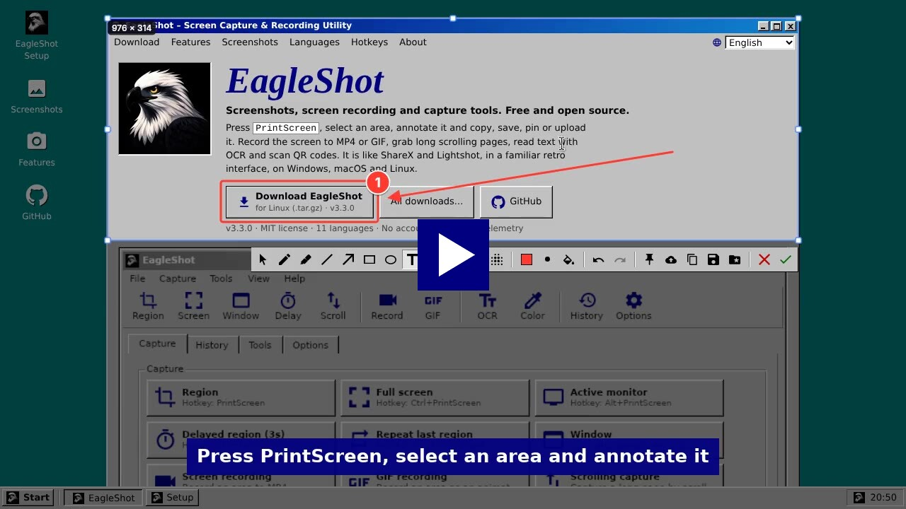
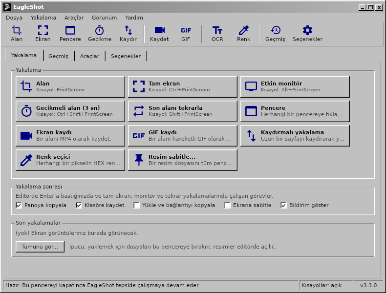
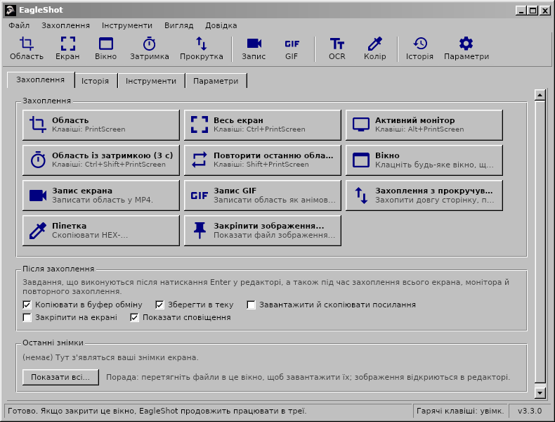

<div align="center">

# EagleShot 🦅

**Screenshots, screen recording and capture tools for Windows, macOS and Linux, in a classic Windows 98-style interface.**

[English](README.md) · [Türkçe](README.tr.md) · [简体中文](README.zh-CN.md) · [繁體中文](README.zh-TW.md) · [日本語](README.ja.md) · [한국어](README.ko.md) · [Deutsch](README.de.md) · [Français](README.fr.md) · [Polski](README.pl.md) · [Українська](README.uk.md) · [Русский](README.ru.md)

[**Website**](https://hhasanguclu.github.io/EagleShot/) · [**Download**](https://github.com/hhasanguclu/EagleShot/releases/latest) · [Releases](https://github.com/hhasanguclu/EagleShot/releases)


<a href="https://hhasanguclu.github.io/EagleShot/#video"></a><br>
<b>▶ <a href="https://hhasanguclu.github.io/EagleShot/#video">Watch the video</a></b>

</div>

---

EagleShot is a free, open-source screenshot tool. It pairs the speed of Lightshot with a ShareX-style workflow: capture modes, an annotation editor, after-capture tasks, uploads, history and pinned screenshots. It also records the screen to MP4 or GIF, captures scrolling pages, reads text with OCR and scans QR codes. The interface looks like a classic Windows 9x/2000 program: a menu bar, a toolbar, tabs, 3D buttons and a status bar. It is available in 11 languages.

## 📸 Screenshots

| | |
|---|---|
|  |  |
| **Editor:** select a region, annotate it (rectangle, arrow, step numbers, text…), then copy, save, pin or upload it | **Menus** show the hotkey of every capture mode |
|  |  |
| **Tools:** recording, scrolling capture, OCR, QR codes, ruler, image combiner, hash checker… | **History** of everything you saved or uploaded |
|  |  |
| **Options:** language, hotkeys, file names, uploaders, image effects, recording | **Splash screen** |

| Screen recorder | Notification | About |
|---|---|---|
|  |  |  |

## 🌍 Languages

EagleShot starts in your system language. You can change it under **Options → General → Language**.

English · Türkçe · 简体中文 · 繁體中文 · 日本語 · 한국어 · Deutsch · Français · Polski · Українська · Русский

| | | |
|---|---|---|
|  |  |  |
|  |  |  |

## 🌟 Features

- **Capture modes:**
  - **Region:** drag to select, or click to grab a whole monitor
  - **Full screen:** all monitors at once
  - **Active monitor:** the monitor under the mouse
  - **Window:** hover to highlight a window, click to capture it (Windows, macOS, X11)
  - **Delayed region:** a countdown first (default 3 s)
  - **Repeat last region:** the same area again, without the editor
  - **Scrolling capture:** scrolls a page or document and stitches it into one long image
  - **Auto capture:** a screenshot every N seconds
  - **Color picker:** copies the HEX value of any pixel
- **Screen recording:** record a region to **MP4** or an animated **GIF** (ffmpeg). A small bar next to the area has Start, a timer, Stop and Cancel.
- **Annotation editor:** pen, marker, line, arrow, rectangle, ellipse, text, highlight, step numbers, pixelate and blur. Undo/redo, a color palette with HEX input and 6 stroke sizes.
- **After-capture tasks** (like ShareX): copy, save, upload and copy the link, pin to screen, notification.
- **Paste anywhere:** copied images paste into chat apps, documents, Explorer and terminals.
- **Pin to screen:** keep a screenshot floating above all windows. The mouse wheel zooms it, Ctrl+wheel changes its opacity.
- **Upload:** Imgur, any custom HTTP uploader, or **ShareX `.sxcu` uploaders**. Optional link shortening.
- **Tools:**
  - **Text recognition (OCR):** copy text from any part of the screen (Tesseract, English + your language)
  - **QR codes:** scan QR codes and barcodes, or create them
  - **Ruler**, **image combiner**, **hash checker** (MD5 / SHA), **image editor**
- **Image effects:** background and padding, rounded corners, shadow, border and watermark, with a live preview.
- **Global hotkeys** for every action. On Windows, **PrintScreen opens EagleShot instead of the Snipping Tool**.
- **Command line:** `eagleshot --region`, `--record`, `--ocr`… are sent to the running app. Handy on Wayland.
- **History** with thumbnails and search, **file name patterns**, PNG / JPEG / WebP.
- **11 languages**, HiDPI support, starts with the system if you want.

## ⌨️ Shortcuts

| Global (default) | |
|---|---|
| `PrintScreen` (`F12` on macOS) | Capture region |
| `Ctrl+PrintScreen` | Capture full screen |
| `Alt+PrintScreen` | Capture active monitor |
| `Shift+PrintScreen` | Repeat last region |
| `Ctrl+Shift+PrintScreen` | Delayed region capture |
| `Ctrl+Shift+K` | Color picker |

| In the editor | |
|---|---|
| `V` `P` `K` `L` `A` `R` `E` `T` `H` `N` `X` `B` | Select, Pen, Marker, Line, Arrow, Rectangle, Ellipse, Text, Highlight, Number, Pixelate, Blur |
| `1`–`9` | Pick a palette color |
| `[` / `]` | Smaller / larger stroke |
| `F` | Toggle fill |
| `Ctrl+Z` / `Ctrl+Y` | Undo / Redo |
| `Ctrl+C` / `Ctrl+S` / `Ctrl+Shift+S` | Copy / Quick save / Save as |
| `Ctrl+U` / `Ctrl+P` | Upload / Pin |
| `Enter` or double-click | Done (run the after-capture tasks) |
| Right-click / `Esc` | Reset the selection / Cancel |

## 🖥️ Command line

```bash
eagleshot --region | --fullscreen | --monitor | --window | --delay | --repeat | --color | --show
eagleshot --record | --gif | --scroll | --ocr | --qr | --ruler
eagleshot --editor [image]      # open an image in the editor
eagleshot --upload <files…>     # upload files
```

`--record` and `--gif` start a recording; run the same command again to stop it. If EagleShot is already running, the command goes to that instance.

## 🚀 Installation

Download the file for your system from [Releases](https://github.com/hhasanguclu/EagleShot/releases/latest).

### Windows

1. Run `EagleShot_Setup_v3.3.0_win-x64.exe`. The installer includes FFmpeg (recording) and Tesseract OCR (text recognition).
2. Keep **"Use the PrintScreen key for EagleShot"** checked so PrintScreen opens EagleShot instead of the Snipping Tool.
3. If SmartScreen warns you, click **More info → Run anyway** (the app isn't code-signed).

A portable `.zip` is also available.

### macOS

1. Open the `.dmg` (Apple Silicon or Intel) and drag **EagleShot** to **Applications**.
2. First launch: right-click EagleShot → **Open**. On macOS 15 and later, use **System Settings → Privacy & Security → Open Anyway**.
3. Allow **Screen Recording** and **Accessibility** (for hotkeys).
4. If macOS says the app is "damaged": `xattr -cr /Applications/EagleShot.app`

For recording and OCR: `brew install ffmpeg tesseract tesseract-lang`

### Linux

```bash
tar xzf EagleShot_v3.3.0_linux-x64.tar.gz
cd EagleShot_v3.3.0_linux-x64
./installers/linux/install.sh
```

- Screen capture: `scrot`, `maim` or ImageMagick (X11). On Wayland, EagleShot uses xdg-desktop-portal (GNOME, KDE) or `grim` / `gnome-screenshot`.
- Clipboard: `xclip` (X11) or `wl-clipboard` (Wayland)
- Optional: `ffmpeg` (recording, X11) and `tesseract-ocr` (text recognition)

### Build from source

```bash
git clone https://github.com/hhasanguclu/EagleShot.git
cd EagleShot
dotnet run
```

Build every platform at once with `./scripts/build-all.ps1` (PowerShell) or `./scripts/build-all.sh` (Bash).

## 🎮 Usage

1. After launch, the main window opens and EagleShot sits in the system tray.
2. Press **PrintScreen** (**F12** on macOS), click a capture mode, or use the tray menu.
3. Drag to select a region (or click a monitor), then adjust it with the handles.
4. Annotate with the toolbar.
5. Press **Enter** to run your after-capture tasks, or pick Copy, Save, Upload or Pin. **Esc** cancels.
6. Find everything later on the **History** tab.

## 🛠️ Tech stack

| | |
|---|---|
| Language | C# / .NET 9 |
| UI | Avalonia UI 11.2 with a custom classic Windows theme |
| Global hotkeys | SharpHook |
| Imaging | SkiaSharp |
| Recording / OCR / QR | ffmpeg / Tesseract / QRCoder + ZXing.Net |
| Translations | `Resources/i18n/*.json` (English text is the key) |

## 📁 Project structure

```
EagleShot/
├── Core/                  # Capture, recording, OCR, uploads, hotkeys, settings, localization
├── Views/                 # Main window, editor overlay, settings, tools, notifications
├── Styles/                # Classic.axaml (classic Windows theme), AppStyles.axaml (palette, icons)
├── Resources/i18n/        # Translations: tr, zh-CN, zh-TW, ja, ko, de, fr, pl, uk, ru
├── installers/            # Windows (Inno Setup), macOS (.app / .dmg), Linux (install.sh)
├── scripts/               # Build scripts, Windows tool bundling
├── docs/                  # Website (GitHub Pages) and screenshots
├── App.axaml(.cs)         # App entry, tray, commands
└── Program.cs             # Main entry point
```

## 🤝 Translations

Translations live in `Resources/i18n/<language>.json`. Each file maps the English text to the translation. Missing entries fall back to English, so a fix or a new language is a small pull request.

## 📝 License

MIT License.
