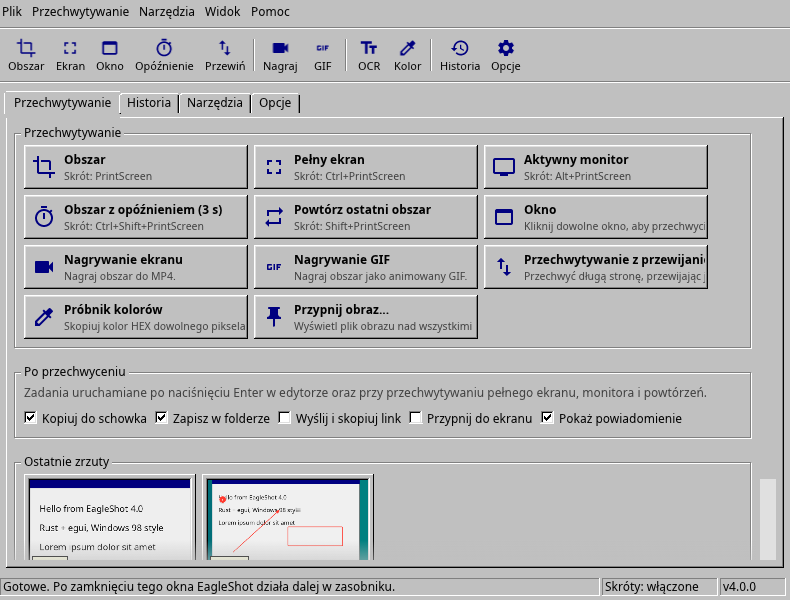
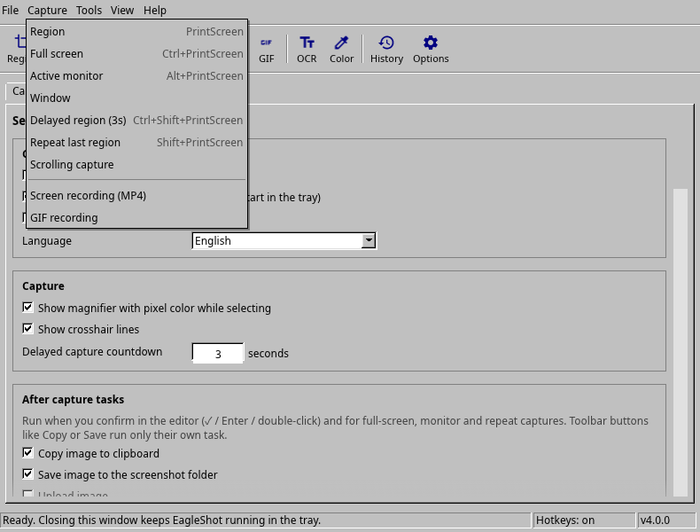
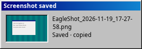
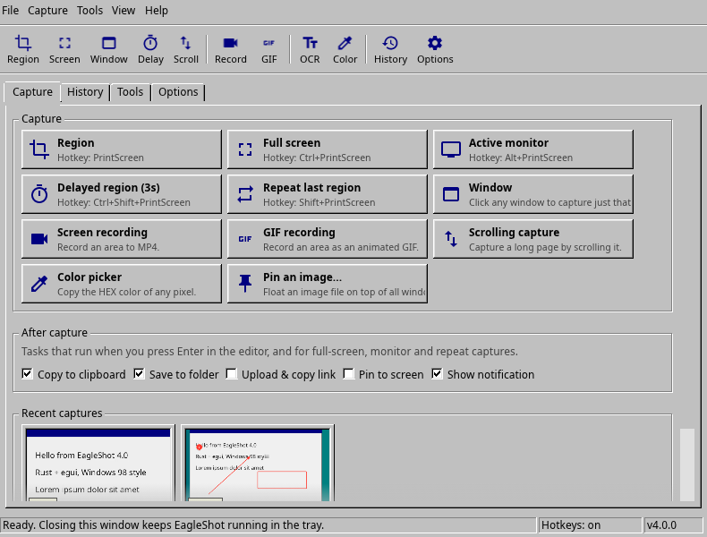
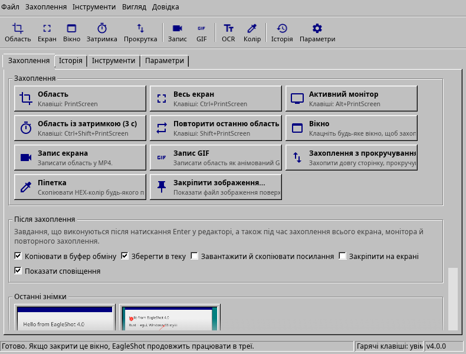
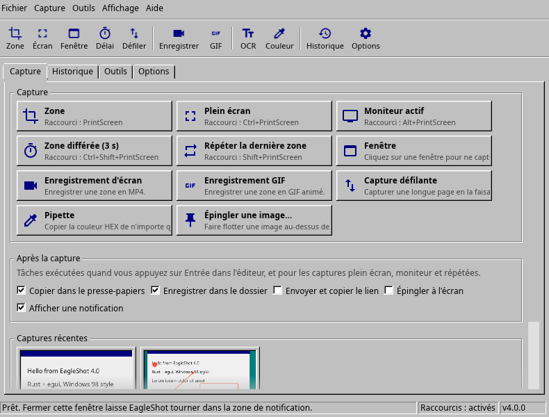

<div align="center">

# EagleShot 🦅

**Zrzuty ekranu, nagrywanie ekranu i narzędzia do przechwytywania dla Windows, macOS i Linux – w klasycznym interfejsie w stylu Windows 98.**

[English](README.md) · [Türkçe](README.tr.md) · [简体中文](README.zh-CN.md) · [繁體中文](README.zh-TW.md) · [日本語](README.ja.md) · [한국어](README.ko.md) · [Deutsch](README.de.md) · [Français](README.fr.md) · [Polski](README.pl.md) · [Українська](README.uk.md) · [Русский](README.ru.md)

[**Strona**](https://hhasanguclu.github.io/EagleShot/) · [**Pobierz**](https://github.com/hhasanguclu/EagleShot/releases/latest) · [Wydania](https://github.com/hhasanguclu/EagleShot/releases)



<a href="https://hhasanguclu.github.io/EagleShot/#video"></a><br>
<b>▶ <a href="https://hhasanguclu.github.io/EagleShot/#video">Obejrzyj film</a></b>

</div>

---

EagleShot to darmowe narzędzie open source do zrzutów ekranu. Łączy szybkość Lightshota z obsługą w stylu ShareX: tryby przechwytywania, edytor adnotacji, zadania po przechwyceniu, wysyłanie, historia i przypięte zrzuty. Nagrywa też ekran do MP4 lub GIF, przechwytuje przewijane strony, odczytuje tekst przez OCR i skanuje kody QR. Interfejs wygląda jak klasyczny program z Windows 9x/2000: pasek menu, pasek narzędzi, karty, przyciski 3D i pasek stanu. Dostępny w 11 językach.

Od wersji 4.0 EagleShot jest napisany w Ruście: to jeden mały program, bez niczego więcej do instalowania.

## 📸 Zrzuty ekranu

| | |
|---|---|
|  |  |
| **Edytor:** zaznacz obszar, dodaj adnotacje (prostokąt, strzałka, numery kroków, tekst…), a potem skopiuj, zapisz, przypnij lub wyślij | **Menu** pokazują skrót każdego trybu przechwytywania |
|  |  |
| **Narzędzia:** nagrywanie, przechwytywanie z przewijaniem, OCR, kody QR, linijka, łączenie obrazów, sprawdzanie skrótów… | **Historia** wszystkiego, co zapisano lub wysłano |
|  |  |
| **Opcje:** język, skróty, nazwy plików, serwisy wysyłania, efekty obrazu, nagrywanie | **Ekran powitalny** |

| Rejestrator ekranu | Powiadomienie | O programie |
|---|---|---|
|  |  |  |

Te obrazy pokazują interfejs angielski; w polskim systemie EagleShot uruchamia się po polsku.

## 🌍 Języki

EagleShot uruchamia się w języku systemu. Możesz go zmienić w **Opcje → Ogólne → Język**.

English · Türkçe · 简体中文 · 繁體中文 · 日本語 · 한국어 · Deutsch · Français · Polski · Українська · Русский

| | | |
|---|---|---|
|  |  |  |
|  |  |  |

## 🌟 Funkcje

- **Tryby przechwytywania:**
  - **Obszar:** przeciągnij, aby zaznaczyć, lub kliknij, aby przechwycić cały monitor
  - **Pełny ekran:** wszystkie monitory naraz
  - **Aktywny monitor:** monitor pod kursorem
  - **Okno:** najedź na okno, aby je wyróżnić, kliknij, aby je przechwycić (Windows, macOS, X11)
  - **Obszar z opóźnieniem:** najpierw odliczanie (domyślnie 3 s)
  - **Powtórz ostatni obszar:** ten sam obszar, bez edytora
  - **Przechwytywanie z przewijaniem:** przewija stronę lub dokument i łączy go w jeden długi obraz
  - **Automatyczne przechwytywanie:** zrzut co N sekund
  - **Próbnik kolorów:** kopiuje wartość HEX dowolnego piksela
- **Nagrywanie ekranu:** nagraj obszar do **MP4** lub animowanego **GIF** (ffmpeg). Mały pasek obok obszaru ma Start, licznik czasu, Stop i Anuluj.
- **Edytor adnotacji:** pióro, zakreślacz, linia, strzałka, prostokąt, elipsa, tekst, wyróżnienie, numery kroków, pikselizacja i rozmycie. Cofnij/ponów, paleta kolorów z polem HEX i 6 grubości linii.
- **Zadania po przechwyceniu** (jak w ShareX): kopiuj, zapisz, wyślij i skopiuj link, przypnij, powiadomienie.
- **Wklejaj wszędzie:** skopiowane obrazy wklejają się w komunikatorach, dokumentach, Eksploratorze i terminalach.
- **Przypnij do ekranu:** zrzut unosi się nad wszystkimi oknami. Kółko myszy przybliża, Ctrl+kółko zmienia krycie.
- **Wysyłanie:** Imgur, własny serwis HTTP lub **serwisy ShareX `.sxcu`**. Opcjonalne skracanie linków.
- **Narzędzia:**
  - **Rozpoznawanie tekstu (OCR):** kopiuj tekst z dowolnej części ekranu (Tesseract, angielski + Twój język)
  - **Kody QR:** skanuj kody QR i kreskowe albo twórz je
  - **Linijka**, **łączenie obrazów**, **sprawdzanie skrótów** (MD5 / SHA), **edytor obrazów**
- **Efekty obrazu:** tło i margines, zaokrąglone rogi, cień, obramowanie i znak wodny, z podglądem na żywo.
- **Globalne skróty** dla każdej akcji. W Windows **klawisz PrintScreen otwiera EagleShot zamiast Narzędzia Wycinanie**.
- **Wiersz poleceń:** `eagleshot --region`, `--record`, `--ocr`… trafiają do działającej aplikacji. Przydatne w Wayland.
- **Historia** z miniaturami i wyszukiwaniem, **wzorce nazw plików**, PNG / JPEG / WebP.
- **11 języków**, obsługa HiDPI, opcjonalny start z systemem.

## ⌨️ Skróty

| Globalne (domyślne) | |
|---|---|
| `PrintScreen` (`F12` w macOS) | Przechwyć obszar |
| `Ctrl+PrintScreen` | Przechwyć pełny ekran |
| `Alt+PrintScreen` | Przechwyć aktywny monitor |
| `Shift+PrintScreen` | Powtórz ostatni obszar |
| `Ctrl+Shift+PrintScreen` | Obszar z opóźnieniem |
| `Ctrl+Shift+K` | Próbnik kolorów |

| W edytorze | |
|---|---|
| `V` `P` `K` `L` `A` `R` `E` `T` `H` `N` `X` `B` | Zaznacz, Pióro, Zakreślacz, Linia, Strzałka, Prostokąt, Elipsa, Tekst, Wyróżnienie, Numer, Pikselizacja, Rozmycie |
| `1`–`9` | Wybierz kolor z palety |
| `[` / `]` | Cieńsza / grubsza linia |
| `F` | Wypełnienie wł./wył. |
| `Ctrl+Z` / `Ctrl+Y` | Cofnij / Ponów |
| `Ctrl+C` / `Ctrl+S` / `Ctrl+Shift+S` | Kopiuj / Szybki zapis / Zapisz jako |
| `Ctrl+U` / `Ctrl+P` | Wyślij / Przypnij |
| `Enter` lub dwuklik | Gotowe (uruchom zadania po przechwyceniu) |
| Prawy przycisk / `Esc` | Resetuj zaznaczenie / Anuluj |

## 🖥️ Wiersz poleceń

```bash
eagleshot --region | --fullscreen | --monitor | --window | --delay | --repeat | --color | --show
eagleshot --record | --gif | --scroll | --ocr | --qr | --ruler
eagleshot --editor [obraz]      # otwórz obraz w edytorze
eagleshot --pin [obraz]         # przypnij obraz do ekranu
eagleshot --upload <pliki…>     # wyślij pliki
eagleshot --minimized | --quit  # uruchom w zasobniku / zamknij działający EagleShot
```

`--record` i `--gif` rozpoczynają nagrywanie; to samo polecenie je kończy. Jeśli EagleShot już działa, polecenie trafia do tej instancji.

## 🚀 Instalacja

Pobierz plik dla swojego systemu ze strony [Wydania](https://github.com/hhasanguclu/EagleShot/releases/latest).

### Windows

1. Uruchom `EagleShot_Setup_v4.0.0_win-x64.exe`. Instalator zawiera FFmpeg (nagrywanie) i Tesseract OCR (rozpoznawanie tekstu).
2. Zostaw zaznaczone **„Używaj klawisza PrintScreen dla EagleShot”**, aby klawisz otwierał EagleShot zamiast Narzędzia Wycinanie.
3. Jeśli SmartScreen ostrzega, kliknij **Więcej informacji → Uruchom mimo to** (aplikacja nie jest podpisana).

Dostępna jest też wersja przenośna `.zip`.

### macOS

1. Otwórz `.dmg` (Apple Silicon lub Intel) i przeciągnij **EagleShot** do **Aplikacji**.
2. Pierwsze uruchomienie: prawy przycisk na EagleShot → **Otwórz**. Od macOS 15: **Ustawienia systemowe → Prywatność i ochrona → Otwórz mimo to**.
3. Zezwól na **Nagrywanie ekranu** i **Dostępność** (dla skrótów).
4. Jeśli macOS twierdzi, że aplikacja jest „uszkodzona”: `xattr -cr /Applications/EagleShot.app`

Do nagrywania i OCR: `brew install ffmpeg tesseract tesseract-lang`

### Linux

```bash
tar xzf EagleShot_v4.0.0_linux-x64.tar.gz
cd EagleShot_v4.0.0_linux-x64
./installers/linux/install.sh
```

- Działa w X11 i Wayland (GNOME, KDE). W Wayland zrzuty przechodzą przez xdg-desktop-portal, a okna działają przez XWayland.
- Globalne skróty wymagają fokusu w X11 lub XWayland; w czystym Wayland przypisz skrót pulpitu do `eagleshot --region`.
- Ikona w zasobniku używa StatusNotifierItem (KDE i większość środowisk; w GNOME zainstaluj rozszerzenie AppIndicator).
- Opcjonalnie: `ffmpeg` (nagrywanie, X11), `tesseract-ocr` (rozpoznawanie tekstu), `wl-clipboard` lub `xclip` (schowek).

### Kompilacja ze źródeł

Potrzebny jest [Rust](https://rustup.rs) 1.85 lub nowszy.

```bash
git clone https://github.com/hhasanguclu/EagleShot.git
cd EagleShot
cargo run --release
```

W Debianie / Ubuntu najpierw zainstaluj pakiety do budowania poleceniem `./scripts/linux-build-deps.sh`. Testy uruchomisz przez `cargo test`.

## 🎮 Użycie

1. Po uruchomieniu otwiera się główne okno, a EagleShot pojawia się w zasobniku.
2. Naciśnij **PrintScreen** (**F12** w macOS), kliknij tryb przechwytywania lub użyj menu w zasobniku.
3. Przeciągnij, aby zaznaczyć obszar (lub kliknij monitor), i dopasuj go uchwytami.
4. Dodaj adnotacje za pomocą paska narzędzi.
5. Naciśnij **Enter**, aby uruchomić zadania po przechwyceniu, albo wybierz Kopiuj, Zapisz, Wyślij lub Przypnij. **Esc** anuluje.
6. Wszystko znajdziesz potem na karcie **Historia**.

## 🛠️ Technologie

| | |
|---|---|
| Język | Rust |
| Interfejs | egui / eframe z ręcznie rysowanym klasycznym motywem Windows |
| Przechwytywanie ekranu | xcap (Windows, macOS, X11, portal Wayland) |
| Zasobnik / skróty | tray-icon, global-hotkey |
| Obrazy | image, tiny-skia, ab_glyph |
| Nagrywanie / OCR / QR | ffmpeg / Tesseract / qrcode + rxing |
| Tłumaczenia | `Resources/i18n/*.json` (kluczem jest tekst angielski) |

## 📁 Struktura projektu

```
EagleShot/
├── src/core/              # Przechwytywanie, nagrywanie, OCR, wysyłanie, schowek, ustawienia, historia (bez interfejsu)
├── src/ui/                # Klasyczne kontrolki Windows, okno główne, edytor, przypięte obrazy, powiadomienia
├── src/app/               # Zasobnik, skróty, przebieg przechwytywania, zadania po przechwyceniu
├── src/main.rs            # Punkt wejścia i wiersz poleceń
├── Resources/i18n/        # Tłumaczenia: tr, zh-CN, zh-TW, ja, ko, de, fr, pl, uk, ru
├── vendor/eframe/         # eframe 0.37 z dwiema małymi poprawkami (zob. Cargo.toml)
├── installers/            # Windows (Inno Setup), macOS (.app / .dmg), Linux (install.sh)
├── scripts/               # Pakiety do budowania na Linuksie, test dymny, narzędzia dla Windows
├── tests/                 # Test kompletności tłumaczeń
└── docs/                  # Strona (GitHub Pages) i zrzuty ekranu
```

## 🤝 Tłumaczenia

Tłumaczenia znajdują się w `Resources/i18n/<język>.json`. Każdy plik przypisuje tekstowi angielskiemu tłumaczenie. Brakujące wpisy wyświetlają się po angielsku; poprawka lub nowy język to mały pull request.

## 📝 Licencja

Licencja MIT. Zobacz [LICENSE](LICENSE).
