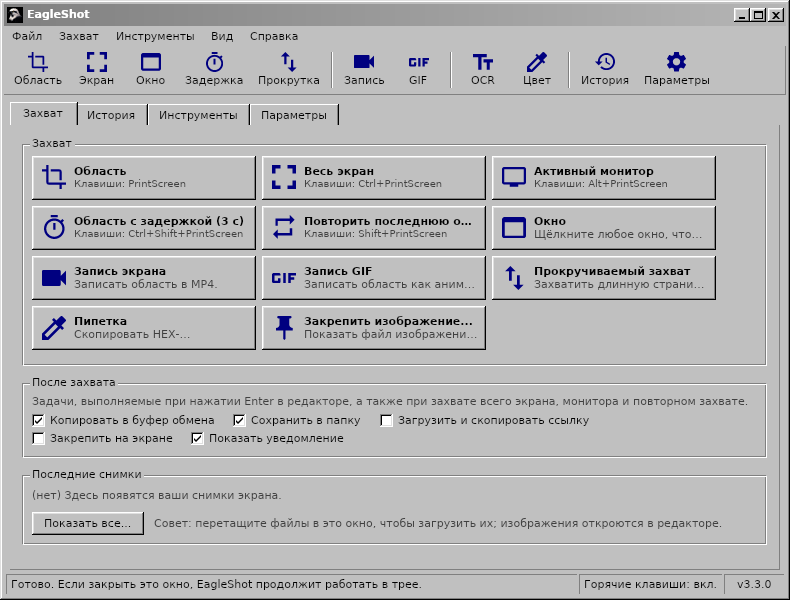
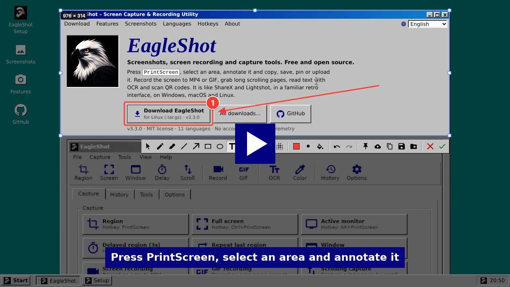
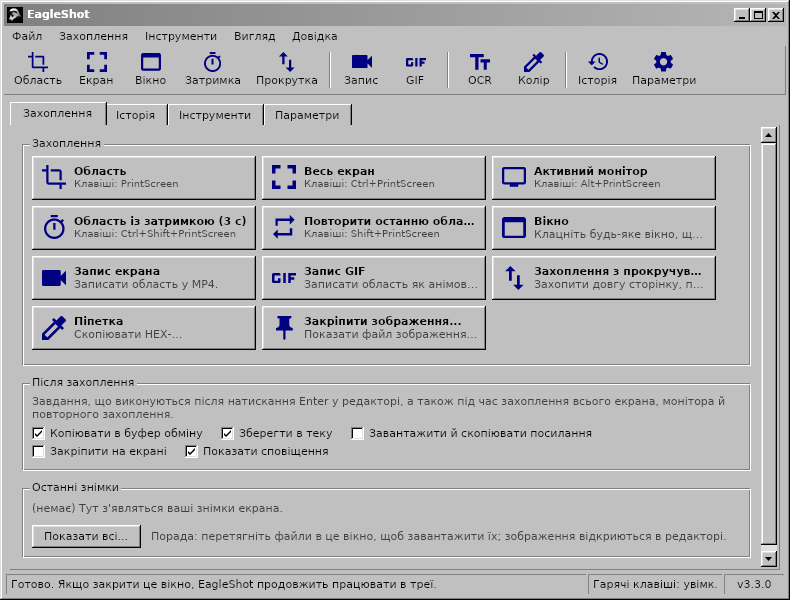

<div align="center">

# EagleShot 🦅

**Снимки экрана, запись экрана и инструменты захвата для Windows, macOS и Linux — в классическом интерфейсе в стиле Windows 98.**

[English](README.md) · [Türkçe](README.tr.md) · [简体中文](README.zh-CN.md) · [繁體中文](README.zh-TW.md) · [日本語](README.ja.md) · [한국어](README.ko.md) · [Deutsch](README.de.md) · [Français](README.fr.md) · [Polski](README.pl.md) · [Українська](README.uk.md) · [Русский](README.ru.md)

[**Сайт**](https://hhasanguclu.github.io/EagleShot/) · [**Скачать**](https://github.com/hhasanguclu/EagleShot/releases/latest) · [Релизы](https://github.com/hhasanguclu/EagleShot/releases)



<a href="https://hhasanguclu.github.io/EagleShot/#video"></a><br>
<b>▶ <a href="https://hhasanguclu.github.io/EagleShot/#video">Смотреть видео</a></b>

</div>

---

EagleShot — бесплатная программа с открытым исходным кодом для снимков экрана. Она сочетает скорость Lightshot с подходом ShareX: режимы захвата, редактор пометок, задачи после захвата, загрузка, история и закреплённые снимки. Она также записывает экран в MP4 или GIF, захватывает прокручиваемые страницы, распознаёт текст (OCR) и сканирует QR-коды. Интерфейс выглядит как классическая программа Windows 9x/2000: строка меню, панель инструментов, вкладки, объёмные кнопки и строка состояния. Доступна на 11 языках.

## 📸 Скриншоты

| | |
|---|---|
|  |  |
| **Редактор:** выделите область, добавьте пометки (прямоугольник, стрелка, номера шагов, текст…), затем скопируйте, сохраните, закрепите или загрузите | **Меню** показывают горячую клавишу каждого режима захвата |
|  |  |
| **Инструменты:** запись, прокручиваемый захват, OCR, QR-коды, линейка, объединение изображений, проверка хеша… | **История** всего, что вы сохранили или загрузили |
|  |  |
| **Параметры:** язык, горячие клавиши, имена файлов, загрузчики, эффекты изображения, запись | **Заставка** |

| Запись экрана | Уведомление | О программе |
|---|---|---|
|  |  |  |

На этих изображениях английский интерфейс; в русской системе EagleShot запускается на русском.

## 🌍 Языки

EagleShot запускается на языке вашей системы. Изменить его можно в **Параметры → Общие → Язык**.

English · Türkçe · 简体中文 · 繁體中文 · 日本語 · 한국어 · Deutsch · Français · Polski · Українська · Русский

| | | |
|---|---|---|
|  |  |  |
|  |  |  |

## 🌟 Возможности

- **Режимы захвата:**
  - **Область:** выделите мышью или щёлкните, чтобы захватить весь монитор
  - **Весь экран:** все мониторы сразу
  - **Активный монитор:** монитор под указателем
  - **Окно:** наведите на окно, чтобы подсветить его, щёлкните, чтобы захватить (Windows, macOS, X11)
  - **Область с задержкой:** сначала обратный отсчёт (по умолчанию 3 с)
  - **Повторить последнюю область:** та же область без редактора
  - **Прокручиваемый захват:** прокручивает страницу или документ и склеивает в одно длинное изображение
  - **Автозахват:** снимок каждые N секунд
  - **Пипетка:** копирует HEX-цвет любого пикселя
- **Запись экрана:** запишите область в **MP4** или анимированный **GIF** (ffmpeg). Небольшая панель рядом с областью содержит «Старт», таймер, «Стоп» и «Отмена».
- **Редактор пометок:** перо, маркер, линия, стрелка, прямоугольник, эллипс, текст, выделение, номера шагов, пикселизация и размытие. Отмена/повтор, палитра с вводом HEX и 6 толщин линии.
- **Задачи после захвата** (как в ShareX): копировать, сохранить, загрузить и скопировать ссылку, закрепить, уведомление.
- **Вставка куда угодно:** скопированные изображения вставляются в мессенджеры, документы, Проводник и терминалы.
- **Закрепить на экране:** снимок висит поверх всех окон. Колесо мыши масштабирует, Ctrl+колесо меняет прозрачность.
- **Загрузка:** Imgur, свой HTTP-загрузчик или **загрузчики ShareX `.sxcu`**. Сокращение ссылок по желанию.
- **Инструменты:**
  - **Распознавание текста (OCR):** копируйте текст с любой части экрана (Tesseract, английский + ваш язык)
  - **QR-коды:** сканируйте QR-коды и штрихкоды или создавайте их
  - **Линейка**, **объединение изображений**, **проверка хеша** (MD5 / SHA), **редактор изображений**
- **Эффекты изображения:** фон и отступ, скруглённые углы, тень, рамка и водяной знак с живым предпросмотром.
- **Глобальные горячие клавиши** для каждого действия. В Windows **PrintScreen открывает EagleShot вместо «Ножниц»**.
- **Командная строка:** `eagleshot --region`, `--record`, `--ocr`… передаются запущенной программе. Удобно в Wayland.
- **История** с миниатюрами и поиском, **шаблоны имён файлов**, PNG / JPEG / WebP.
- **11 языков**, поддержка HiDPI, автозапуск вместе с системой по желанию.

## ⌨️ Горячие клавиши

| Глобальные (по умолчанию) | |
|---|---|
| `PrintScreen` (`F12` в macOS) | Захватить область |
| `Ctrl+PrintScreen` | Захватить весь экран |
| `Alt+PrintScreen` | Захватить активный монитор |
| `Shift+PrintScreen` | Повторить последнюю область |
| `Ctrl+Shift+PrintScreen` | Область с задержкой |
| `Ctrl+Shift+K` | Пипетка |

| В редакторе | |
|---|---|
| `V` `P` `K` `L` `A` `R` `E` `T` `H` `N` `X` `B` | Выбор, Перо, Маркер, Линия, Стрелка, Прямоугольник, Эллипс, Текст, Выделение, Номер, Пикселизация, Размытие |
| `1`–`9` | Цвет из палитры |
| `[` / `]` | Тоньше / толще |
| `F` | Заливка вкл./выкл. |
| `Ctrl+Z` / `Ctrl+Y` | Отменить / Повторить |
| `Ctrl+C` / `Ctrl+S` / `Ctrl+Shift+S` | Копировать / Быстро сохранить / Сохранить как |
| `Ctrl+U` / `Ctrl+P` | Загрузить / Закрепить |
| `Enter` или двойной щелчок | Готово (выполнить задачи после захвата) |
| Правый щелчок / `Esc` | Сбросить выделение / Отмена |

## 🖥️ Командная строка

```bash
eagleshot --region | --fullscreen | --monitor | --window | --delay | --repeat | --color | --show
eagleshot --record | --gif | --scroll | --ocr | --qr | --ruler
eagleshot --editor [изображение]   # открыть изображение в редакторе
eagleshot --upload <файлы…>        # загрузить файлы
```

`--record` и `--gif` начинают запись; та же команда её останавливает. Если EagleShot уже запущен, команда передаётся ему.

## 🚀 Установка

Скачайте файл для своей системы на странице [Релизы](https://github.com/hhasanguclu/EagleShot/releases/latest).

### Windows

1. Запустите `EagleShot_Setup_v3.3.0_win-x64.exe`. Установщик включает FFmpeg (запись) и Tesseract OCR (распознавание текста).
2. Оставьте включённым **«Использовать клавишу PrintScreen для EagleShot»**, чтобы клавиша открывала EagleShot вместо «Ножниц».
3. Если SmartScreen предупреждает, нажмите **Подробнее → Выполнить в любом случае** (приложение не подписано).

Есть и портативная версия `.zip`.

### macOS

1. Откройте `.dmg` (Apple Silicon или Intel) и перетащите **EagleShot** в **Программы**.
2. Первый запуск: правый щелчок по EagleShot → **Открыть**. В macOS 15 и новее: **Системные настройки → Конфиденциальность и безопасность → Всё равно открыть**.
3. Разрешите **Запись экрана** и **Универсальный доступ** (для горячих клавиш).
4. Если macOS сообщает, что приложение «повреждено»: `xattr -cr /Applications/EagleShot.app`

Для записи и OCR: `brew install ffmpeg tesseract tesseract-lang`

### Linux

```bash
tar xzf EagleShot_v3.3.0_linux-x64.tar.gz
cd EagleShot_v3.3.0_linux-x64
./installers/linux/install.sh
```

- Захват экрана: `scrot`, `maim` или ImageMagick (X11). В Wayland EagleShot использует xdg-desktop-portal (GNOME, KDE) или `grim` / `gnome-screenshot`.
- Буфер обмена: `xclip` (X11) или `wl-clipboard` (Wayland)
- Необязательно: `ffmpeg` (запись, X11) и `tesseract-ocr` (распознавание текста)

### Сборка из исходников

```bash
git clone https://github.com/hhasanguclu/EagleShot.git
cd EagleShot
dotnet run
```

Собрать все платформы сразу: `./scripts/build-all.ps1` (PowerShell) или `./scripts/build-all.sh` (Bash).

## 🎮 Использование

1. После запуска открывается главное окно, а EagleShot появляется в трее.
2. Нажмите **PrintScreen** (**F12** в macOS), выберите режим захвата или воспользуйтесь меню в трее.
3. Выделите область мышью (или щёлкните монитор) и подправьте её маркерами.
4. Добавьте пометки с помощью панели инструментов.
5. Нажмите **Enter**, чтобы выполнить задачи после захвата, или выберите «Копировать», «Сохранить», «Загрузить» или «Закрепить». **Esc** — отмена.
6. Всё сохранённое найдётся на вкладке **История**.

## 🛠️ Технологии

| | |
|---|---|
| Язык | C# / .NET 9 |
| Интерфейс | Avalonia UI 11.2 с собственной классической темой Windows |
| Глобальные клавиши | SharpHook |
| Изображения | SkiaSharp |
| Запись / OCR / QR | ffmpeg / Tesseract / QRCoder + ZXing.Net |
| Переводы | `Resources/i18n/*.json` (ключ — английский текст) |

## 📁 Структура проекта

```
EagleShot/
├── Core/                  # Захват, запись, OCR, загрузка, горячие клавиши, настройки, переводы
├── Views/                 # Главное окно, редактор, настройки, инструменты, уведомления
├── Styles/                # Classic.axaml (классическая тема Windows), AppStyles.axaml (цвета, значки)
├── Resources/i18n/        # Переводы: tr, zh-CN, zh-TW, ja, ko, de, fr, pl, uk, ru
├── installers/            # Windows (Inno Setup), macOS (.app / .dmg), Linux (install.sh)
├── scripts/               # Скрипты сборки, упаковка инструментов для Windows
├── docs/                  # Сайт (GitHub Pages) и скриншоты
├── App.axaml(.cs)         # Запуск приложения, трей, команды
└── Program.cs             # Точка входа
```

## 🤝 Переводы

Переводы лежат в `Resources/i18n/<язык>.json`. Каждый файл сопоставляет английскому тексту перевод. Недостающие строки показываются по-английски; исправление или новый язык — это небольшой pull request.

## 📝 Лицензия

Лицензия MIT.
