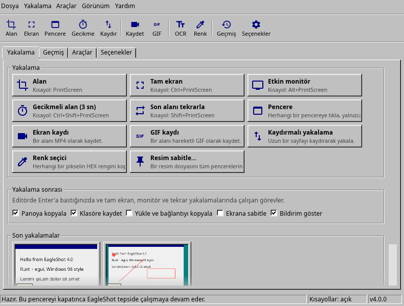
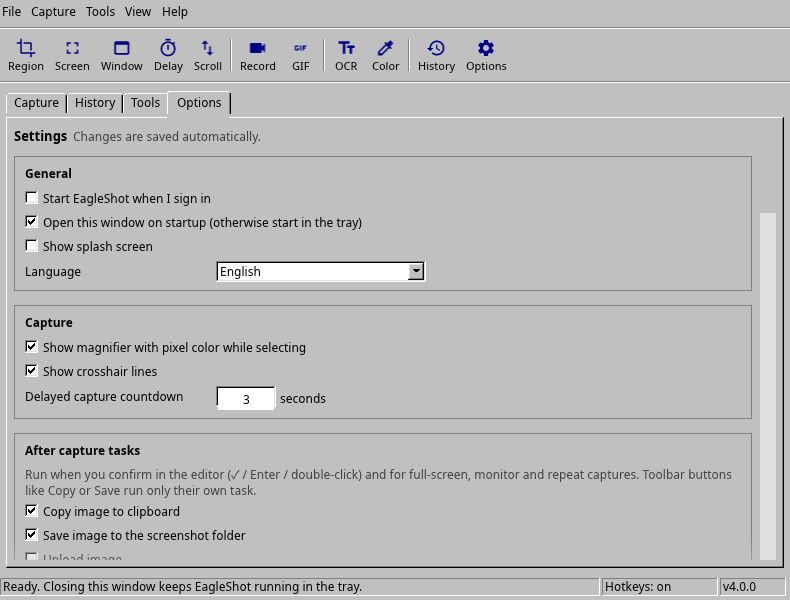
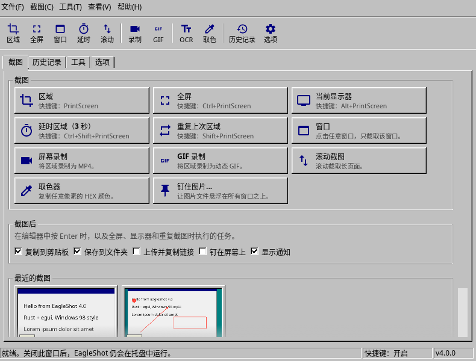
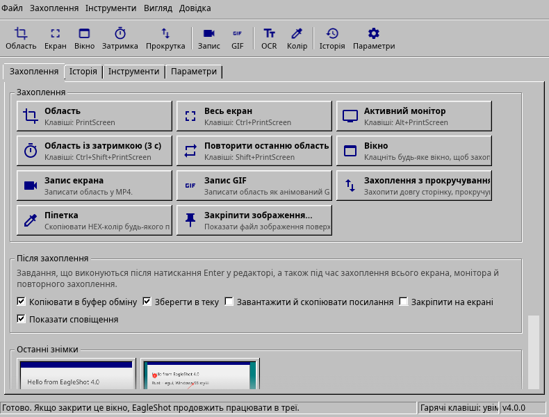

<div align="center">

# EagleShot 🦅

**Windows, macOS ve Linux için ekran görüntüsü, ekran kaydı ve yakalama araçları. Klasik Windows 98 tarzı bir arayüzle.**

[English](README.md) · [Türkçe](README.tr.md) · [简体中文](README.zh-CN.md) · [繁體中文](README.zh-TW.md) · [日本語](README.ja.md) · [한국어](README.ko.md) · [Deutsch](README.de.md) · [Français](README.fr.md) · [Polski](README.pl.md) · [Українська](README.uk.md) · [Русский](README.ru.md)

[**Web sitesi**](https://hhasanguclu.github.io/EagleShot/) · [**İndir**](https://github.com/hhasanguclu/EagleShot/releases/latest) · [Sürümler](https://github.com/hhasanguclu/EagleShot/releases)



<a href="https://hhasanguclu.github.io/EagleShot/#video"></a><br>
<b>▶ <a href="https://hhasanguclu.github.io/EagleShot/#video">Videoyu izle</a></b>

</div>

---

EagleShot ücretsiz ve açık kaynaklı bir ekran görüntüsü aracıdır. Lightshot'ın hızını ShareX tarzı bir iş akışıyla birleştirir: yakalama modları, düzenleme editörü, yakalama sonrası görevler, yükleme, geçmiş ve ekrana sabitleme. Ekranı MP4 veya GIF olarak kaydeder, kaydırmalı sayfaları yakalar, OCR ile metin okur ve QR kod tarar. Arayüzü klasik bir Windows 9x/2000 programına benzer: menü çubuğu, araç çubuğu, sekmeler, 3D butonlar ve durum çubuğu. 11 dilde kullanılabilir.

4.0 sürümünden itibaren EagleShot Rust ile yazılmıştır: kurulacak başka hiçbir şey gerektirmeyen tek, küçük bir program.

## 📸 Ekran görüntüleri

| | |
|---|---|
|  |  |
| **Editör:** alan seç, işaretle (dikdörtgen, ok, adım numarası, metin…), sonra kopyala, kaydet, sabitle ya da yükle | **Menüler** her yakalama modunun kısayolunu gösterir |
|  |  |
| **Araçlar:** kayıt, kaydırmalı yakalama, OCR, QR kod, cetvel, resim birleştirici, hash kontrolü… | Kaydettiğin veya yüklediğin her şeyin **geçmişi** |
|  |  |
| **Seçenekler:** dil, kısayollar, dosya adları, yükleyiciler, resim efektleri, kayıt | **Açılış ekranı** |

| Ekran kaydedici | Bildirim | Hakkında |
|---|---|---|
|  |  |  |

Yukarıdaki görüntüler İngilizce arayüzdendir; uygulama sisteminiz Türkçeyse Türkçe açılır.

## 🌍 Diller

EagleShot sistem dilinizde açılır. Dili **Seçenekler → Genel → Dil** bölümünden değiştirebilirsiniz.

English · Türkçe · 简体中文 · 繁體中文 · 日本語 · 한국어 · Deutsch · Français · Polski · Українська · Русский

| | | |
|---|---|---|
|  |  |  |
|  |  |  |

## 🌟 Özellikler

- **Yakalama modları:**
  - **Alan:** sürükleyerek seç ya da tıklayıp bütün monitörü al
  - **Tam ekran:** tüm monitörler tek seferde
  - **Etkin monitör:** farenin bulunduğu monitör
  - **Pencere:** pencerenin üzerine gel, vurgulansın; tıkla, yakalansın (Windows, macOS, X11)
  - **Gecikmeli alan:** önce geri sayım (varsayılan 3 sn)
  - **Son alanı tekrarla:** aynı alan, editör açılmadan
  - **Kaydırmalı yakalama:** sayfayı ya da belgeyi kaydırıp tek uzun görüntüde birleştirir
  - **Otomatik yakalama:** her N saniyede bir ekran görüntüsü
  - **Renk seçici:** herhangi bir pikselin HEX değerini kopyalar
- **Ekran kaydı:** bir alanı **MP4** veya hareketli **GIF** olarak kaydet (ffmpeg). Alanın yanındaki küçük çubukta Başlat, sayaç, Durdur ve İptal var.
- **Düzenleme editörü:** kalem, işaretleyici, çizgi, ok, dikdörtgen, elips, metin, vurgu, adım numarası, pikselleştirme ve bulanıklaştırma. Geri al/yinele, HEX girişli renk paleti ve 6 çizgi kalınlığı.
- **Yakalama sonrası görevler** (ShareX gibi): kopyala, kaydet, yükle ve bağlantıyı kopyala, ekrana sabitle, bildirim.
- **Her yere yapıştır:** kopyalanan resimler sohbet uygulamalarına, belgelere, Gezgin'e ve terminale yapışır.
- **Ekrana sabitle:** bir görüntüyü tüm pencerelerin üstünde tut. Fare tekerleği yakınlaştırır, Ctrl+tekerlek saydamlığı değiştirir.
- **Yükleme:** Imgur, özel HTTP yükleyici ya da **ShareX `.sxcu` yükleyicileri**. İsteğe bağlı bağlantı kısaltma.
- **Araçlar:**
  - **Metin tanıma (OCR):** ekranın herhangi bir yerindeki metni kopyala (Tesseract, İngilizce + sizin diliniz)
  - **QR kodlar:** QR kod ve barkod tara ya da oluştur
  - **Cetvel**, **resim birleştirici**, **hash kontrolü** (MD5 / SHA), **resim editörü**
- **Resim efektleri:** arka plan ve kenar boşluğu, yuvarlak köşe, gölge, kenarlık ve filigran; canlı önizlemeyle.
- Her işlem için **genel kısayollar**. Windows'ta **PrintScreen, Ekran Alıntısı Aracı yerine EagleShot'ı açar**.
- **Komut satırı:** `eagleshot --region`, `--record`, `--ocr`… çalışan uygulamaya iletilir. Wayland'de kullanışlı.
- Küçük resimli ve aranabilir **geçmiş**, **dosya adı şablonları**, PNG / JPEG / WebP.
- **11 dil**, HiDPI desteği, isterseniz sistemle birlikte başlar.

## ⌨️ Kısayollar

| Genel (varsayılan) | |
|---|---|
| `PrintScreen` (macOS'ta `F12`) | Alan yakala |
| `Ctrl+PrintScreen` | Tam ekran yakala |
| `Alt+PrintScreen` | Etkin monitörü yakala |
| `Shift+PrintScreen` | Son alanı tekrarla |
| `Ctrl+Shift+PrintScreen` | Gecikmeli alan yakalama |
| `Ctrl+Shift+K` | Renk seçici |

| Editörde | |
|---|---|
| `V` `P` `K` `L` `A` `R` `E` `T` `H` `N` `X` `B` | Seç, Kalem, İşaretleyici, Çizgi, Ok, Dikdörtgen, Elips, Metin, Vurgu, Numara, Pikselleştir, Bulanıklaştır |
| `1`–`9` | Paletten renk seç |
| `[` / `]` | İnce / kalın çizgi |
| `F` | Dolguyu aç/kapat |
| `Ctrl+Z` / `Ctrl+Y` | Geri al / Yinele |
| `Ctrl+C` / `Ctrl+S` / `Ctrl+Shift+S` | Kopyala / Hızlı kaydet / Farklı kaydet |
| `Ctrl+U` / `Ctrl+P` | Yükle / Sabitle |
| `Enter` veya çift tık | Bitti (yakalama sonrası görevleri çalıştır) |
| Sağ tık / `Esc` | Seçimi sıfırla / İptal |

## 🖥️ Komut satırı

```bash
eagleshot --region | --fullscreen | --monitor | --window | --delay | --repeat | --color | --show
eagleshot --record | --gif | --scroll | --ocr | --qr | --ruler
eagleshot --editor [resim]      # resmi editörde aç
eagleshot --pin [resim]         # resmi ekrana sabitle
eagleshot --upload <dosyalar…>  # dosyaları yükle
eagleshot --minimized | --quit  # tepside başlat / çalışan EagleShot'ı kapat
```

`--record` ve `--gif` kaydı başlatır; aynı komutu tekrar çalıştırınca durur. EagleShot zaten açıksa komut o örneğe gider.

## 🚀 Kurulum

Sisteminize uygun dosyayı [Sürümler](https://github.com/hhasanguclu/EagleShot/releases/latest) sayfasından indirin.

### Windows

1. `EagleShot_Setup_v4.0.0_win-x64.exe` dosyasını çalıştırın. Kurulum FFmpeg (kayıt) ve Tesseract OCR (metin tanıma) içerir.
2. PrintScreen'in Ekran Alıntısı Aracı yerine EagleShot'ı açması için **"PrintScreen tuşunu EagleShot için kullan"** seçeneğini açık bırakın.
3. SmartScreen uyarı verirse **Ek bilgi → Yine de çalıştır**'a tıklayın (uygulama imzalı değil).

Taşınabilir `.zip` sürümü de var.

### macOS

**En kolayı:** **Terminal**'i açın ve şunu çalıştırın

```bash
curl -fsSL https://hhasanguclu.github.io/EagleShot/install-macos.sh | bash
```

Mac'inize uygun sürümü (Apple Silicon veya Intel) indirir, **Uygulamalar** klasörüne kurar ve güvenlik uyarısı olmadan açar.

**`.dmg` ile:**

1. `.dmg` dosyasını açın ve **EagleShot**'ı **Uygulamalar** klasörüne sürükleyin.
2. EagleShot ücretli bir Apple geliştirici sertifikasıyla imzalanmadığı için macOS uygulamanın "açılamadığını", "doğrulanamadığını" veya "hasarlı" olduğunu söyler ve **Çöp Sepetine Taşı** seçeneğini sunar. **Bitti**'ye tıklayın (Çöp Sepetine Taşı'ya değil), ardından **Sistem Ayarları → Gizlilik ve Güvenlik**'e gidip **Yine de Aç**'a tıklayın. Ya da Terminal'de `xattr -cr /Applications/EagleShot.app` komutunu çalıştırın.
3. **Ekran Kaydı** ve **Erişilebilirlik** (kısayollar için) izinlerini verin.

Kayıt ve OCR için: `brew install ffmpeg tesseract tesseract-lang`

### Linux

```bash
tar xzf EagleShot_v4.0.0_linux-x64.tar.gz
cd EagleShot_v4.0.0_linux-x64
./installers/linux/install.sh
```

- X11 ve Wayland'de (GNOME, KDE) çalışır. Wayland'de ekran görüntüleri xdg-desktop-portal üzerinden alınır, pencereler XWayland ile çalışır.
- Genel kısayollar X11 ya da XWayland odağı gerektirir; saf Wayland'de `eagleshot --region` komutuna bir masaüstü kısayolu atayın.
- Tepsi simgesi StatusNotifierItem kullanır (KDE ve çoğu masaüstü; GNOME'da AppIndicator eklentisini kurun).
- İsteğe bağlı: `ffmpeg` (kayıt, X11), `tesseract-ocr` (metin tanıma), `wl-clipboard` veya `xclip` (pano).

### Kaynaktan derleme

[Rust](https://rustup.rs) 1.85 veya daha yeni bir sürüm gerekir.

```bash
git clone https://github.com/hhasanguclu/EagleShot.git
cd EagleShot
cargo run --release
```

Debian / Ubuntu'da önce derleme paketlerini `./scripts/linux-build-deps.sh` ile kurun. Testleri `cargo test` ile çalıştırın.

## 🎮 Kullanım

1. Açıldığında ana pencere görünür ve EagleShot sistem tepsisine yerleşir.
2. **PrintScreen**'e basın (macOS'ta **F12**), bir yakalama moduna tıklayın ya da tepsi menüsünü kullanın.
3. Sürükleyerek alan seçin (veya bir monitöre tıklayın), tutamaçlarla ayarlayın.
4. Araç çubuğuyla işaretleyin.
5. Yakalama sonrası görevleri çalıştırmak için **Enter**'a basın ya da Kopyala, Kaydet, Yükle veya Sabitle'yi seçin. **Esc** iptal eder.
6. Hepsini daha sonra **Geçmiş** sekmesinde bulabilirsiniz.

## 🛠️ Teknolojiler

| | |
|---|---|
| Dil | Rust |
| Arayüz | egui / eframe, elle çizilmiş klasik Windows teması |
| Ekran yakalama | xcap (Windows, macOS, X11, Wayland portalı) |
| Tepsi / kısayollar | tray-icon, global-hotkey |
| Görüntü işleme | image, tiny-skia, ab_glyph |
| Kayıt / OCR / QR | ffmpeg / Tesseract / qrcode + rxing |
| Çeviriler | `Resources/i18n/*.json` (anahtar İngilizce metindir) |

## 📁 Proje yapısı

```
EagleShot/
├── src/core/              # Yakalama, kayıt, OCR, yükleme, pano, ayarlar, geçmiş (arayüz yok)
├── src/ui/                # Klasik Windows bileşenleri, ana pencere, editör, sabitlenen görüntüler, bildirimler
├── src/app/               # Tepsi, kısayollar, yakalama akışları, yakalama sonrası görevler
├── src/main.rs            # Giriş noktası ve komut satırı
├── Resources/i18n/        # Çeviriler: tr, zh-CN, zh-TW, ja, ko, de, fr, pl, uk, ru
├── vendor/eframe/         # İki küçük yamayla eframe 0.37 (bkz. Cargo.toml)
├── installers/            # Windows (Inno Setup), macOS (.app / .dmg), Linux (install.sh)
├── scripts/               # Linux derleme paketleri, duman testi, Windows araç paketleme
├── tests/                 # Çeviri kapsamı testi
└── docs/                  # Web sitesi (GitHub Pages) ve ekran görüntüleri
```

## 🤝 Çeviriler

Çeviriler `Resources/i18n/<dil>.json` dosyalarındadır. Her dosya İngilizce metni çevirisine eşler. Eksik metinler İngilizce görünür; bir düzeltme ya da yeni bir dil küçük bir pull request ile eklenebilir.

## 📝 Lisans

MIT Lisansı. Ayrıntılar için [LICENSE](LICENSE).
