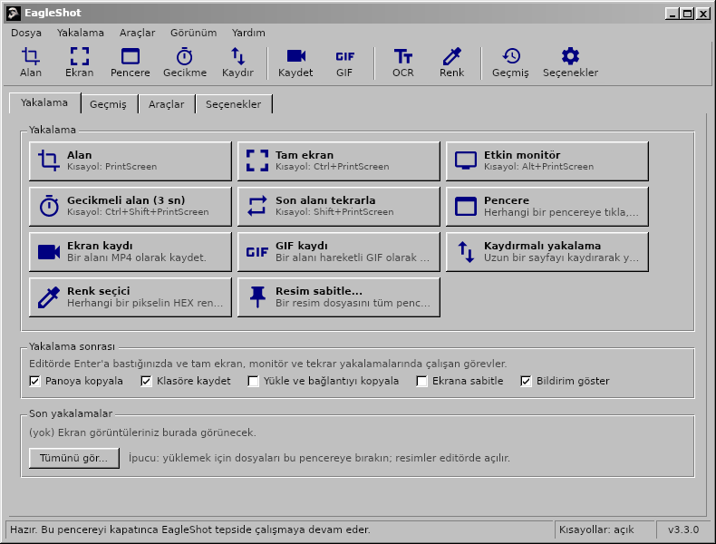
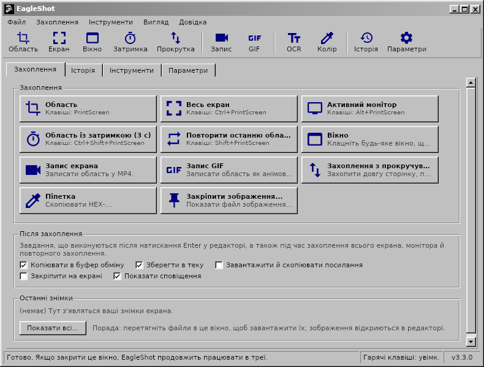

<div align="center">

# EagleShot 🦅

**Windows, macOS ve Linux için ekran görüntüsü, ekran kaydı ve yakalama araçları. Klasik Windows 98 tarzı bir arayüzle.**

[English](README.md) · [Türkçe](README.tr.md) · [简体中文](README.zh-CN.md) · [繁體中文](README.zh-TW.md) · [日本語](README.ja.md) · [한국어](README.ko.md) · [Deutsch](README.de.md) · [Français](README.fr.md) · [Polski](README.pl.md) · [Українська](README.uk.md) · [Русский](README.ru.md)

[**Web sitesi**](https://hhasanguclu.github.io/EagleShot/) · [**İndir**](https://github.com/hhasanguclu/EagleShot/releases/latest) · [Sürümler](https://github.com/hhasanguclu/EagleShot/releases)



</div>

---

EagleShot ücretsiz ve açık kaynaklı bir ekran görüntüsü aracıdır. Lightshot'ın hızını ShareX tarzı bir iş akışıyla birleştirir: yakalama modları, düzenleme editörü, yakalama sonrası görevler, yükleme, geçmiş ve ekrana sabitleme. Ekranı MP4 veya GIF olarak kaydeder, kaydırmalı sayfaları yakalar, OCR ile metin okur ve QR kod tarar. Arayüzü klasik bir Windows 9x/2000 programına benzer: menü çubuğu, araç çubuğu, sekmeler, 3D butonlar ve durum çubuğu. 11 dilde kullanılabilir.

## 📸 Ekran görüntüleri

| | |
|---|---|
|  |  |
| **Editör:** alan seç, işaretle (dikdörtgen, ok, adım numarası, metin…), sonra kopyala, kaydet, sabitle ya da yükle | **Menüler** her yakalama modunun kısayolunu gösterir |
|  |  |
| **Araçlar:** kayıt, kaydırmalı yakalama, OCR, QR kod, cetvel, resim birleştirici, hash kontrolü… | Kaydettiğin veya yüklediğin her şeyin **geçmişi** |
|  |  |
| **Seçenekler:** dil, kısayollar, dosya adları, yükleyiciler, resim efektleri, kayıt | **Açılış ekranı** |

| Ekran kaydedici | Bildirim | Hakkında |
|---|---|---|
|  |  |  |

Yukarıdaki görüntüler İngilizce arayüzdendir; uygulama sisteminiz Türkçeyse Türkçe açılır.

## 🌍 Diller

EagleShot sistem dilinizde açılır. Dili **Seçenekler → Genel → Dil** bölümünden değiştirebilirsiniz.

English · Türkçe · 简体中文 · 繁體中文 · 日本語 · 한국어 · Deutsch · Français · Polski · Українська · Русский

| | | |
|---|---|---|
|  |  |  |
|  |  |  |

## 🌟 Özellikler

- **Yakalama modları:**
  - **Alan:** sürükleyerek seç ya da tıklayıp bütün monitörü al
  - **Tam ekran:** tüm monitörler tek seferde
  - **Etkin monitör:** farenin bulunduğu monitör
  - **Pencere:** pencerenin üzerine gel, vurgulansın; tıkla, yakalansın (Windows, macOS, X11)
  - **Gecikmeli alan:** önce geri sayım (varsayılan 3 sn)
  - **Son alanı tekrarla:** aynı alan, editör açılmadan
  - **Kaydırmalı yakalama:** sayfayı ya da belgeyi kaydırıp tek uzun görüntüde birleştirir
  - **Otomatik yakalama:** her N saniyede bir ekran görüntüsü
  - **Renk seçici:** herhangi bir pikselin HEX değerini kopyalar
- **Ekran kaydı:** bir alanı **MP4** veya hareketli **GIF** olarak kaydet (ffmpeg). Alanın yanındaki küçük çubukta Başlat, sayaç, Durdur ve İptal var.
- **Düzenleme editörü:** kalem, işaretleyici, çizgi, ok, dikdörtgen, elips, metin, vurgu, adım numarası, pikselleştirme ve bulanıklaştırma. Geri al/yinele, HEX girişli renk paleti ve 6 çizgi kalınlığı.
- **Yakalama sonrası görevler** (ShareX gibi): kopyala, kaydet, yükle ve bağlantıyı kopyala, ekrana sabitle, bildirim.
- **Her yere yapıştır:** kopyalanan resimler sohbet uygulamalarına, belgelere, Gezgin'e ve terminale yapışır.
- **Ekrana sabitle:** bir görüntüyü tüm pencerelerin üstünde tut. Fare tekerleği yakınlaştırır, Ctrl+tekerlek saydamlığı değiştirir.
- **Yükleme:** Imgur, özel HTTP yükleyici ya da **ShareX `.sxcu` yükleyicileri**. İsteğe bağlı bağlantı kısaltma.
- **Araçlar:**
  - **Metin tanıma (OCR):** ekranın herhangi bir yerindeki metni kopyala (Tesseract, İngilizce + sizin diliniz)
  - **QR kodlar:** QR kod ve barkod tara ya da oluştur
  - **Cetvel**, **resim birleştirici**, **hash kontrolü** (MD5 / SHA), **resim editörü**
- **Resim efektleri:** arka plan ve kenar boşluğu, yuvarlak köşe, gölge, kenarlık ve filigran; canlı önizlemeyle.
- Her işlem için **genel kısayollar**. Windows'ta **PrintScreen, Ekran Alıntısı Aracı yerine EagleShot'ı açar**.
- **Komut satırı:** `eagleshot --region`, `--record`, `--ocr`… çalışan uygulamaya iletilir. Wayland'de kullanışlı.
- Küçük resimli ve aranabilir **geçmiş**, **dosya adı şablonları**, PNG / JPEG / WebP.
- **11 dil**, HiDPI desteği, isterseniz sistemle birlikte başlar.

## ⌨️ Kısayollar

| Genel (varsayılan) | |
|---|---|
| `PrintScreen` (macOS'ta `F12`) | Alan yakala |
| `Ctrl+PrintScreen` | Tam ekran yakala |
| `Alt+PrintScreen` | Etkin monitörü yakala |
| `Shift+PrintScreen` | Son alanı tekrarla |
| `Ctrl+Shift+PrintScreen` | Gecikmeli alan yakalama |
| `Ctrl+Shift+K` | Renk seçici |

| Editörde | |
|---|---|
| `V` `P` `K` `L` `A` `R` `E` `T` `H` `N` `X` `B` | Seç, Kalem, İşaretleyici, Çizgi, Ok, Dikdörtgen, Elips, Metin, Vurgu, Numara, Pikselleştir, Bulanıklaştır |
| `1`–`9` | Paletten renk seç |
| `[` / `]` | İnce / kalın çizgi |
| `F` | Dolguyu aç/kapat |
| `Ctrl+Z` / `Ctrl+Y` | Geri al / Yinele |
| `Ctrl+C` / `Ctrl+S` / `Ctrl+Shift+S` | Kopyala / Hızlı kaydet / Farklı kaydet |
| `Ctrl+U` / `Ctrl+P` | Yükle / Sabitle |
| `Enter` veya çift tık | Bitti (yakalama sonrası görevleri çalıştır) |
| Sağ tık / `Esc` | Seçimi sıfırla / İptal |

## 🖥️ Komut satırı

```bash
eagleshot --region | --fullscreen | --monitor | --window | --delay | --repeat | --color | --show
eagleshot --record | --gif | --scroll | --ocr | --qr | --ruler
eagleshot --editor [resim]      # resmi editörde aç
eagleshot --upload <dosyalar…>  # dosyaları yükle
```

`--record` ve `--gif` kaydı başlatır; aynı komutu tekrar çalıştırınca durur. EagleShot zaten açıksa komut o örneğe gider.

## 🚀 Kurulum

Sisteminize uygun dosyayı [Sürümler](https://github.com/hhasanguclu/EagleShot/releases/latest) sayfasından indirin.

### Windows

1. `EagleShot_Setup_v3.3.0_win-x64.exe` dosyasını çalıştırın. Kurulum FFmpeg (kayıt) ve Tesseract OCR (metin tanıma) içerir.
2. PrintScreen'in Ekran Alıntısı Aracı yerine EagleShot'ı açması için **"PrintScreen tuşunu EagleShot için kullan"** seçeneğini açık bırakın.
3. SmartScreen uyarı verirse **Ek bilgi → Yine de çalıştır**'a tıklayın (uygulama imzalı değil).

Taşınabilir `.zip` sürümü de var.

### macOS

1. `.dmg` dosyasını (Apple Silicon veya Intel) açın ve **EagleShot**'ı **Uygulamalar** klasörüne sürükleyin.
2. İlk açılışta EagleShot'a sağ tıklayıp **Aç**'ı seçin. macOS 15 ve sonrasında **Sistem Ayarları → Gizlilik ve Güvenlik → Yine de Aç**.
3. **Ekran Kaydı** ve **Erişilebilirlik** (kısayollar için) izinlerini verin.
4. macOS uygulamanın "hasarlı" olduğunu söylerse: `xattr -cr /Applications/EagleShot.app`

Kayıt ve OCR için: `brew install ffmpeg tesseract tesseract-lang`

### Linux

```bash
tar xzf EagleShot_v3.3.0_linux-x64.tar.gz
cd EagleShot_v3.3.0_linux-x64
./installers/linux/install.sh
```

- Ekran yakalama: `scrot`, `maim` veya ImageMagick (X11). Wayland'de EagleShot xdg-desktop-portal (GNOME, KDE) ya da `grim` / `gnome-screenshot` kullanır.
- Pano: `xclip` (X11) veya `wl-clipboard` (Wayland)
- İsteğe bağlı: `ffmpeg` (kayıt, X11) ve `tesseract-ocr` (metin tanıma)

### Kaynaktan derleme

```bash
git clone https://github.com/hhasanguclu/EagleShot.git
cd EagleShot
dotnet run
```

Tüm platformları tek seferde derlemek için `./scripts/build-all.ps1` (PowerShell) veya `./scripts/build-all.sh` (Bash).

## 🎮 Kullanım

1. Açıldığında ana pencere görünür ve EagleShot sistem tepsisine yerleşir.
2. **PrintScreen**'e basın (macOS'ta **F12**), bir yakalama moduna tıklayın ya da tepsi menüsünü kullanın.
3. Sürükleyerek alan seçin (veya bir monitöre tıklayın), tutamaçlarla ayarlayın.
4. Araç çubuğuyla işaretleyin.
5. Yakalama sonrası görevleri çalıştırmak için **Enter**'a basın ya da Kopyala, Kaydet, Yükle veya Sabitle'yi seçin. **Esc** iptal eder.
6. Hepsini daha sonra **Geçmiş** sekmesinde bulabilirsiniz.

## 🛠️ Teknolojiler

| | |
|---|---|
| Dil | C# / .NET 9 |
| Arayüz | Avalonia UI 11.2, özel klasik Windows teması |
| Genel kısayollar | SharpHook |
| Görüntü işleme | SkiaSharp |
| Kayıt / OCR / QR | ffmpeg / Tesseract / QRCoder + ZXing.Net |
| Çeviriler | `Resources/i18n/*.json` (anahtar İngilizce metindir) |

## 📁 Proje yapısı

```
EagleShot/
├── Core/                  # Yakalama, kayıt, OCR, yükleme, kısayollar, ayarlar, çeviri
├── Views/                 # Ana pencere, editör, ayarlar, araçlar, bildirimler
├── Styles/                # Classic.axaml (klasik Windows teması), AppStyles.axaml (renkler, simgeler)
├── Resources/i18n/        # Çeviriler: tr, zh-CN, zh-TW, ja, ko, de, fr, pl, uk, ru
├── installers/            # Windows (Inno Setup), macOS (.app / .dmg), Linux (install.sh)
├── scripts/               # Derleme betikleri, Windows araç paketleme
├── docs/                  # Web sitesi (GitHub Pages) ve ekran görüntüleri
├── App.axaml(.cs)         # Uygulama girişi, tepsi, komutlar
└── Program.cs             # Ana giriş noktası
```

## 🤝 Çeviriler

Çeviriler `Resources/i18n/<dil>.json` dosyalarındadır. Her dosya İngilizce metni çevirisine eşler. Eksik metinler İngilizce görünür; bir düzeltme ya da yeni bir dil küçük bir pull request ile eklenebilir.

## 📝 Lisans

MIT Lisansı.
