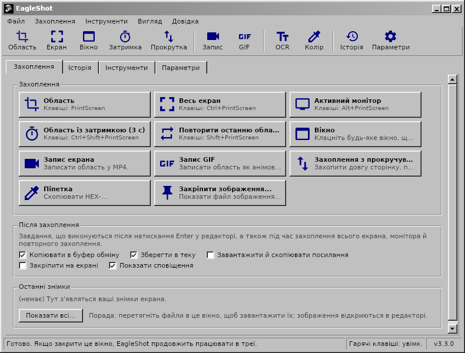
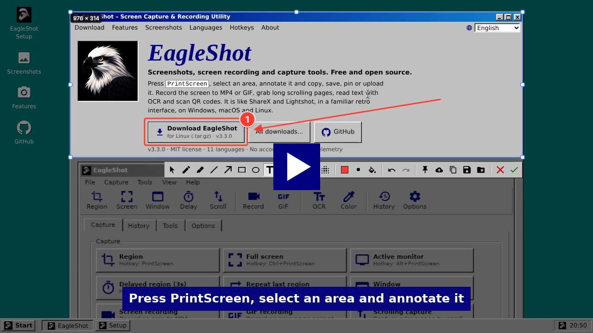
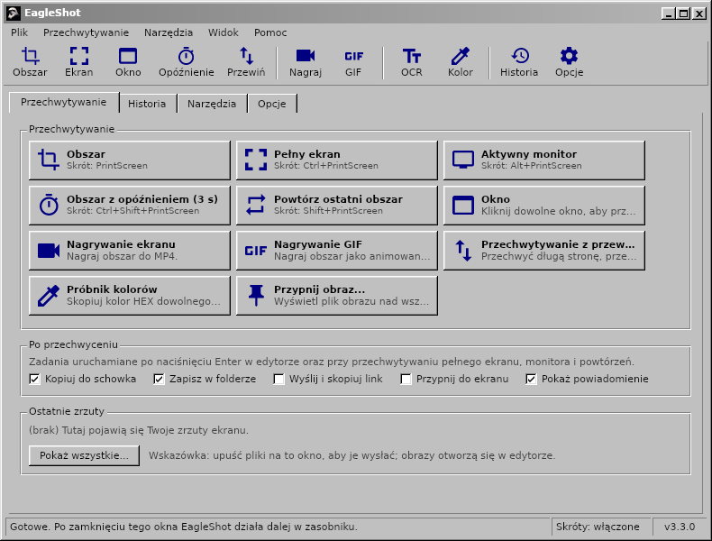

<div align="center">

# EagleShot 🦅

**Знімки екрана, запис екрана та інструменти захоплення для Windows, macOS і Linux — у класичному інтерфейсі в стилі Windows 98.**

[English](README.md) · [Türkçe](README.tr.md) · [简体中文](README.zh-CN.md) · [繁體中文](README.zh-TW.md) · [日本語](README.ja.md) · [한국어](README.ko.md) · [Deutsch](README.de.md) · [Français](README.fr.md) · [Polski](README.pl.md) · [Українська](README.uk.md) · [Русский](README.ru.md)

[**Сайт**](https://hhasanguclu.github.io/EagleShot/) · [**Завантажити**](https://github.com/hhasanguclu/EagleShot/releases/latest) · [Релізи](https://github.com/hhasanguclu/EagleShot/releases)



<a href="https://hhasanguclu.github.io/EagleShot/#video"></a><br>
<b>▶ <a href="https://hhasanguclu.github.io/EagleShot/#video">Дивитися відео</a></b>

</div>

---

EagleShot — безкоштовна програма з відкритим кодом для знімків екрана. Вона поєднує швидкість Lightshot із підходом ShareX: режими захоплення, редактор позначок, завдання після захоплення, завантаження, історія та закріплені знімки. Вона також записує екран у MP4 або GIF, захоплює сторінки з прокручуванням, розпізнає текст (OCR) і сканує QR-коди. Інтерфейс схожий на класичну програму Windows 9x/2000: рядок меню, панель інструментів, вкладки, об'ємні кнопки й рядок стану. Доступна 11 мовами.

## 📸 Знімки екрана

| | |
|---|---|
|  |  |
| **Редактор:** виділіть область, додайте позначки (прямокутник, стрілка, номери кроків, текст…), потім скопіюйте, збережіть, закріпіть або завантажте | **Меню** показують гарячу клавішу кожного режиму захоплення |
|  |  |
| **Інструменти:** запис, захоплення з прокручуванням, OCR, QR-коди, лінійка, об'єднання зображень, перевірка хешу… | **Історія** всього, що ви зберегли чи завантажили |
|  |  |
| **Параметри:** мова, гарячі клавіші, назви файлів, завантажувачі, ефекти зображення, запис | **Заставка** |

| Запис екрана | Сповіщення | Про програму |
|---|---|---|
|  |  |  |

На цих зображеннях англійський інтерфейс; в українській системі EagleShot запускається українською.

## 🌍 Мови

EagleShot запускається мовою вашої системи. Змінити її можна в **Параметри → Загальні → Мова**.

English · Türkçe · 简体中文 · 繁體中文 · 日本語 · 한국어 · Deutsch · Français · Polski · Українська · Русский

| | | |
|---|---|---|
|  |  |  |
|  |  |  |

## 🌟 Можливості

- **Режими захоплення:**
  - **Область:** виділіть мишею або клацніть, щоб захопити весь монітор
  - **Весь екран:** усі монітори одразу
  - **Активний монітор:** монітор під вказівником
  - **Вікно:** наведіть на вікно, щоб підсвітити його, клацніть, щоб захопити (Windows, macOS, X11)
  - **Область із затримкою:** спочатку зворотний відлік (типово 3 с)
  - **Повторити останню область:** та сама область без редактора
  - **Захоплення з прокручуванням:** прокручує сторінку чи документ і склеює в одне довге зображення
  - **Автозахоплення:** знімок кожні N секунд
  - **Піпетка:** копіює HEX-колір будь-якого пікселя
- **Запис екрана:** запишіть область у **MP4** або анімований **GIF** (ffmpeg). Невелика панель поруч з областю містить «Старт», таймер, «Стоп» і «Скасувати».
- **Редактор позначок:** перо, маркер, лінія, стрілка, прямокутник, еліпс, текст, виділення, номери кроків, пікселізація й розмиття. Скасування/повтор, палітра з полем HEX і 6 товщин лінії.
- **Завдання після захоплення** (як у ShareX): копіювати, зберегти, завантажити й скопіювати посилання, закріпити, сповіщення.
- **Вставляйте будь-куди:** скопійовані зображення вставляються в месенджери, документи, Провідник і термінали.
- **Закріпити на екрані:** знімок тримається поверх усіх вікон. Коліщатко масштабує, Ctrl+коліщатко змінює прозорість.
- **Завантаження:** Imgur, власний HTTP-завантажувач або **завантажувачі ShareX `.sxcu`**. Скорочення посилань за бажанням.
- **Інструменти:**
  - **Розпізнавання тексту (OCR):** копіюйте текст із будь-якої частини екрана (Tesseract, англійська + ваша мова)
  - **QR-коди:** скануйте QR-коди й штрихкоди або створюйте їх
  - **Лінійка**, **об'єднання зображень**, **перевірка хешу** (MD5 / SHA), **редактор зображень**
- **Ефекти зображення:** фон і відступ, заокруглені кути, тінь, рамка й водяний знак із живим попереднім переглядом.
- **Глобальні гарячі клавіші** для кожної дії. У Windows **PrintScreen відкриває EagleShot замість «Ножиць»**.
- **Командний рядок:** `eagleshot --region`, `--record`, `--ocr`… передаються запущеній програмі. Зручно у Wayland.
- **Історія** з мініатюрами й пошуком, **шаблони назв файлів**, PNG / JPEG / WebP.
- **11 мов**, підтримка HiDPI, автозапуск із системою за бажанням.

## ⌨️ Гарячі клавіші

| Глобальні (типово) | |
|---|---|
| `PrintScreen` (`F12` у macOS) | Захопити область |
| `Ctrl+PrintScreen` | Захопити весь екран |
| `Alt+PrintScreen` | Захопити активний монітор |
| `Shift+PrintScreen` | Повторити останню область |
| `Ctrl+Shift+PrintScreen` | Область із затримкою |
| `Ctrl+Shift+K` | Піпетка |

| У редакторі | |
|---|---|
| `V` `P` `K` `L` `A` `R` `E` `T` `H` `N` `X` `B` | Вибір, Перо, Маркер, Лінія, Стрілка, Прямокутник, Еліпс, Текст, Виділення, Номер, Пікселізація, Розмиття |
| `1`–`9` | Колір із палітри |
| `[` / `]` | Тонша / товща лінія |
| `F` | Заливка увімк./вимк. |
| `Ctrl+Z` / `Ctrl+Y` | Скасувати / Повторити |
| `Ctrl+C` / `Ctrl+S` / `Ctrl+Shift+S` | Копіювати / Швидко зберегти / Зберегти як |
| `Ctrl+U` / `Ctrl+P` | Завантажити / Закріпити |
| `Enter` або подвійне клацання | Готово (виконати завдання після захоплення) |
| Правий клік / `Esc` | Скинути виділення / Скасувати |

## 🖥️ Командний рядок

```bash
eagleshot --region | --fullscreen | --monitor | --window | --delay | --repeat | --color | --show
eagleshot --record | --gif | --scroll | --ocr | --qr | --ruler
eagleshot --editor [зображення]   # відкрити зображення в редакторі
eagleshot --upload <файли…>       # завантажити файли
```

`--record` і `--gif` починають запис; та сама команда його зупиняє. Якщо EagleShot уже запущено, команда передається йому.

## 🚀 Встановлення

Завантажте файл для своєї системи на сторінці [Релізи](https://github.com/hhasanguclu/EagleShot/releases/latest).

### Windows

1. Запустіть `EagleShot_Setup_v3.3.0_win-x64.exe`. Інсталятор містить FFmpeg (запис) і Tesseract OCR (розпізнавання тексту).
2. Залиште ввімкненим **«Використовувати клавішу PrintScreen для EagleShot»**, щоб клавіша відкривала EagleShot замість «Ножиць».
3. Якщо SmartScreen попереджає, натисніть **Докладніше → Усе одно запустити** (застосунок не підписаний).

Є також портативна версія `.zip`.

### macOS

1. Відкрийте `.dmg` (Apple Silicon або Intel) і перетягніть **EagleShot** у **Програми**.
2. Перший запуск: правий клік на EagleShot → **Відкрити**. У macOS 15 і новіших: **Системні параметри → Приватність і безпека → Усе одно відкрити**.
3. Дозвольте **Запис екрана** та **Доступність** (для гарячих клавіш).
4. Якщо macOS повідомляє, що застосунок «пошкоджений»: `xattr -cr /Applications/EagleShot.app`

Для запису й OCR: `brew install ffmpeg tesseract tesseract-lang`

### Linux

```bash
tar xzf EagleShot_v3.3.0_linux-x64.tar.gz
cd EagleShot_v3.3.0_linux-x64
./installers/linux/install.sh
```

- Захоплення екрана: `scrot`, `maim` або ImageMagick (X11). У Wayland EagleShot використовує xdg-desktop-portal (GNOME, KDE) або `grim` / `gnome-screenshot`.
- Буфер обміну: `xclip` (X11) або `wl-clipboard` (Wayland)
- Необов'язково: `ffmpeg` (запис, X11) і `tesseract-ocr` (розпізнавання тексту)

### Збирання з вихідного коду

```bash
git clone https://github.com/hhasanguclu/EagleShot.git
cd EagleShot
dotnet run
```

Зібрати всі платформи одразу: `./scripts/build-all.ps1` (PowerShell) або `./scripts/build-all.sh` (Bash).

## 🎮 Використання

1. Після запуску відкривається головне вікно, а EagleShot з'являється в треї.
2. Натисніть **PrintScreen** (**F12** у macOS), виберіть режим захоплення або скористайтеся меню в треї.
3. Виділіть область мишею (або клацніть монітор) і підправте її маркерами.
4. Додайте позначки за допомогою панелі інструментів.
5. Натисніть **Enter**, щоб виконати завдання після захоплення, або виберіть «Копіювати», «Зберегти», «Завантажити» чи «Закріпити». **Esc** — скасування.
6. Усе збережене знайдете на вкладці **Історія**.

## 🛠️ Технології

| | |
|---|---|
| Мова | C# / .NET 9 |
| Інтерфейс | Avalonia UI 11.2 із власною класичною темою Windows |
| Глобальні клавіші | SharpHook |
| Зображення | SkiaSharp |
| Запис / OCR / QR | ffmpeg / Tesseract / QRCoder + ZXing.Net |
| Переклади | `Resources/i18n/*.json` (ключ — англійський текст) |

## 📁 Структура проєкту

```
EagleShot/
├── Core/                  # Захоплення, запис, OCR, завантаження, гарячі клавіші, налаштування, переклади
├── Views/                 # Головне вікно, редактор, налаштування, інструменти, сповіщення
├── Styles/                # Classic.axaml (класична тема Windows), AppStyles.axaml (кольори, значки)
├── Resources/i18n/        # Переклади: tr, zh-CN, zh-TW, ja, ko, de, fr, pl, uk, ru
├── installers/            # Windows (Inno Setup), macOS (.app / .dmg), Linux (install.sh)
├── scripts/               # Скрипти збирання, пакування інструментів для Windows
├── docs/                  # Сайт (GitHub Pages) і знімки екрана
├── App.axaml(.cs)         # Запуск застосунку, трей, команди
└── Program.cs             # Точка входу
```

## 🤝 Переклади

Переклади зберігаються в `Resources/i18n/<мова>.json`. Кожен файл зіставляє англійському тексту переклад. Відсутні рядки показуються англійською; виправлення чи нова мова — це невеликий pull request.

## 📝 Ліцензія

Ліцензія MIT.
