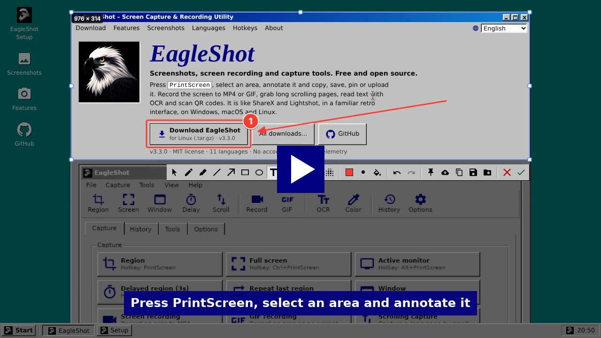
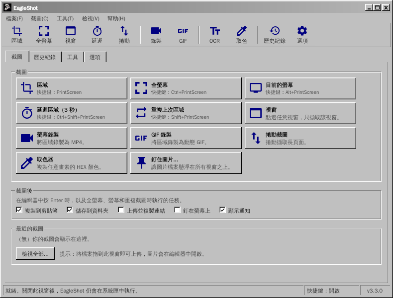
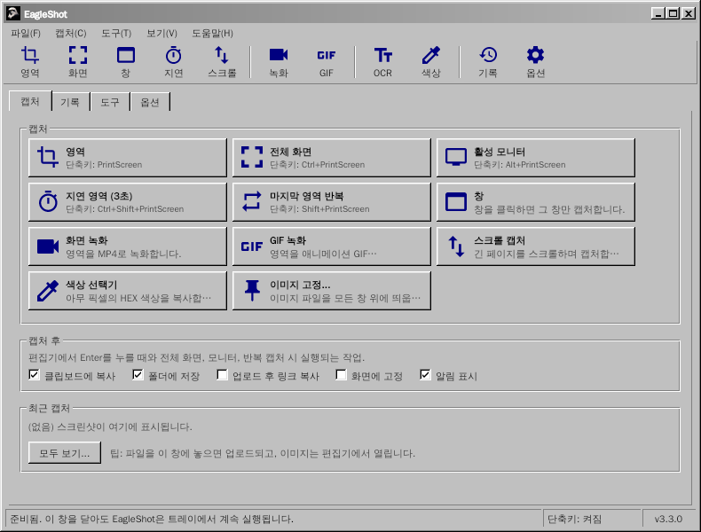

<div align="center">

# EagleShot 🦅

**适用于 Windows、macOS 和 Linux 的截图、录屏与截图工具，采用经典 Windows 98 风格界面。**

[English](README.md) · [Türkçe](README.tr.md) · [简体中文](README.zh-CN.md) · [繁體中文](README.zh-TW.md) · [日本語](README.ja.md) · [한국어](README.ko.md) · [Deutsch](README.de.md) · [Français](README.fr.md) · [Polski](README.pl.md) · [Українська](README.uk.md) · [Русский](README.ru.md)

[**网站**](https://hhasanguclu.github.io/EagleShot/) · [**下载**](https://github.com/hhasanguclu/EagleShot/releases/latest) · [版本发布](https://github.com/hhasanguclu/EagleShot/releases)


<a href="https://hhasanguclu.github.io/EagleShot/#video"></a><br>
<b>▶ <a href="https://hhasanguclu.github.io/EagleShot/#video">观看视频</a></b>

</div>

---

EagleShot 是一款免费开源的截图工具。它兼具 Lightshot 的速度和 ShareX 式的工作流程：多种截图模式、标注编辑器、截图后任务、上传、历史记录和钉图。它还能把屏幕录制为 MP4 或 GIF，截取滚动页面，用 OCR 识别文字，并扫描二维码。界面就像经典的 Windows 9x/2000 程序：菜单栏、工具栏、选项卡、立体按钮和状态栏。支持 11 种语言。

## 📸 截图

| | |
|---|---|
|  |  |
| **编辑器：** 选择区域并标注（矩形、箭头、步骤编号、文字…），然后复制、保存、钉住或上传 | **菜单**中显示每种截图模式的快捷键 |
|  |  |
| **工具：** 录屏、滚动截图、OCR、二维码、标尺、图片拼接、哈希校验… | 你保存或上传过的所有内容的**历史记录** |
|  |  |
| **选项：** 语言、快捷键、文件名、上传服务、图片效果、录制 | **启动画面** |

| 屏幕录制器 | 通知 | 关于 |
|---|---|---|
|  |  |  |

以上图片为英文界面；在中文系统上，EagleShot 会以中文启动。

## 🌍 语言

EagleShot 会以系统语言启动。可在 **选项 → 常规 → 语言** 中更改。

English · Türkçe · 简体中文 · 繁體中文 · 日本語 · 한국어 · Deutsch · Français · Polski · Українська · Русский

| | | |
|---|---|---|
|  |  |  |
|  |  |  |

## 🌟 功能

- **截图模式：**
  - **区域：** 拖动选择，或点击截取整个显示器
  - **全屏：** 一次截取所有显示器
  - **当前显示器：** 鼠标所在的显示器
  - **窗口：** 鼠标悬停高亮窗口，点击即可截取（Windows、macOS、X11）
  - **延时区域：** 先倒计时（默认 3 秒）
  - **重复上次区域：** 不打开编辑器，直接截取相同区域
  - **滚动截图：** 自动滚动页面或文档，拼接成一张长图
  - **自动截图：** 每隔 N 秒截一张图
  - **取色器：** 复制任意像素的 HEX 值
- **屏幕录制：** 将区域录制为 **MP4** 或动态 **GIF**（ffmpeg）。区域旁的小工具条提供开始、计时、停止和取消。
- **标注编辑器：** 画笔、荧光笔、直线、箭头、矩形、椭圆、文字、高亮、步骤编号、马赛克和模糊。支持撤销/重做、带 HEX 输入的调色板和 6 种线条粗细。
- **截图后任务**（类似 ShareX）：复制、保存、上传并复制链接、钉在屏幕上、通知。
- **随处粘贴：** 复制的图片可以粘贴到聊天软件、文档、资源管理器和终端中。
- **钉在屏幕上：** 让截图悬浮在所有窗口之上。滚轮缩放，Ctrl+滚轮调整不透明度。
- **上传：** Imgur、自定义 HTTP 上传，或 **ShareX `.sxcu` 上传器**。可选缩短链接。
- **工具：**
  - **文字识别 (OCR)：** 从屏幕任意位置复制文字（Tesseract，英语 + 你的语言）
  - **二维码：** 扫描或生成二维码和条形码
  - **标尺**、**图片拼接**、**哈希校验**（MD5 / SHA）、**图片编辑器**
- **图片效果：** 背景和边距、圆角、阴影、边框和水印，带实时预览。
- 每个操作都可设置**全局快捷键**。在 Windows 上，**PrintScreen 键会打开 EagleShot 而不是截图工具**。
- **命令行：** `eagleshot --region`、`--record`、`--ocr` 等会发送给正在运行的程序。适合 Wayland。
- 带缩略图和搜索的**历史记录**、**文件名模板**、PNG / JPEG / WebP。
- **11 种语言**、支持 HiDPI、可选开机启动。

## ⌨️ 快捷键

| 全局（默认） | |
|---|---|
| `PrintScreen`（macOS 为 `F12`） | 区域截图 |
| `Ctrl+PrintScreen` | 全屏截图 |
| `Alt+PrintScreen` | 截取当前显示器 |
| `Shift+PrintScreen` | 重复上次区域 |
| `Ctrl+Shift+PrintScreen` | 延时区域截图 |
| `Ctrl+Shift+K` | 取色器 |

| 编辑器中 | |
|---|---|
| `V` `P` `K` `L` `A` `R` `E` `T` `H` `N` `X` `B` | 选择、画笔、荧光笔、直线、箭头、矩形、椭圆、文字、高亮、编号、马赛克、模糊 |
| `1`–`9` | 选择调色板颜色 |
| `[` / `]` | 线条变细 / 变粗 |
| `F` | 切换填充 |
| `Ctrl+Z` / `Ctrl+Y` | 撤销 / 重做 |
| `Ctrl+C` / `Ctrl+S` / `Ctrl+Shift+S` | 复制 / 快速保存 / 另存为 |
| `Ctrl+U` / `Ctrl+P` | 上传 / 钉住 |
| `Enter` 或双击 | 完成（执行截图后任务） |
| 右键 / `Esc` | 重置选区 / 取消 |

## 🖥️ 命令行

```bash
eagleshot --region | --fullscreen | --monitor | --window | --delay | --repeat | --color | --show
eagleshot --record | --gif | --scroll | --ocr | --qr | --ruler
eagleshot --editor [图片]       # 在编辑器中打开图片
eagleshot --upload <文件…>      # 上传文件
```

`--record` 和 `--gif` 开始录制，再次运行同一命令即停止。如果 EagleShot 已在运行，命令会发送给该实例。

## 🚀 安装

在 [版本发布](https://github.com/hhasanguclu/EagleShot/releases/latest) 页面下载适合你系统的文件。

### Windows

1. 运行 `EagleShot_Setup_v3.3.0_win-x64.exe`。安装程序已包含 FFmpeg（录屏）和 Tesseract OCR（文字识别）。
2. 保持勾选 **“将 PrintScreen 键用于 EagleShot”**，这样按 PrintScreen 会打开 EagleShot 而不是截图工具。
3. 如果 SmartScreen 发出警告，点击 **更多信息 → 仍要运行**（程序未签名）。

也提供便携版 `.zip`。

### macOS

1. 打开 `.dmg`（Apple Silicon 或 Intel），将 **EagleShot** 拖到 **应用程序** 中。
2. 首次启动：右键点击 EagleShot → **打开**。macOS 15 及以上：**系统设置 → 隐私与安全性 → 仍要打开**。
3. 授予 **屏幕录制** 和 **辅助功能**（用于快捷键）权限。
4. 如果 macOS 提示应用“已损坏”：`xattr -cr /Applications/EagleShot.app`

录屏和 OCR 需要：`brew install ffmpeg tesseract tesseract-lang`

### Linux

```bash
tar xzf EagleShot_v3.3.0_linux-x64.tar.gz
cd EagleShot_v3.3.0_linux-x64
./installers/linux/install.sh
```

- 截图：`scrot`、`maim` 或 ImageMagick（X11）。在 Wayland 下，EagleShot 使用 xdg-desktop-portal（GNOME、KDE）或 `grim` / `gnome-screenshot`。
- 剪贴板：`xclip`（X11）或 `wl-clipboard`（Wayland）
- 可选：`ffmpeg`（录屏，X11）和 `tesseract-ocr`（文字识别）

### 从源码构建

```bash
git clone https://github.com/hhasanguclu/EagleShot.git
cd EagleShot
dotnet run
```

一次构建所有平台：`./scripts/build-all.ps1`（PowerShell）或 `./scripts/build-all.sh`（Bash）。

## 🎮 使用方法

1. 启动后会打开主窗口，EagleShot 常驻系统托盘。
2. 按 **PrintScreen**（macOS 为 **F12**），点击一种截图模式，或使用托盘菜单。
3. 拖动选择区域（或点击某个显示器），用控制点调整。
4. 用工具栏进行标注。
5. 按 **Enter** 执行截图后任务，或选择复制、保存、上传、钉住。**Esc** 取消。
6. 之后可以在 **历史记录** 选项卡中找到所有内容。

## 🛠️ 技术栈

| | |
|---|---|
| 语言 | C# / .NET 9 |
| 界面 | Avalonia UI 11.2 + 自制经典 Windows 主题 |
| 全局快捷键 | SharpHook |
| 图像处理 | SkiaSharp |
| 录屏 / OCR / 二维码 | ffmpeg / Tesseract / QRCoder + ZXing.Net |
| 翻译 | `Resources/i18n/*.json`（键为英文原文） |

## 📁 项目结构

```
EagleShot/
├── Core/                  # 截图、录屏、OCR、上传、快捷键、设置、本地化
├── Views/                 # 主窗口、编辑器、设置、工具、通知
├── Styles/                # Classic.axaml（经典 Windows 主题）、AppStyles.axaml（颜色、图标）
├── Resources/i18n/        # 翻译：tr, zh-CN, zh-TW, ja, ko, de, fr, pl, uk, ru
├── installers/            # Windows (Inno Setup)、macOS (.app / .dmg)、Linux (install.sh)
├── scripts/               # 构建脚本、Windows 工具打包
├── docs/                  # 网站（GitHub Pages）和截图
├── App.axaml(.cs)         # 程序入口、托盘、命令
└── Program.cs             # 主入口
```

## 🤝 翻译

翻译文件位于 `Resources/i18n/<语言>.json`，每个文件把英文原文映射到译文。缺少的条目会显示英文，所以修正翻译或新增语言只需一个小小的 Pull Request。

## 📝 许可证

MIT 许可证。
