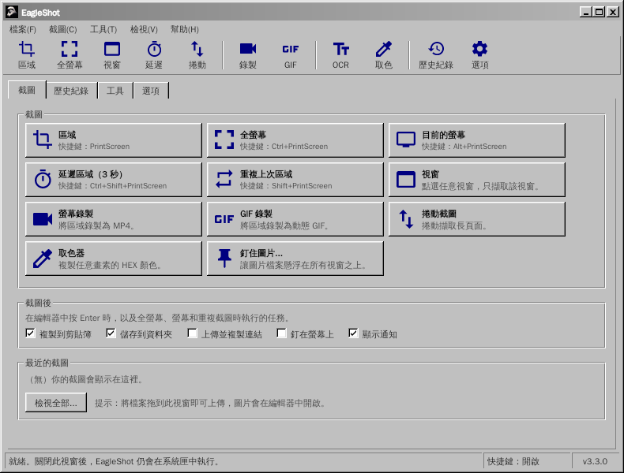
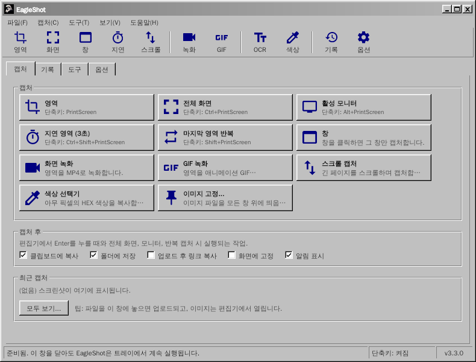

<div align="center">

# EagleShot 🦅

**適用於 Windows、macOS 和 Linux 的截圖、錄影與截圖工具，採用經典 Windows 98 風格介面。**

[English](README.md) · [Türkçe](README.tr.md) · [简体中文](README.zh-CN.md) · [繁體中文](README.zh-TW.md) · [日本語](README.ja.md) · [한국어](README.ko.md) · [Deutsch](README.de.md) · [Français](README.fr.md) · [Polski](README.pl.md) · [Українська](README.uk.md) · [Русский](README.ru.md)

[**網站**](https://hhasanguclu.github.io/EagleShot/) · [**下載**](https://github.com/hhasanguclu/EagleShot/releases/latest) · [版本釋出](https://github.com/hhasanguclu/EagleShot/releases)



</div>

---

EagleShot 是一款免費開源的截圖工具。它兼具 Lightshot 的速度和 ShareX 式的工作流程：多種截圖模式、標註編輯器、截圖後任務、上傳、歷史紀錄和釘圖。它還能把螢幕錄製為 MP4 或 GIF，擷取捲動頁面，用 OCR 辨識文字，並掃描 QR 碼。介面就像經典的 Windows 9x/2000 程式：選單欄、工具欄、選項卡、立體按鈕和狀態列。支援 11 種語言。

## 📸 截圖

| | |
|---|---|
|  |  |
| **編輯器：** 選擇區域並標註（矩形、箭頭、步驟編號、文字…），然後複製、儲存、釘住或上傳 | **選單**中顯示每種截圖模式的快捷鍵 |
|  |  |
| **工具：** 錄影、捲動截圖、OCR、 QR 碼、標尺、圖片合併、雜湊校驗… | 你儲存或上傳過的所有內容的**歷史紀錄** |
|  |  |
| **選項：** 語言、快捷鍵、檔名、上傳服務、圖片效果、錄製 | **啟動畫面** |

| 螢幕錄製器 | 通知 | 關於 |
|---|---|---|
|  |  |  |

以上圖片為英文介面；在中文系統上，EagleShot 會以中文啟動。

## 🌍 語言

EagleShot 會以系統語言啟動。可在 **選項 → 一般 → 語言** 中更改。

English · Türkçe · 简体中文 · 繁體中文 · 日本語 · 한국어 · Deutsch · Français · Polski · Українська · Русский

| | | |
|---|---|---|
|  |  |  |
|  |  |  |

## 🌟 功能

- **截圖模式：**
  - **區域：** 拖動選擇，或點選擷取整個螢幕
  - **全螢幕：** 一次擷取所有螢幕
  - **目前的螢幕：** 滑鼠所在的螢幕
  - **視窗：** 滑鼠懸停高亮視窗，點選即可擷取（Windows、macOS、X11）
  - **延遲區域：** 先倒計時（預設 3 秒）
  - **重複上次區域：** 不開啟編輯器，直接擷取相同區域
  - **捲動截圖：** 自動捲動頁面或文件，合併成一張長圖
  - **自動截圖：** 每隔 N 秒截一張圖
  - **取色器：** 複製任意畫素的 HEX 值
- **螢幕錄製：** 將區域錄製為 **MP4** 或動態 **GIF**（ffmpeg）。區域旁的小工具條提供開始、計時、停止和取消。
- **標註編輯器：** 畫筆、熒光筆、直線、箭頭、矩形、橢圓、文字、高亮、步驟編號、馬賽克和模糊。支援撤銷/重做、帶 HEX 輸入的調色盤和 6 種線條粗細。
- **截圖後任務**（類似 ShareX）：複製、儲存、上傳並複製連結、釘在螢幕上、通知。
- **隨處貼上：** 複製的圖片可以貼上到聊天軟體、文件、資源管理器和終端中。
- **釘在螢幕上：** 讓截圖懸浮在所有視窗之上。滾輪縮放，Ctrl+滾輪調整不透明度。
- **上傳：** Imgur、自訂 HTTP 上傳，或 **ShareX `.sxcu` 上傳器**。可選縮短連結。
- **工具：**
  - **文字辨識 (OCR)：** 從螢幕任意位置複製文字（Tesseract，英語 + 你的語言）
  - **QR 碼：** 掃描或產生 QR 碼和條碼
  - **標尺**、**圖片合併**、**雜湊校驗**（MD5 / SHA）、**圖片編輯器**
- **圖片效果：** 背景和邊距、圓角、陰影、邊框和水印，帶實時預覽。
- 每個操作都可設定**全域性快捷鍵**。在 Windows 上，**PrintScreen 鍵會開啟 EagleShot 而不是截圖工具**。
- **命令列：** `eagleshot --region`、`--record`、`--ocr` 等會傳送給正在執行的程式。適合 Wayland。
- 帶縮圖和搜尋的**歷史紀錄**、**檔名模板**、PNG / JPEG / WebP。
- **11 種語言**、支援 HiDPI、可選開機啟動。

## ⌨️ 快捷鍵

| 全域性（預設） | |
|---|---|
| `PrintScreen`（macOS 為 `F12`） | 區域截圖 |
| `Ctrl+PrintScreen` | 全螢幕截圖 |
| `Alt+PrintScreen` | 擷取目前的螢幕 |
| `Shift+PrintScreen` | 重複上次區域 |
| `Ctrl+Shift+PrintScreen` | 延遲區域截圖 |
| `Ctrl+Shift+K` | 取色器 |

| 編輯器中 | |
|---|---|
| `V` `P` `K` `L` `A` `R` `E` `T` `H` `N` `X` `B` | 選擇、畫筆、熒光筆、直線、箭頭、矩形、橢圓、文字、高亮、編號、馬賽克、模糊 |
| `1`–`9` | 選擇調色盤顏色 |
| `[` / `]` | 線條變細 / 變粗 |
| `F` | 切換填充 |
| `Ctrl+Z` / `Ctrl+Y` | 撤銷 / 重做 |
| `Ctrl+C` / `Ctrl+S` / `Ctrl+Shift+S` | 複製 / 快速儲存 / 另存為 |
| `Ctrl+U` / `Ctrl+P` | 上傳 / 釘住 |
| `Enter` 或雙擊 | 完成（執行截圖後任務） |
| 右鍵 / `Esc` | 重置選區 / 取消 |

## 🖥️ 命令列

```bash
eagleshot --region | --fullscreen | --monitor | --window | --delay | --repeat | --color | --show
eagleshot --record | --gif | --scroll | --ocr | --qr | --ruler
eagleshot --editor [圖片]       # 在編輯器中開啟圖片
eagleshot --upload <檔案…>      # 上傳檔案
```

`--record` 和 `--gif` 開始錄製，再次執行同一命令即停止。如果 EagleShot 已在執行，命令會傳送給該例項。

## 🚀 安裝

在 [版本釋出](https://github.com/hhasanguclu/EagleShot/releases/latest) 頁面下載適合你係統的檔案。

### Windows

1. 執行 `EagleShot_Setup_v3.3.0_win-x64.exe`。安裝程式已包含 FFmpeg（錄影）和 Tesseract OCR（文字辨識）。
2. 保持勾選 **“將 PrintScreen 鍵用於 EagleShot”**，這樣按 PrintScreen 會開啟 EagleShot 而不是截圖工具。
3. 如果 SmartScreen 發出警告，點選 **更多資訊 → 仍要執行**（程式未簽名）。

也提供便攜版 `.zip`。

### macOS

1. 開啟 `.dmg`（Apple Silicon 或 Intel），將 **EagleShot** 拖到 **應用程式** 中。
2. 首次啟動：右鍵點選 EagleShot → **開啟**。macOS 15 及以上：**系統設定 → 隱私與安全性 → 仍要開啟**。
3. 授予 **螢幕錄製** 和 **輔助功能**（用於快捷鍵）許可權。
4. 如果 macOS 提示應用“已損壞”：`xattr -cr /Applications/EagleShot.app`

錄影和 OCR 需要：`brew install ffmpeg tesseract tesseract-lang`

### Linux

```bash
tar xzf EagleShot_v3.3.0_linux-x64.tar.gz
cd EagleShot_v3.3.0_linux-x64
./installers/linux/install.sh
```

- 截圖：`scrot`、`maim` 或 ImageMagick（X11）。在 Wayland 下，EagleShot 使用 xdg-desktop-portal（GNOME、KDE）或 `grim` / `gnome-screenshot`。
- 剪貼簿：`xclip`（X11）或 `wl-clipboard`（Wayland）
- 可選：`ffmpeg`（錄影，X11）和 `tesseract-ocr`（文字辨識）

### 從原始碼構建

```bash
git clone https://github.com/hhasanguclu/EagleShot.git
cd EagleShot
dotnet run
```

一次構建所有平臺：`./scripts/build-all.ps1`（PowerShell）或 `./scripts/build-all.sh`（Bash）。

## 🎮 使用方法

1. 啟動後會開啟主視窗，EagleShot 常駐系統系統匣。
2. 按 **PrintScreen**（macOS 為 **F12**），點選一種截圖模式，或使用系統匣選單。
3. 拖動選擇區域（或點選某個螢幕），用控制點調整。
4. 用工具欄進行標註。
5. 按 **Enter** 執行截圖後任務，或選擇複製、儲存、上傳、釘住。**Esc** 取消。
6. 之後可以在 **歷史紀錄** 選項卡中找到所有內容。

## 🛠️ 技術棧

| | |
|---|---|
| 語言 | C# / .NET 9 |
| 介面 | Avalonia UI 11.2 + 自制經典 Windows 主題 |
| 全域性快捷鍵 | SharpHook |
| 影象處理 | SkiaSharp |
| 錄影 / OCR / QR 碼 | ffmpeg / Tesseract / QRCoder + ZXing.Net |
| 翻譯 | `Resources/i18n/*.json`（鍵為英文原文） |

## 📁 專案結構

```
EagleShot/
├── Core/                  # 截圖、錄影、OCR、上傳、快捷鍵、設定、本地化
├── Views/                 # 主視窗、編輯器、設定、工具、通知
├── Styles/                # Classic.axaml（經典 Windows 主題）、AppStyles.axaml（顏色、圖示）
├── Resources/i18n/        # 翻譯：tr, zh-CN, zh-TW, ja, ko, de, fr, pl, uk, ru
├── installers/            # Windows (Inno Setup)、macOS (.app / .dmg)、Linux (install.sh)
├── scripts/               # 構建指令碼、Windows 工具打包
├── docs/                  # 網站（GitHub Pages）和截圖
├── App.axaml(.cs)         # 程式入口、系統匣、命令
└── Program.cs             # 主入口
```

## 🤝 翻譯

翻譯檔案位於 `Resources/i18n/<語言>.json`，每個檔案把英文原文對映到譯文。缺少的條目會顯示英文，所以修正翻譯或新增語言只需一個小小的 Pull Request。

## 📝 授權條款

MIT 授權條款。
